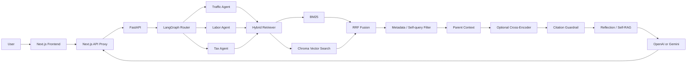
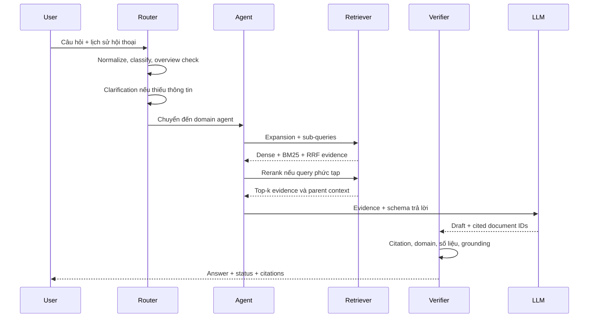

# Trust Agent

## Project Overview

Trust Agent là một nền tảng hỏi đáp pháp luật tiếng Việt được xây dựng theo kiến trúc Agentic RAG. Hệ thống kết hợp các domain agent chuyên trách, hybrid retrieval và cơ chế kiểm chứng evidence để trả lời câu hỏi trong ba nhóm dữ liệu: giao thông, lao động và thuế/hóa đơn.

Thay vì để mô hình ngôn ngữ tự suy đoán từ kiến thức nền, Trust Agent buộc câu trả lời phải dựa trên các đoạn luật được truy xuất từ corpus nội bộ. Mỗi câu hỏi được phân loại, tìm kiếm bằng cả semantic search và BM25, hợp nhất bằng RRF, sau đó kiểm tra citation, Điều/Khoản và các thông tin định lượng trước khi trả về cho người dùng.

Mục tiêu của dự án là xây dựng một hệ thống pháp lý có thể giải thích được và có giới hạn an toàn: khi câu hỏi thiếu ngữ cảnh hoặc dữ liệu chưa đủ căn cứ, hệ thống yêu cầu làm rõ hoặc trả về `insufficient_evidence` thay vì tạo ra một câu trả lời có vẻ thuyết phục nhưng không được chứng minh.

## Problem Statement

### Bối cảnh

Tra cứu pháp luật Việt Nam không chỉ là bài toán tìm một đoạn văn có nội dung gần với câu hỏi. Một câu hỏi thực tế thường chứa các ràng buộc pháp lý quan trọng như loại phương tiện, hành vi vi phạm, mức tiền phạt, số điểm bị trừ, số hiệu văn bản, Điều/Khoản, thời điểm áp dụng hoặc đối tượng chịu tác động.

Ví dụ, hai câu hỏi “ô tô vượt đèn đỏ bị phạt bao nhiêu?” và “xe máy vượt đèn đỏ bị phạt bao nhiêu?” có cùng chủ đề nhưng có thể dẫn đến Điều, mức phạt và số điểm khác nhau. Nếu hệ thống chỉ dựa vào semantic similarity, nó dễ lấy đúng chủ đề nhưng sai đối tượng áp dụng.

### Các vấn đề cần giải quyết

1. **Tìm kiếm theo ngữ nghĩa chưa đủ cho văn bản pháp luật**

   Dense retrieval phù hợp để hiểu các cách diễn đạt khác nhau, nhưng có thể bỏ sót các token chính xác như số hiệu nghị định, số Điều/Khoản, mức tiền, tốc độ, nồng độ hoặc đơn vị. Ngược lại, tìm kiếm từ khóa thuần túy khó xử lý cách hỏi tự nhiên và từ đồng nghĩa. Vì vậy hệ thống cần kết hợp semantic search với BM25.

2. **Các quy định gần giống nhau nhưng khác điều kiện áp dụng**

   Corpus giao thông có nhiều quy định song song cho ô tô, xe máy, xe máy chuyên dùng, người điều khiển và người được chở. Corpus lao động và thuế cũng có các nhánh khác nhau theo loại hợp đồng, vai trò hoặc loại người nộp thuế. Nếu không lọc metadata và ràng buộc domain, retrieval có thể đưa evidence đúng chủ đề nhưng sai trường hợp.

3. **Câu hỏi thường thiếu thông tin hoặc chứa nhiều ý**

   Người dùng có thể hỏi “không đội mũ bảo hiểm bị phạt thế nào?” nhưng không nói rõ người điều khiển hay người được chở; hoặc hỏi cùng lúc mức phạt, điểm giấy phép và xử phạt bổ sung. Hệ thống phải nhận diện khi nào cần hỏi lại, khi nào có thể tách câu hỏi thành các sub-query và khi nào evidence chưa đủ để kết luận.

4. **LLM có nguy cơ tạo câu trả lời hợp lý nhưng không có căn cứ**

   LLM có thể bưng nguyên văn chunk, trộn hai điều khoản, tự tạo số tiền hoặc ghi citation không tồn tại trong evidence. Với bài toán pháp luật, câu trả lời trôi chảy nhưng sai căn cứ nguy hiểm hơn việc trả lời “chưa đủ căn cứ”. Vì vậy citation phải được tạo từ metadata thực tế và các claim định lượng phải được kiểm tra sau generation.

5. **Dữ liệu pháp luật không đồng nhất**

   Dữ liệu crawl từ nhiều nguồn có thể khác encoding, cách ghi Điều/Khoản, tiêu đề, số hiệu và độ dài chunk. Một chunk quá dài, đặc biệt là bảng phạt, làm loãng embedding và khiến một đoạn chứa nhiều phương tiện hoặc nhiều mức phạt cạnh tranh nhau trong retrieval. Pipeline cần normalization, metadata schema, deduplication và parent-context phù hợp.

6. **Độ chính xác và độ trễ có trade-off**

   Cross-encoder thường giúp xếp hạng chính xác hơn nhưng phải tải model và chấm từng cặp query-document, làm tăng latency và chi phí tài nguyên CPU/GPU. Do đó hệ thống không rerank mọi câu hỏi; nó dùng policy deterministic để chỉ rerank những truy vấn dài, có nhiều điều kiện, số liệu hoặc độ tách biệt RRF thấp.

### Yêu cầu thiết kế

Từ các vấn đề trên, hệ thống cần đáp ứng các yêu cầu sau:

- **Domain-aware:** không để evidence giao thông, lao động và thuế trộn lẫn.
- **Evidence-grounded:** câu trả lời phải dựa trên các document đã truy xuất trong cùng request.
- **Metadata-aware:** hỗ trợ lọc theo domain, văn bản, Điều, Khoản và nhóm phương tiện.
- **Safe under uncertainty:** hỏi lại khi thiếu biến quan trọng và trả `insufficient_evidence` khi corpus không chứng minh được claim.
- **Traceable:** citation được dựng từ metadata thật, gồm document ID, văn bản, Điều/Khoản và nguồn.
- **Cost/latency-aware:** giữ RRF làm đường mặc định, chỉ bật reranker khi cần.
- **Maintainable:** có thể ingest thêm dữ liệu, loại bản ghi trùng và đánh giá riêng từng domain.

### Mục tiêu và phạm vi

Mục tiêu của dự án là xây dựng một pipeline hỏi đáp pháp luật có thể kiểm tra được: từ routing, retrieval, generation đến citation verification. Chất lượng được theo dõi bằng Recall@K và MRR trên benchmark retrieval, đồng thời giữ lại các trạng thái an toàn để phân biệt câu trả lời có căn cứ với trường hợp chưa đủ dữ liệu.

Hệ thống không nhằm thay thế luật sư, tự quyết định hiệu lực pháp lý trong mọi tình huống, hoặc bảo đảm rằng corpus luôn đầy đủ và cập nhật. Tính đúng đắn cuối cùng vẫn phụ thuộc vào chất lượng nguồn crawl, metadata, thời điểm áp dụng và việc người dùng cung cấp đủ bối cảnh.

### Pipeline giải quyết bài toán

```text
Câu hỏi + lịch sử hội thoại
    -> normalize và nhận diện intent/domain
    -> overview hoặc clarification nếu phù hợp
    -> query expansion/decomposition
    -> metadata filter + hybrid retrieval
    -> RRF và parent-context expansion
    -> rerank có điều kiện
    -> grounded answer generation
    -> reflection + citation/quantitative guardrail
    -> answer, citations và trạng thái an toàn
```

## Key Features

- Ba domain agent: `traffic`, `labor`, `tax`.
- Query routing bằng LLM classifier và keyword fallback.
- Overview cho câu hỏi chung, dựa trên metadata thay vì top-k ngẫu nhiên.
- Conversation memory qua SQLite/LangGraph checkpoint.
- Clarification gate cho câu hỏi thiếu phương tiện, vai trò hoặc loại người nộp thuế.
- Hybrid search: Chroma vector search + BM25 + RRF.
- Self-query rule-based, vehicle-aware retrieval, query expansion và query decomposition.
- Parent-context expansion cho ngữ cảnh điều khoản liên quan.
- Reflection/Self-RAG kiểm tra evidence.
- Citation guardrail kiểm tra document ID, domain, Điều/Khoản và claim định lượng.
- SSE streaming, lịch sử hội thoại, crawler và deduplication dữ liệu.

## System Architecture



Frontend có thể chạy trên Vercel; backend chạy local, Docker hoặc container platform. API proxy giữ secret LLM ở server-side.

## Agent Workflow



Các trạng thái chính: `verified`, `needs_clarification`, `insufficient_evidence` và `provider_error`.

## Technical Implementation

| Technique | Cách dùng | Trạng thái |
|---|---|---|
| Query classification | Router chọn domain và fallback khi provider lỗi | Đã triển khai |
| Clarification gate | Rule deterministic yêu cầu bổ sung ngữ cảnh | Đã triển khai |
| Hybrid search | Chroma semantic search + BM25 keyword search | Đã triển khai |
| Reciprocal Rank Fusion | Hợp nhất dense/sparse theo `1 / (k + rank)` | Đã triển khai |
| Metadata filtering | Lọc domain, văn bản, Điều, Khoản, phương tiện | Đã triển khai |
| Self-query retrieval | Parser tạo semantic query và metadata constraints | Đã triển khai |
| Query expansion | Bổ sung thuật ngữ chuẩn, không thay câu hỏi gốc | Đã triển khai |
| Query decomposition | Tách các ý/hành vi trong câu hỏi nhiều phần | Đã triển khai |
| Parent-document retrieval | Thêm sibling/parent context, giữ child đứng đầu | Đã triển khai |
| Cross-encoder reranking | Rerank candidate khi query phức tạp | Đã triển khai, tùy chọn |
| Conversation memory | SQLite conversation store và LangGraph checkpoint | Đã triển khai |
| Reflection / Self-RAG | Critique evidence và tìm facet còn thiếu | Đã triển khai |
| Citation verification | Citation lấy từ metadata thật | Đã triển khai |
| Quantitative guardrail | Kiểm tra tiền, ngày, điểm, tốc độ, nồng độ và đơn vị | Đã triển khai |

Query decomposition, reflection và self-RAG hiện là controller deterministic hỗ trợ pipeline; không phải vòng suy luận tự trị không giới hạn.

## Dataset & Data Pipeline

| Domain | File | Collection | Records tại mốc kiểm tra |
|---|---|---|---:|
| Traffic | `crawl/data/raw/giao thông.json` | `legal_traffic` | 3,048 |
| Labor | `crawl/data/raw/lao_dong.json` | `legal_labor` | 2,745 |
| Tax | `crawl/data/raw/thue.json` | `legal_accounting` | 1,421 |

Các con số có thể thay đổi sau crawl/clean. Crawler hỗ trợ HTML/PDF/TXT/Markdown, sửa encoding và chuẩn hóa schema. Chunk được tổ chức theo văn bản, chương, điều và khoản; bảng phạt dài vẫn là điểm cần cải thiện.

Metadata chính:

```text
id, domain, source, ten_van_ban, so_hieu,
chuong, dieu, khoan, tieu_de_dieu,
document_type, article_number, clause_number,
structure_key, status, effective_from
```

Embedding mặc định: `sentence-transformers/paraphrase-multilingual-MiniLM-L12-v2`. Ingest kiểm tra ID/nội dung và bỏ qua bản ghi trùng.

## Tech Stack

- Python 3.11, FastAPI, Uvicorn, Pydantic Settings.
- LangChain Core, LangGraph, LangChain Chroma, ChromaDB.
- Sentence Transformers multilingual embeddings và `rank-bm25`.
- OpenAI hoặc Gemini cho structured answer generation.
- Next.js 16, React 19, TypeScript.
- SQLite local; PostgreSQL có thể cấu hình qua `DATABASE_URL`.
- Docker Compose; Vercel frontend; `render.yaml` là blueprint tham khảo.

## Evaluation & Benchmarks

Bộ benchmark có 300 cases, chia đều 100 câu/domain. Một lần chạy local ghi nhận:

| Domain | Recall@1 | Recall@3 | Recall@5 | Corpus coverage |
|---|---:|---:|---:|---:|
| Traffic | 0.75 |  0.87 |  0.89 |  0.95 |
| Labor | 0.93 |   0.95 | 0.95 | 1.00 |
| Tax |  0.82 |  0.91 |  0.97 |  1.00 |
| **MRR tổng** | **0.8333** | **0.8689** | **0.8751** | — |

Đây là retrieval benchmark, không phải độ chính xác pháp lý tổng quát. `Corpus coverage` đo xem evidence phù hợp có tồn tại ở đâu đó trong toàn bộ corpus hay không; nó giúp phân biệt lỗi thiếu dữ liệu với lỗi xếp hạng retrieval. Kết quả mới được chạy local trên bộ `benchmark_v3.jsonl` gồm 300 cases.

| Metric | Trạng thái |
|---|---|
| Recall@K, MRR@K | Đã đo trên benchmark retrieval |
| Citation accuracy | Có kiểm tra rule-based |
| Precision@K | Chưa có benchmark chuẩn |
| Faithfulness, answer relevance | Chưa có bộ chấm độc lập |
| Latency p50/p95, token/cost | Chưa benchmark ổn định theo phần cứng/provider |

Chạy benchmark:

```powershell
cd D:\Trust-AGENT\crawl
\.venv\Scripts\python.exe scripts\evaluate\benchmark_retrieval_v2.py `
  --cases scripts\evaluate\benchmark_v3.jsonl --k 1
\.venv\Scripts\python.exe scripts\evaluate\benchmark_retrieval_v2.py `
  --cases scripts\evaluate\benchmark_v3.jsonl --k 5
```

## Project Structure

```text
Trust-Agent/
├─ crawl/
│  ├─ app/
│  │  ├─ main.py                 # FastAPI endpoints
│  │  ├─ router.py               # LangGraph orchestration
│  │  ├─ agents/                 # Traffic, labor, tax agents
│  │  ├─ retrieval.py            # BM25, Chroma, RRF, reranking
│  │  ├─ self_query.py            # Metadata query planning
│  │  ├─ self_rag.py              # Evidence critique
│  │  ├─ citation_guardrail.py    # Grounding checks
│  │  ├─ clarification.py         # Deterministic clarification
│  │  └─ crawler.py               # Crawl and normalize sources
│  ├─ data/raw/                  # Legal corpora
│  ├─ scripts/                   # Ingest and evaluation
│  ├─ tests/                     # Backend tests
│  ├─ Dockerfile
│  └─ docker-compose.yml
├─ web/                          # Next.js frontend
├─ docs/                         # Technical documents
├─ render.yaml
└─ README.md
```

## Getting Started

### Backend local

Yêu cầu Python 3.11 và `crawl/.env`. Không commit file này, không đưa API key vào frontend.

```powershell
cd D:\Trust-AGENT\crawl
\.venv\Scripts\python.exe -m uvicorn app.main:app `
  --host 127.0.0.1 --port 8000 --reload
```

Backend: `http://127.0.0.1:8000`; Swagger: `http://127.0.0.1:8000/docs`.

Ví dụ OpenAI:

```env
LLM_PROVIDER=openai
OPENAI_MODEL=gpt-4o-mini
OPENAI_API_KEY=your-key
```

### Frontend local

```powershell
cd D:\Trust-AGENT\web
npm.cmd install
Copy-Item .env.example .env.local
npm.cmd run dev
```

Trong `web/.env.local`:

```env
TRUST_AGENT_API_URL=http://127.0.0.1:8000
```

Frontend: `http://localhost:3000`.

### Ingest corpus

```powershell
cd D:\Trust-AGENT\crawl
\.venv\Scripts\python.exe scripts\ingest_domain.py traffic
\.venv\Scripts\python.exe scripts\ingest_domain.py labor
\.venv\Scripts\python.exe scripts\ingest_domain.py tax
```

### Docker

```powershell
cd D:\Trust-AGENT\crawl
docker compose up -d --build
docker compose ps
docker compose logs -f trust-agent
```

Compose dùng port `8000`; nếu port bị chiếm, dừng service/container đang dùng port đó trước.

## API Documentation

| Method | Endpoint | Mục đích |
|---|---|---|
| `GET` | `/health` | Health domain mặc định |
| `GET` | `/domains/{domain}/health` | Health và số document |
| `GET` | `/domains/{domain}/overview` | Tổng quan corpus |
| `POST` | `/router/ask` | Hỏi đáp qua router |
| `POST` | `/router/ask/stream` | Hỏi đáp SSE |
| `POST` | `/domains/{domain}/ask` | Hỏi trực tiếp domain |
| `POST` | `/domains/{domain}/search/hybrid` | Xem hybrid retrieval |
| `GET` | `/api/conversations` | Danh sách hội thoại |
| `DELETE` | `/api/conversations` | Xóa toàn bộ history |
| `POST` | `/paid/traffic/ask` | Endpoint x402 khi bật |

Smoke test PowerShell:

```powershell
$body = '{"query":"Người lao động ký hợp đồng thử việc tối đa bao nhiêu ngày?","k":5}'
Invoke-RestMethod -Uri "http://127.0.0.1:8000/router/ask" `
  -Method Post -ContentType "application/json; charset=utf-8" `
  -Body ([Text.Encoding]::UTF8.GetBytes($body))
```

## x402 Payment Layer

x402 là lớp thanh toán HTTP cho endpoint trả phí; nó không thay thế LLM và không ảnh hưởng đến retrieval miễn phí. Trong Trust Agent, middleware x402 bảo vệ `POST /paid/traffic/ask`: client phải gửi payment proof hợp lệ trước khi backend xử lý câu hỏi giao thông.

Luồng hoạt động:

```text
Client -> gửi request đến paid endpoint
       -> x402 middleware kiểm tra payment
       -> facilitator xác nhận giao dịch
       -> Traffic Agent xử lý RAG
       -> trả answer, citations và provenance receipt
```

Các biến cấu hình:

```env
X402_ENABLED=false
X402_PRICE_USD=0.01
X402_NETWORK=eip155:84532
X402_PAY_TO=0x...
X402_FACILITATOR_URL=https://x402.org/facilitator
```

Khi bật `X402_ENABLED=true`, backend yêu cầu `X402_PAY_TO` và `X402_FACILITATOR_URL`, đồng thời cài payment extra:

```powershell
cd D:\Trust-AGENT\crawl
\.venv\Scripts\python.exe -m pip install -e ".[payments]"
```

`X402_PAY_TO` là địa chỉ ví public nhận thanh toán trên đúng network, không phải private key. Không commit private key, seed phrase, API key hoặc token vào GitHub; local có thể để x402 tắt để kiểm thử RAG thông thường.

## Demo

Frontend cung cấp giao diện chat, lịch sử hội thoại, citation và trạng thái grounding. Khi có ảnh demo đã commit vào repo, đặt trong `docs/assets/` và nhúng bằng đường dẫn tương đối. README không gắn ảnh giả hoặc số liệu demo chưa được lưu trong repository.

## Limitations

- Chất lượng phụ thuộc vào độ đầy đủ, độ mới, encoding, chunking và metadata của corpus.
- Bảng phạt giao thông dài và câu hỏi phân biệt ô tô/xe máy khó hơn các câu hỏi lao động có cấu trúc rõ.
- Public domain là `tax`/“Thuế”; key nội bộ `accounting` vẫn được giữ để tương thích; dữ liệu chính là thuế/hóa đơn, chưa phải corpus kế toán độc lập đầy đủ.
- Metadata hiệu lực thời gian chưa đồng đều; `status=unknown` không xác nhận văn bản còn hiệu lực.
- Reranker tăng chất lượng trong một số truy vấn nhưng làm tăng latency và RAM/VRAM.
- Recall/MRR trên benchmark nhỏ không đại diện cho toàn bộ chất lượng pháp lý thực tế.

## Roadmap

- Chuẩn hóa ngày ban hành, ngày hiệu lực và ngày hết hiệu lực.
- Tách bảng phạt dài thành atomic chunks theo hành vi và loại phương tiện.
- Bổ sung/kiểm định corpus traffic và tax.
- Benchmark Precision@K, citation accuracy, faithfulness, answer relevance và latency p50/p95.
- So sánh định lượng RRF, RRF + reranker và parent-context retrieval.
- Temporal retrieval theo thời điểm xảy ra hành vi.
- Hoàn thiện monitoring, provenance và production deployment.

## Contributors

Project owner: `minhtangithu0b123`.

## License

Xem [LICENSE](LICENSE).
