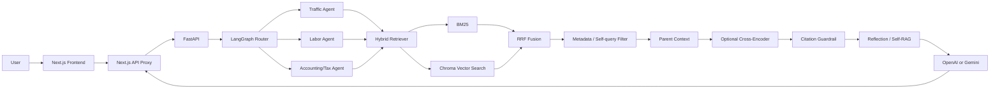
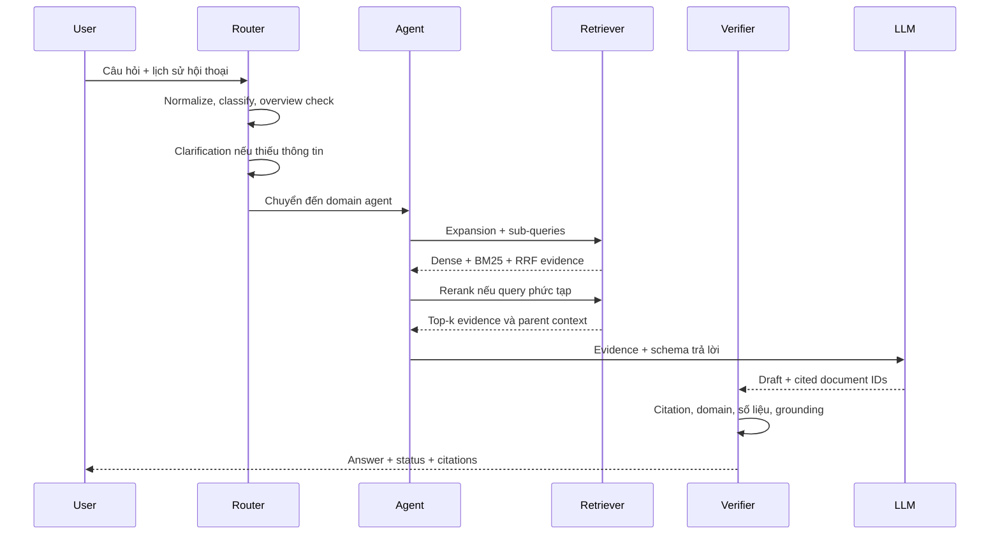

# Trust Agent

Agentic RAG cho tra cứu pháp luật Việt Nam, tập trung vào ba nhóm dữ liệu: giao thông, lao động và thuế/hóa đơn. Hệ thống định tuyến câu hỏi đến agent chuyên trách, truy xuất evidence từ corpus nội bộ và tạo câu trả lời có citation. Khi evidence chưa đủ hoặc câu hỏi thiếu thông tin quan trọng, hệ thống trả về trạng thái an toàn thay vì tự đoán.
.
## Project Overview

Trust Agent tách routing, retrieval, generation và verification để giới hạn truy xuất trong đúng domain, kết hợp tìm kiếm ngữ nghĩa và từ khóa, tạo citation từ metadata thật và yêu cầu làm rõ khi thiếu thông tin.

## Problem Statement

Semantic search có thể bỏ sót số hiệu văn bản, Điều, Khoản, mức phạt hoặc đơn vị số. LLM cũng có thể trộn quy định giữa ô tô và xe máy hoặc tạo citation không tồn tại. Pipeline của dự án là:

```text
Câu hỏi -> routing/intent -> clarification -> hybrid retrieval
         -> rerank tùy chọn -> grounded answer -> citation guardrail
```

## Key Features

- Ba domain agent: `traffic`, `labor`, `accounting`.
- Query routing bằng LLM classifier và keyword fallback.
- Overview cho câu hỏi chung, dựa trên metadata thay vì top-k ngẫu nhiên.
- Conversation memory qua SQLite/LangGraph checkpoint.
- Clarification gate cho câu hỏi thiếu phương tiện, vai trò hoặc loại người nộp thuế.
- Hybrid search: Chroma vector search + BM25 + RRF.
- Self-query rule-based, vehicle-aware retrieval, query expansion và query decomposition.
- Parent-context expansion cho ngữ cảnh điều khoản liên quan.
- Reflection/Self-RAG kiểm tra evidence.
- Citation guardrail kiểm tra document ID, domain, Điều/Khoản và claim định lượng.
- SSE streaming, lịch sử hội thoại, crawler và deduplication dữ liệu.

## System Architecture



Frontend có thể chạy trên Vercel; backend chạy local, Docker hoặc container platform. API proxy giữ secret LLM ở server-side.

## Agent Workflow



Các trạng thái chính: `verified`, `needs_clarification`, `insufficient_evidence` và `provider_error`.

## Technical Implementation

| Technique | Cách dùng | Trạng thái |
|---|---|---|
| Query classification | Router chọn domain và fallback khi provider lỗi | Đã triển khai |
| Clarification gate | Rule deterministic yêu cầu bổ sung ngữ cảnh | Đã triển khai |
| Hybrid search | Chroma semantic search + BM25 keyword search | Đã triển khai |
| Reciprocal Rank Fusion | Hợp nhất dense/sparse theo `1 / (k + rank)` | Đã triển khai |
| Metadata filtering | Lọc domain, văn bản, Điều, Khoản, phương tiện | Đã triển khai |
| Self-query retrieval | Parser tạo semantic query và metadata constraints | Đã triển khai |
| Query expansion | Bổ sung thuật ngữ chuẩn, không thay câu hỏi gốc | Đã triển khai |
| Query decomposition | Tách các ý/hành vi trong câu hỏi nhiều phần | Đã triển khai |
| Parent-document retrieval | Thêm sibling/parent context, giữ child đứng đầu | Đã triển khai |
| Cross-encoder reranking | Rerank candidate khi query phức tạp | Đã triển khai, tùy chọn |
| Conversation memory | SQLite conversation store và LangGraph checkpoint | Đã triển khai |
| Reflection / Self-RAG | Critique evidence và tìm facet còn thiếu | Đã triển khai |
| Citation verification | Citation lấy từ metadata thật | Đã triển khai |
| Quantitative guardrail | Kiểm tra tiền, ngày, điểm, tốc độ, nồng độ và đơn vị | Đã triển khai |

Query decomposition, reflection và self-RAG hiện là controller deterministic hỗ trợ pipeline; không phải vòng suy luận tự trị không giới hạn.

## Dataset & Data Pipeline

| Domain | File | Collection | Records tại mốc kiểm tra |
|---|---|---|---:|
| Traffic | `crawl/data/raw/giao thông.json` | `legal_traffic` | 3,048 |
| Labor | `crawl/data/raw/lao_dong.json` | `legal_labor` | 2,745 |
| Tax / accounting | `crawl/data/raw/thue.json` | `legal_accounting` | 1,421 |

Các con số có thể thay đổi sau crawl/clean. Crawler hỗ trợ HTML/PDF/TXT/Markdown, sửa encoding và chuẩn hóa schema. Chunk được tổ chức theo văn bản, chương, điều và khoản; bảng phạt dài vẫn là điểm cần cải thiện.

Metadata chính:

```text
id, domain, source, ten_van_ban, so_hieu,
chuong, dieu, khoan, tieu_de_dieu,
document_type, article_number, clause_number,
structure_key, status, effective_from
```

Embedding mặc định: `sentence-transformers/paraphrase-multilingual-MiniLM-L12-v2`. Ingest kiểm tra ID/nội dung và bỏ qua bản ghi trùng.

## Tech Stack

- Python 3.11, FastAPI, Uvicorn, Pydantic Settings.
- LangChain Core, LangGraph, LangChain Chroma, ChromaDB.
- Sentence Transformers multilingual embeddings và `rank-bm25`.
- OpenAI hoặc Gemini cho structured answer generation.
- Next.js 16, React 19, TypeScript.
- SQLite local; PostgreSQL có thể cấu hình qua `DATABASE_URL`.
- Docker Compose; Vercel frontend; `render.yaml` là blueprint tham khảo.

## Evaluation & Benchmarks

Bộ benchmark có 300 cases, chia đều 100 câu/domain. Một lần chạy local ghi nhận:

| Domain | Recall@1 | Recall@3 | Recall@5 | Corpus coverage |
|---|---:|---:|---:|---:|
| Traffic | 75/100 = 0.75 | 87/100 = 0.87 | 89/100 = 0.89 | 95/100 = 0.95 |
| Labor | 93/100 = 0.93 | 95/100 = 0.95 | 95/100 = 0.95 | 100/100 = 1.00 |
| Accounting | 82/100 = 0.82 | 91/100 = 0.91 | 97/100 = 0.97 | 100/100 = 1.00 |
| **MRR tổng** | **0.8333** | **0.8689** | **0.8751** | — |

Đây là retrieval benchmark, không phải độ chính xác pháp lý tổng quát. `Corpus coverage` đo xem evidence phù hợp có tồn tại ở đâu đó trong toàn bộ corpus hay không; nó giúp phân biệt lỗi thiếu dữ liệu với lỗi xếp hạng retrieval. Kết quả mới được chạy local trên bộ `benchmark_v3.jsonl` gồm 300 cases.

| Metric | Trạng thái |
|---|---|
| Recall@K, MRR@K | Đã đo trên benchmark retrieval |
| Citation accuracy | Có kiểm tra rule-based |
| Precision@K | Chưa có benchmark chuẩn |
| Faithfulness, answer relevance | Chưa có bộ chấm độc lập |
| Latency p50/p95, token/cost | Chưa benchmark ổn định theo phần cứng/provider |

Chạy benchmark:

```powershell
cd D:\Trust-AGENT\crawl
\.venv\Scripts\python.exe scripts\evaluate\benchmark_retrieval_v2.py `
  --cases scripts\evaluate\benchmark_v3.jsonl --k 1
\.venv\Scripts\python.exe scripts\evaluate\benchmark_retrieval_v2.py `
  --cases scripts\evaluate\benchmark_v3.jsonl --k 5
```

## Project Structure

```text
Trust-Agent/
├─ crawl/
│  ├─ app/
│  │  ├─ main.py                 # FastAPI endpoints
│  │  ├─ router.py               # LangGraph orchestration
│  │  ├─ agents/                 # Traffic, labor, accounting agents
│  │  ├─ retrieval.py            # BM25, Chroma, RRF, reranking
│  │  ├─ self_query.py            # Metadata query planning
│  │  ├─ self_rag.py              # Evidence critique
│  │  ├─ citation_guardrail.py    # Grounding checks
│  │  ├─ clarification.py         # Deterministic clarification
│  │  └─ crawler.py               # Crawl and normalize sources
│  ├─ data/raw/                  # Legal corpora
│  ├─ scripts/                   # Ingest and evaluation
│  ├─ tests/                     # Backend tests
│  ├─ Dockerfile
│  └─ docker-compose.yml
├─ web/                          # Next.js frontend
├─ docs/                         # Technical documents
├─ render.yaml
└─ README.md
```

## Getting Started

### Backend local

Yêu cầu Python 3.11 và `crawl/.env`. Không commit file này, không đưa API key vào frontend.

```powershell
cd D:\Trust-AGENT\crawl
\.venv\Scripts\python.exe -m uvicorn app.main:app `
  --host 127.0.0.1 --port 8000 --reload
```

Backend: `http://127.0.0.1:8000`; Swagger: `http://127.0.0.1:8000/docs`.

Ví dụ OpenAI:

```env
LLM_PROVIDER=openai
OPENAI_MODEL=gpt-4o-mini
OPENAI_API_KEY=your-key
```

### Frontend local

```powershell
cd D:\Trust-AGENT\web
npm.cmd install
Copy-Item .env.example .env.local
npm.cmd run dev
```

Trong `web/.env.local`:

```env
TRUST_AGENT_API_URL=http://127.0.0.1:8000
```

Frontend: `http://localhost:3000`.

### Ingest corpus

```powershell
cd D:\Trust-AGENT\crawl
\.venv\Scripts\python.exe scripts\ingest_domain.py traffic
\.venv\Scripts\python.exe scripts\ingest_domain.py labor
\.venv\Scripts\python.exe scripts\ingest_domain.py accounting
```

### Docker

```powershell
cd D:\Trust-AGENT\crawl
docker compose up -d --build
docker compose ps
docker compose logs -f trust-agent
```

Compose dùng port `8000`; nếu port bị chiếm, dừng service/container đang dùng port đó trước.

## API Documentation

| Method | Endpoint | Mục đích |
|---|---|---|
| `GET` | `/health` | Health domain mặc định |
| `GET` | `/domains/{domain}/health` | Health và số document |
| `GET` | `/domains/{domain}/overview` | Tổng quan corpus |
| `POST` | `/router/ask` | Hỏi đáp qua router |
| `POST` | `/router/ask/stream` | Hỏi đáp SSE |
| `POST` | `/domains/{domain}/ask` | Hỏi trực tiếp domain |
| `POST` | `/domains/{domain}/search/hybrid` | Xem hybrid retrieval |
| `GET` | `/api/conversations` | Danh sách hội thoại |
| `DELETE` | `/api/conversations` | Xóa toàn bộ history |
| `POST` | `/paid/traffic/ask` | Endpoint x402 khi bật |

Smoke test PowerShell:

```powershell
$body = '{"query":"Người lao động ký hợp đồng thử việc tối đa bao nhiêu ngày?","k":5}'
Invoke-RestMethod -Uri "http://127.0.0.1:8000/router/ask" `
  -Method Post -ContentType "application/json; charset=utf-8" `
  -Body ([Text.Encoding]::UTF8.GetBytes($body))
```

## Demo

Frontend cung cấp giao diện chat, lịch sử hội thoại, citation và trạng thái grounding. Khi có ảnh demo đã commit vào repo, đặt trong `docs/assets/` và nhúng bằng đường dẫn tương đối. README không gắn ảnh giả hoặc số liệu demo chưa được lưu trong repository.

## Limitations

- Chất lượng phụ thuộc vào độ đầy đủ, độ mới, encoding, chunking và metadata của corpus.
- Bảng phạt giao thông dài và câu hỏi phân biệt ô tô/xe máy khó hơn các câu hỏi lao động có cấu trúc rõ.
- `accounting` là tên kỹ thuật tương thích; dữ liệu chính là thuế/hóa đơn, chưa phải corpus kế toán độc lập đầy đủ.
- Metadata hiệu lực thời gian chưa đồng đều; `status=unknown` không xác nhận văn bản còn hiệu lực.
- Reranker tăng chất lượng trong một số truy vấn nhưng làm tăng latency và RAM/VRAM.
- Recall/MRR trên benchmark nhỏ không đại diện cho toàn bộ chất lượng pháp lý thực tế.

## Roadmap

- Chuẩn hóa ngày ban hành, ngày hiệu lực và ngày hết hiệu lực.
- Tách bảng phạt dài thành atomic chunks theo hành vi và loại phương tiện.
- Bổ sung/kiểm định corpus traffic và tax/accounting.
- Benchmark Precision@K, citation accuracy, faithfulness, answer relevance và latency p50/p95.
- So sánh định lượng RRF, RRF + reranker và parent-context retrieval.
- Temporal retrieval theo thời điểm xảy ra hành vi.
- Hoàn thiện monitoring, provenance và production deployment.

## Contributors

Project owner: `minhtangithu0b123`.

## License

Xem [LICENSE](LICENSE).
