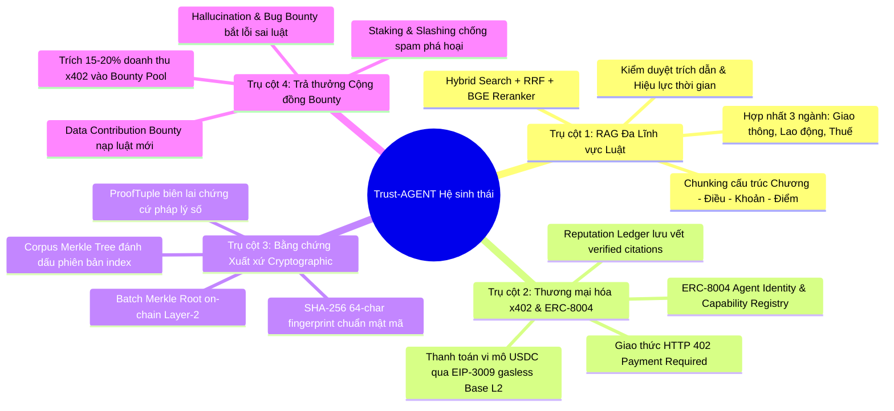
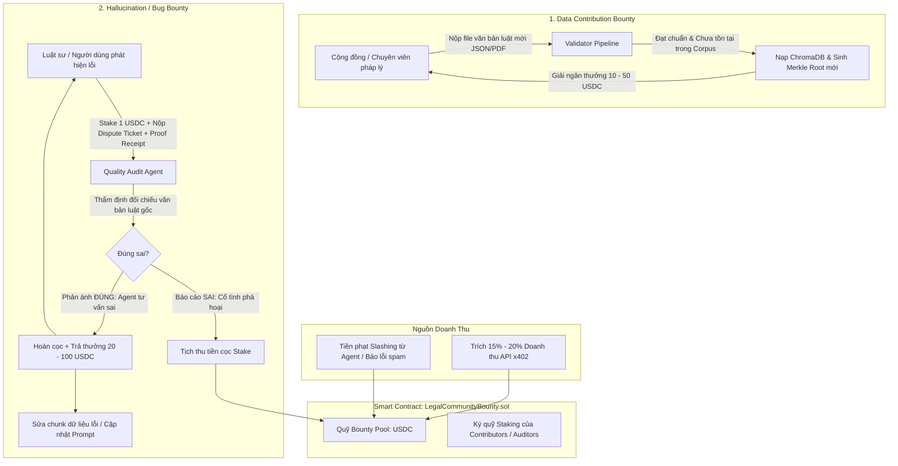
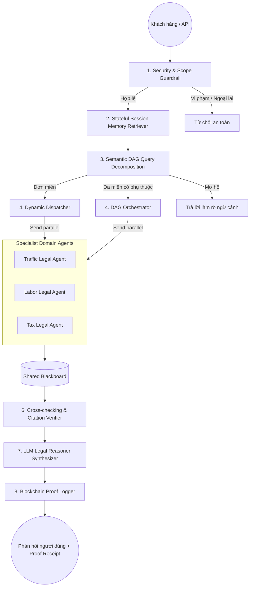

# BÁO CÁO PHÂN TÍCH KHOẢNG TRỐNG TOÀN DIỆN HỆ THỐNG MULTI-AGENT & NỀN TẢNG RAG PHÁP LÝ ĐA LĨNH VỰC (GAP ANALYSIS REPORT)

**Dự án**: Trust-AGENT — Vietnamese Multi-Agent Legal RAG Platform & Web3 Commercialization  
**Tài liệu tham chiếu**: `ORIGINAL_REQUEST.md`, `PROJECT.md`, `trustagent-architecture.md`  
**Ngày lập báo cáo**: 09/11/2026  
**Phiên bản**: 1.0.0 (Final Official Release)  
**Tác giả**: Worker 1 (Technical Author & Systems Engineer phụ trách Milestone 1)  
**Trạng thái**: Đã đối soát thực tế toàn bộ codebase, dữ liệu, test harness và tài liệu dự án  

---

## MỤC LỤC
1. [TỔNG QUAN DỰ ÁN VÀ TÓM TẮT ĐIỀU HÀNH (EXECUTIVE SUMMARY)](#1-tổng-quan-dự-án-và-tóm-tắt-điều-hành-executive-summary)
2. [ĐÁNH GIÁ CHI TIẾT HIỆN TRẠNG 3 MẢNG LUẬT (LEGAL CORPUS AUDIT)](#2-đánh-giá-chi-tiết-hiện-trạng-3-mảng-luật-legal-corpus-audit)
   - [2.1. Mảng Luật Lao động (`lao_dong.json`)](#21-mảng-luật-lao-động-lao_dongjson)
   - [2.2. Mảng Luật Giao thông (`giao thông.json`)](#22-mảng-luật-giao-thông-giao-thôngjson)
   - [2.3. Mảng Luật Thuế / Kế toán (`thue.json`) — Phát hiện khoảng trống nghiêm trọng](#23-mảng-luật-thuế--kế-toán-thuejson--phát-hiện-khoảng-trống-nghiêm-trọng)
   - [2.4. Đánh giá chất lượng Metadata trong Vector Database (ChromaDB)](#24-đánh-giá-chất-lượng-metadata-trong-vector-database-chromadb)
   - [2.5. Đánh giá Động cơ Hybrid RAG & Pipeline trích xuất](#25-đánh-giá-động-cơ-hybrid-rag--pipeline-trích-xuất)
3. [DANH MỤC THÀNH PHẦN HIỆN CÓ VÀ ĐÁNH GIÁ MỨC ĐỘ SẴN SÀNG (INVENTORY & READINESS SCORECARD)](#3-danh-mục-thành-phần-hiện-có-và-đánh-giá-mức-độ-sẵn-sàng-inventory--readiness-scorecard)
   - [3.1. Dữ liệu thô (`crawl/data/raw/`)](#31-dữ-liệu-thô-crawldataraw)
   - [3.2. Vectorstore Indexes (`crawl/data/chroma/`)](#32-vectorstore-indexes-crawldatachroma)
   - [3.3. Mã nguồn Backend & API Gateway (`crawl/app/`)](#33-mã-nguồn-backend--api-gateway-crawlapp)
   - [3.4. Module cào dữ liệu (`crawl/src/`) & Bản kế hoạch `BUILD_PLAN.md`](#34-module-cào-dữ-liệu-crawlsrc--bản-kế-hoạch-build_planmd)
   - [3.5. Bộ kiểm thử (`crawl/tests/`) & Các vấn đề môi trường thực thi](#35-bộ-kiểm-thử-crawltests--các-vấn-đề-môi-trường-thực-thi)
   - [3.6. Scripts đánh giá & Báo cáo benchmark (`crawl/scripts/`, `crawl/reports/`)](#36-scripts-đánh-giá--báo-cáo-benchmark-crawlscripts-crawlreports)
   - [3.7. Phân hệ Web Frontend (`site/`)](#37-phân-hệ-web-frontend-site)
   - [3.8. Tài liệu kỹ thuật & Tệp tin ngoại lai (`docs/`, `trustagent-architecture.md`, `bo_100_cau_hoi_phan_bien_SignEmo.md`)](#38-tài-liệu-kỹ-thuật--tệp-tin-ngoại-lai-docs-trustagent-architecturemd-bo_100_cau_hoi_phan_bien_signemomd)
   - [3.9. Bảng Master Readiness Scorecard toàn diện](#39-bảng-master-readiness-scorecard-toàn-diện)
4. [PHÂN TÍCH CHI TIẾT 4 TRỤ CỘT Ý TƯỞNG SẢN PHẨM ĐÍCH (PRODUCT PILLARS)](#4-phân-tích-chi-tiết-4-trụ-cột-ý-tưởng-sản-phẩm-đích-product-pillars)
   - [4.1. Trụ cột 1: RAG Đa Lĩnh vực Luật Việt Nam (Giao thông, Lao động, Thuế) Hợp nhất](#41-trụ-cột-1-rag-đa-lĩnh-vực-luật-việt-nam-giao-thông-lao-động-thuế-hợp-nhất)
   - [4.2. Trụ cột 2: Kinh doanh API theo lượt qua x402 & Đăng ký Chuẩn ERC-8004](#42-trụ-cột-2-kinh-doanh-api-theo-lượt-qua-x402--đăng-ký-chuẩn-erc-8004)
   - [4.3. Trụ cột 3: Gắn Bằng chứng Xuất xứ Mật mã (Cryptographic Provenance / Proofs)](#43-trụ-cột-3-gắn-bằng-chứng-xuất-xứ-mật-mã-cryptographic-provenance--proofs)
   - [4.4. Trụ cột 4: Cơ chế Trả thưởng Cộng đồng (Incentive / Bounty System)](#44-trụ-cột-4-cơ-chế-trả-thưởng-cộng-đồng-incentive--bounty-system)
5. [KIẾN TRÚC MULTI-AGENT PHỐI HỢP & GIAO THỨC ĐIỀU PHỐI](#5-kiến-trúc-multi-agent-phối-hợp--giao-thức-điều-phối)
   - [5.1. Master Router / Dispatcher Agent Nâng cấp](#51-master-router--dispatcher-agent-nâng-cấp)
   - [5.2. Hệ thống 7 Vai trò Agent Chuyên biệt (+ 1 Dispute Agent)](#52-hệ-thống-7-vai-trò-agent-chuyên-biệt--1-dispute-agent)
   - [5.3. Giao thức Trao đổi Ngữ cảnh & Quản trị Trạng thái (Context & State Protocols)](#53-giao-thức-trao-đổi-ngữ-cảnh--quản-trị-trạng-thái-context--state-protocols)
6. [TỔNG HỢP BẢNG ĐỐI CHIẾU HIỆN TRẠNG VS YÊU CẦU ĐÍCH VS KHOẢNG TRỐNG KỸ THUẬT](#6-tổng-hợp-bảng-đối-chiếu-hiện-trạng-vs-yêu-cầu-đích-vs-khoảng-trống-kỹ-thuật)
7. [KẾT LUẬN VÀ ĐỀ XUẤT HÀNH ĐỘNG TIẾP THEO](#7-kết-luận-và-đề-xuất-hành-động-tiếp-theo)

---

## 1. TỔNG QUAN DỰ ÁN VÀ TÓM TẮT ĐIỀU HÀNH (EXECUTIVE SUMMARY)

### 1.1. Bối cảnh và Tầm nhìn
Dự án **Trust-AGENT** đặt mục tiêu phát triển một nền tảng trí tuệ nhân tạo Agentic RAG pháp lý đa lĩnh vực phục vụ thị trường Việt Nam. Hệ thống tập trung giải quyết bài toán tư vấn và tra cứu quy chuẩn pháp lý chính xác, có căn cứ trích dẫn rõ ràng trên 3 trụ cột luật pháp có tần suất phát sinh nhu cầu lớn nhất đối với người dân và doanh nghiệp: **Giao thông đường bộ**, **Lao động - Tiền lương**, và **Thuế - Kế toán**.

Khác biệt cốt lõi của Trust-AGENT so với các chatbot pháp lý truyền thống nằm ở sự kết hợp đột phá giữa **Kiến trúc Multi-Agent phối hợp có kiểm duyệt suy luận (Cross-checking Verification)** và **Ngăn xếp công nghệ Web3 cho kinh tế Agentic (Agentic Commerce)**:
1. **Thương mại hóa API qua chuẩn thanh toán mở x402**: Khôi phục mã trạng thái HTTP 402 để cung cấp cơ chế thanh toán vi mô (micro-payments tính bằng USDC trên Layer-2 EVM) theo từng câu hỏi, loại bỏ rào cản nạp tiền trước hoặc ký hợp đồng phức tạp.
2. **Định danh và chấm điểm uy tín on-chain qua chuẩn ERC-8004**: Định danh minh bạch cho từng Agent chuyên ngành, ghi nhận tỷ lệ trích dẫn chính xác (`status: verified`) trên sổ cái phi tập trung.
3. **Lưu vết bằng chứng mật mã (Cryptographic Provenance on-chain)**: Tạo biên lai mật mã băm nối kết giữa câu hỏi, tập bằng chứng pháp luật, phiên bản cơ sở dữ liệu và câu trả lời, gom lô Merkle Tree để neo lên blockchain nhằm phục vụ truy vết tranh chấp pháp lý.
4. **Cơ chế kinh tế trả thưởng cộng đồng (Incentive & Bounty System)**: Quỹ thưởng ký quỹ thông minh (Smart Contract Escrow) khuyến khích cộng đồng đóng góp văn bản luật mới và bắt lỗi ảo giác (hallucination), tạo ra chu trình tự hoàn thiện cho hệ thống.

### 1.2. Tóm tắt kết quả phân tích khoảng trống
Qua khảo sát thực tế toàn diện toàn bộ mã nguồn, cấu hình, dữ liệu và tài liệu trong repository `d:\Trust-AGENT`, nhóm kỹ thuật xác định hiện trạng hệ thống:

```
[Hiện trạng Codebase: MVP Hybrid RAG đơn miền & Router cơ bản]
                 │
                 ├── 1. DỮ LIỆU PHÁP LUẬT: 
                 │      ├── Lao động: 1.108 bản ghi (Bộ luật Lao động 2019, 2 bản ghi duplicate).
                 │      ├── Giao thông: 1.852 bản ghi (5 văn bản, lỗi parser số hiệu NĐ 238 & tên TT 35).
                 │      └── Thuế: 593 bản ghi ──> SAI LỆCH NGHIỆP VỤ NGHIÊM TRỌNG: 100% là LUẬT KẾ TOÁN 2015.
                 │                                Hoàn toàn thiếu Luật Quản lý thuế, GTGT, TNDN, TNCN.
                 │
                 ├── 2. PIPELINE & METADATA VECTORSTORE:
                 │      ├── Toàn bộ 3.553 vectors trong ChromaDB THIẾU METADATA HIỆU LỰC (effective_from, expiry, status).
                 │      └── Pipeline Hybrid Search (BM25 + Chroma + RRF) THIẾU KHỐI RERANKER (Cross-encoder).
                 │
                 ├── 3. KIẾN TRÚC MULTI-AGENT:
                 │      ├── LangGraph Router hiện tại STATELESS, không nhớ lịch sử hội thoại (Session Memory: 0%).
                 │      ├── Phân tách câu hỏi đa ngành thô sơ, chưa có Semantic DAG Decomposition.
                 │      └── Tổng hợp kết quả đa miền bằng NỐI CHUỖI VĂN BẢN THÔ (\n\n), thiếu Legal Synthesizer.
                 │
                 └── 4. PHÂN HỆ WEB3 (x402, ERC-8004, PROVENANCE, BOUNTY):
                        ├── Hiện diện trong mã nguồn: HOÀN TOÀN 0% (GREENFIELD).
                        └── Điểm tựa sẵn có: Fingerprint SHA-256 24-char, DomainAgentSpec, verify_citations gate.
```

### 1.3. Các chỉ số kỹ thuật then chốt (Key Baseline Metrics)
- **Tổng số tệp dữ liệu thô (`crawl/data/raw/`)**: 11 tệp (4 JSON, 5 HTML, 1 PDF, 1 URLs JSON).
- **Tổng số vector đã nạp trong ChromaDB (`crawl/data/chroma/`)**: **3.553 vectors** phân bổ trên 3 collections:
  - `legal_labor`: 1.108 vectors.
  - `legal_traffic`: 1.852 vectors.
  - `legal_accounting`: 593 vectors.
- **Tỷ lệ bản ghi có đầy đủ metadata hiệu lực thời gian**: **0%** (100% mang `status: "unknown"`, `effective_from: ""`).
- **Tỷ lệ sẵn sàng phân hệ RAG**: **75%**.
- **Tỷ lệ sẵn sàng phân hệ Multi-Agent Router**: **40%** (khung điều phối có sẵn nhưng stateless, thiếu bộ nhớ và lập luận tổng hợp).
- **Tỷ lệ sẵn sàng phân hệ Web3 (x402, ERC-8004, Provenance on-chain, Bounty)**: **0%**.
- **Tệp tin ngoại lai cần loại bỏ**: `bo_100_cau_hoi_phan_bien_SignEmo.md` (thuộc dự án SignEmo nhận diện cảm xúc người khiếm thính, kích thước 110.248 bytes, 695 dòng).

---

## 2. ĐÁNH GIÁ CHI TIẾT HIỆN TRẠNG 3 MẢNG LUẬT (LEGAL CORPUS AUDIT)

Bảng đối chiếu tổng quan dữ liệu 3 mảng luật trong `crawl/data/raw/`:

| Tên tệp trên đĩa | Dung lượng | Số bản ghi | Collection ChromaDB | Lĩnh vực khai báo | Bản chất văn bản thực tế | Tình trạng kỹ thuật |
|---|---|---|---|---|---|---|
| `lao_dong.json` | 1.189.261 B | 1.108 | `legal_labor` | Lao động | Bộ luật Lao động 2019 (45/2019/QH14) | Tồn tại 2 bản ghi duplicate; lỗi encoding Unicode Latin-1 mojibake. |
| `giao thông.json` | 2.290.218 B | 1.852 | `legal_traffic` | Giao thông | Hợp nhất 5 văn bản (Luật 36, Luật 35, NĐ 168, TT 35, VBHN 12) | Lỗi parser regex số hiệu NĐ 238; sai tên TT 35 và VBHN 12; tên tệp chứa dấu tiếng Việt. |
| `thue.json` | 521.173 B | 593 | `legal_accounting` | Thuế / Kế toán | **Luật Kế toán 2015 (88/2015/QH13)** | **Sai lệch nghiệp vụ nghiêm trọng: Hoàn toàn không có Luật Thuế**. Trùng 3 bản ghi. |
| `thuế + lao động.json` | 1.325.598 B | 1.701 | *(Chưa nạp)* | Thuế + Lao động | Ghép nối thô giữa `thue.json` (593) và `lao_dong.json` (1.108) | Tệp ghép dư thừa, tên tệp có dấu, trùng lặp nội dung. |
| `35-2024-qh15.pdf` | 743.123 B | 69 trang | *(Nạp gián tiếp)* | Giao thông | Luật Đường bộ 2024 (Công báo 983+984) | Dữ liệu nguồn PDF, đã bóc tách vào `giao thông.json`. |
| 5 tệp HTML Giao thông | ~4.16 MB | Nhiều bảng | *(Nạp gián tiếp)* | Giao thông | HTML Công báo / Thư viện pháp luật | Chứa nhiều thẻ table phức tạp về mức phạt. |

---

### 2.1. Mảng Luật Lao động (`lao_dong.json`)
- **Tệp nguồn**: `crawl/data/raw/lao_dong.json` (1.189.261 bytes, 1.108 records).
- **Văn bản quy phạm pháp luật**: Duy nhất **01 văn bản** — Bộ luật Lao động 2019 (Số hiệu: `45/2019/QH14`, ngày ban hành 20/11/2019, có hiệu lực từ 01/01/2021).
- **Cấu trúc trường dữ liệu (Schema 8 trường)**:
  `source`, `so_hieu`, `ten_van_ban`, `chuong`, `dieu`, `tieu_de_dieu`, `khoan`, `text`.
- **Độ sâu phân mảnh điều khoản**:
  - Số Chương: 18 chương.
  - Số Điều: 226 điều (toàn bộ 220 điều luật thực định, cộng Điều 0 mở đầu và phụ lục).
  - Số Khoản: 644 khoản phân mảnh chi tiết.
  - Phân bố độ dài ký tự (`len(text)`): Ngắn nhất = 202 ký tự, Dài nhất = 1.812 ký tự, Trung bình = 445.9 ký tự.
- **Lỗi kỹ thuật & Điểm khiếm khuyết phát hiện**:
  1. **Tồn tại 2 bản ghi trùng lặp hoàn toàn (Duplicate records)**: Cần được deduplicate để tối ưu hóa không gian vector và tránh làm lệch điểm số RRF.
  2. **125 bản ghi có trường `tieu_de_dieu` bị rỗng**: Xuất hiện ở các phần lời nói đầu, điều khoản chuyển tiếp và điều khoản thi hành.
  3. **Lỗi encoding Unicode mojibake gốc**: Trong JSON thô trên đĩa, chuỗi tiêu đề bị lỗi bảng mã kép (double UTF-8 encoded as Latin-1), ví dụ: `Luât Lao Ä‘á»™ng 2019`. Mặc dù tầng ứng dụng tại `crawl/app/normalization.py` có hàm `repair_text(text)` bọc thư viện `ftfy` để vá tạm thời khi đọc vào RAM, tệp JSON thô trên đĩa chưa được làm sạch triệt để.
  4. **Thiếu hoàn toàn hệ thống Nghị định hướng dẫn thi hành**: Quan hệ lao động thực tế tại Việt Nam phụ thuộc chặt chẽ vào:
     - *Nghị định 145/2020/NĐ-CP*: Quy định chi tiết và hướng dẫn thi hành một số điều của Bộ luật Lao động về điều kiện lao động và quan hệ lao động (tiền lương, làm thêm giờ, kỷ luật lao động, giải quyết tranh chấp).
     - *Nghị định 12/2022/NĐ-CP*: Quy định xử phạt vi phạm hành chính trong lĩnh vực lao động, bảo hiểm xã hội, người lao động Việt Nam đi làm việc ở nước ngoài theo hợp đồng.
     - *Luật Bảo hiểm xã hội*: Các quy định về thai sản, ốm đau, tai nạn lao động liên đới chặt chẽ với quyền lợi người lao động.

---

### 2.2. Mảng Luật Giao thông (`giao thông.json`)
- **Tệp nguồn**: `crawl/data/raw/giao thông.json` (2.290.218 bytes, 1.852 records).
- **Phạm vi văn bản hợp nhất**: Gồm 5 văn bản pháp luật:
  1. `36/2024/QH15` (Luật Trật tự, an toàn giao thông đường bộ 2024): 524 bản ghi.
  2. `168/2024/NĐ-CP` (Nghị định 168/2024/NĐ-CP quy định xử phạt vi phạm hành chính về trật tự, an toàn giao thông đường bộ): 478 bản ghi.
  3. `35/2024/QH15` (Luật Đường bộ 2024, trích xuất từ `35-2024-qh15.pdf` 69 trang): 416 bản ghi.
  4. `35/2024/TT-BGTVT` (Thông tư 35/2024/TT-BGTVT đào tạo, sát hạch, cấp giấy phép lái xe cơ giới đường bộ): 304 bản ghi.
  5. `168/2024/NĐ-CP` (*Thực chất là Nghị định 238/2026/NĐ-CP sửa đổi bổ sung Nghị định 168/2024*): 79 bản ghi.
  6. `12/VBHN-BGTVT` (Văn bản hợp nhất quy định về tốc độ và khoảng cách an toàn của xe cơ giới): 51 bản ghi.
- **Độ sâu phân mảnh điều khoản**:
  - Số Chương: 11 chương.
  - Số Điều: 89 mã điều.
  - Số Khoản: 68 mã khoản.
  - Phân bố độ dài ký tự: Ngắn nhất = 155 ký tự, Dài nhất = **8.948 ký tự**, Trung bình = 643.8 ký tự.
- **Lỗi kỹ thuật & Sai sót Parser nghiêm trọng**:
  1. **Lỗi Regex Parser số hiệu văn bản (Critical Parser Bug)**:
     - 79 bản ghi thuộc **Nghị định 238/2026/NĐ-CP** (sửa đổi, bổ sung một số điều của Nghị định 168/2024/NĐ-CP) đã bị biểu thức chính quy (regex) bóc tách nhầm trường `so_hieu` thành `168/2024/NĐ-CP`. Nguyên nhân do regex tìm thấy chuỗi `"168/2024/NĐ-CP"` xuất hiện ngay trong tên tiêu đề của Nghị định 238 và gán đè. Hậu quả: Khi truy vấn trích dẫn, hệ thống viện dẫn sai số hiệu văn bản pháp quy có hiệu lực sửa đổi.
  2. **Lỗi trích xuất sai tên văn bản (`ten_van_ban`)**:
     - Toàn bộ 304 bản ghi của **Thông tư 35/2024/TT-BGTVT** bị trích sai tên văn bản thành chuỗi cụt: `"luật về giao thông đường bộ."`.
     - Toàn bộ 51 bản ghi của **Văn bản hợp nhất 12/VBHN-BGTVT** bị trích sai tên thành: `"Luật Giao thông đường bộ ngày 13 tháng 11 năm 2008;"`.
  3. **Bản ghi có độ dài văn bản bất thường (> 5.000 ký tự)**:
     - Một số bản ghi trong Nghị định 168/2024 có độ dài lên tới 8.948 ký tự do parser chuyển đổi toàn bộ bảng ma trận các khung phạt hành chính nhiều cấp (xe máy, ô tô, máy kéo, các mức nồng độ cồn) thành một đoạn narrative đơn nhất mà không chunk nhỏ theo từng hành vi/phương tiện. Điều này làm loãng vector embedding và vượt quá context window hiệu quả của bộ embedding `paraphrase-multilingual-MiniLM-L12-v2` (ngưỡng tối đa 512 tokens).
  4. **Quy chuẩn đặt tên tệp**: Tên tệp trên hệ thống tệp tin chứa ký tự tiếng Việt có dấu và khoảng trắng (`giao thông.json`), vi phạm nguyên tắc chuẩn hóa hệ thống Linux/POSIX và dễ gây lỗi path resolution trên môi trường containerized.

---

### 2.3. Mảng Luật Thuế / Kế toán (`thue.json`) — Phát hiện khoảng trống nghiêm trọng
- **Tệp nguồn**: `crawl/data/raw/thue.json` (521.173 bytes, 593 records).
- **Phân loại trong hệ thống hiện tại**:
  - Tệp được đặt tên là `thue.json` trong thư mục `crawl/data/raw/`.
  - Được script `crawl/scripts/ingest_domain.py` nạp vào collection ChromaDB tên là `legal_accounting`.
  - Phục vụ ReAct Agent `accounting_agent.py` và các truy vấn được Master Router phân loại vào domain `accounting` ("thuế", "kế toán", "hóa đơn", "kê khai").
- **PHÁT HIỆN KHOẢNG TRỐNG NGHIỆP VỤ ĐẶC BIỆT NGHIÊM TRỌNG (CRITICAL SYSTEMIC GAP)**:
  - **100% nội dung thực tế bên trong tệp `thue.json` là "LUẬT KẾ TOÁN 2015"** (Số hiệu: `88/2015/QH13`, thông qua ngày 20/11/2015, có hiệu lực từ 01/01/2017).
  - Nguồn cào: `https://thuvienphapluat.vn/van-ban/Ke-toan-Kiem-toan/Luat-ke-toan-2015-298369.aspx`.
  - **TRONG TOÀN BỘ REPOSITORY HOÀN TOÀN KHÔNG CÓ BẤT KỲ VĂN BẢN NÀO VỀ HỆ THỐNG LUẬT THUẾ VIỆT NAM THỰC THỤ**.
  - Không có:
    + *Luật Quản lý thuế số 38/2019/QH14* (quy định thủ tục đăng ký thuế, khai thuế, nộp thuế, ấn định thuế, kiểm tra và thanh tra thuế).
    + *Luật Thuế Giá trị gia tăng (GTGT)*: Luật số 13/2008/QH12 và Luật Thuế GTGT sửa đổi số 48/2024/QH15.
    + *Luật Thuế Thu nhập doanh nghiệp (TNDN)*: Luật số 14/2008/QH12 (chi phí được trừ và không được trừ, thuế suất ưu đãi).
    + *Luật Thuế Thu nhập cá nhân (TNCN)*: Luật số 04/2007/QH12 (biểu thuế lũy tiến từng phần, giảm trừ gia cảnh, các khoản thu nhập chịu thuế).
    + *Nghị định 123/2020/NĐ-CP & Thông tư 78/2021/TT-BTC*: Quy định về hóa đơn, chứng từ điện tử — nội dung được người dùng tra cứu nhiều nhất.
  - Tệp `thuế + lao động.json` (1.325.598 bytes, 1.701 records) thực chất chỉ là phép ghép nối đơn giản giữa `thue.json` (593) và `lao_dong.json` (1.108), không mang lại bất kỳ tri thức mới nào về pháp luật thuế.
- **Lỗi kỹ thuật**: Tồn tại 3 bản ghi trùng lặp hoàn toàn; 55 bản ghi rỗng trường `tieu_de_dieu`; lỗi Unicode mojibake gốc `Luáº\xadt Kế toán 2015`.

---

### 2.4. Đánh giá chất lượng Metadata trong Vector Database (ChromaDB)
Cơ sở dữ liệu vector hiện tại được lưu trữ cục bộ dưới dạng SQLite + Parquet tại thư mục `crawl/data/chroma/`, bao gồm 3 collections với tổng số **3.553 vector chunks**:
- `legal_labor`: 1.108 vectors.
- `legal_traffic`: 1.852 vectors.
- `legal_accounting`: 593 vectors.

Khảo sát schema metadata thực tế được nạp vào ChromaDB qua `crawl/app/normalization.py:59-71`:
```python
# Cấu trúc metadata thực tế đang lưu trong ChromaDB
metadata = {
    "id": record_id,                      # 24 hex characters
    "domain": domain,                     # "labor" | "traffic" | "accounting"
    "source": values["source"],           # URL nguồn
    "so_hieu": values["so_hieu"],         # Số hiệu văn bản
    "ten_van_ban": values["ten_van_ban"], # Tên văn bản
    "chuong": values["chuong"],           # Tên chương
    "dieu": values["dieu"],               # Tên điều
    "tieu_de_dieu": values["tieu_de_dieu"],
    "khoan": values["khoan"],             # Tên khoản
    "effective_from": "",                 # CHUỖI RỖNG TRÊN TOÀN BỘ 3.553 VECTORS
    "status": "unknown",                  # "unknown" TRÊN TOÀN BỘ 3.553 VECTORS
}
```

#### Phân tích hệ quả kỹ thuật:
1. **Thiếu hoàn toàn thông tin hiệu lực thời gian**:
   - `effective_from`: Bị hardcode bằng chuỗi rỗng `""` trên toàn bộ 3.553 vector chunks.
   - `expiry_date` (ngày hết hiệu lực): Hoàn toàn không tồn tại trường này trong schema.
   - `status` (tình trạng hiệu lực): Bị hardcode thành `"unknown"` trên toàn bộ 3.553 vector chunks.
   - `ngay_ban_hanh` (ngày ký ban hành): Hoàn toàn không có trong schema.
2. **Hậu quả trực tiếp đối với kiến trúc hệ thống**:
   - Bộ phận cổng kiểm chứng hiệu lực pháp luật (`Citation & Effective Date Verifier`) được vẽ trong sơ đồ kiến trúc `trustagent-architecture.md` hoàn toàn **không thể vận hành được** do không có dữ liệu để so sánh mốc thời gian truy vấn với khoảng thời gian văn bản có hiệu lực.
   - Khi văn bản mới sửa đổi văn bản cũ (ví dụ: Nghị định 238/2026/NĐ-CP sửa đổi Nghị định 168/2024/NĐ-CP, hoặc Luật Trật tự ATGT đường bộ 2024 thay thế Luật GTĐB 2008), hệ thống sẽ truy xuất cả hai văn bản và không thể xác định văn bản nào đang có hiệu lực thi hành, dẫn đến nguy cơ tư vấn sai luật cho người dùng.

---

### 2.5. Đánh giá Động cơ Hybrid RAG & Pipeline trích xuất
Động cơ truy vấn lai được triển khai tại `crawl/app/retrieval.py` và `crawl/app/vectorstore.py`:
- **Dense Retrieval**: Sử dụng mô hình `sentence-transformers/paraphrase-multilingual-MiniLM-L12-v2` sinh vector 384 chiều, tìm kiếm khoảng cách cosine trên ChromaDB với bộ lọc `{ "domain": domain }`.
- **Sparse Retrieval**: Sử dụng `rank_bm25.BM25Okapi`. Tự động trích xuất từ khóa thô bằng regex `\w+`.
- **Hợp nhất điểm số (Rank Fusion)**: Thuật toán Reciprocal Rank Fusion (RRF) với hằng số $k = 60$:
  $$\text{RRF\_Score}(d) = \sum_{m \in \{\text{dense}, \text{sparse}\}} \frac{1}{60 + \text{rank}_m(d)}$$
- **Kết quả đánh giá benchmark**: Đạt 10/10 test cases trong bài đánh giá chuẩn `crawl/scripts/evaluate_retrieval.py` trên miền Lao động.

#### Khoảng trống kỹ thuật so với kiến trúc mục tiêu:
1. **Thiếu hoàn toàn khối Reranking**:
   - Sơ đồ kiến trúc chính thức (`trustagent-architecture.md`, dòng 28-32) quy định rõ ràng luồng:
     $$\text{BM25} + \text{Chroma} + \text{Filter} \longrightarrow \text{RRF} \longrightarrow \textbf{Reranking}$$
   - Trong mã nguồn thực tế tại `retrieval.py`, kết quả sau bước RRF được cắt lấy `top_k` và trả về trực tiếp cho LLM. **Hoàn toàn chưa tích hợp mô hình Cross-Encoder Reranker** (như `bge-reranker-v2-m3` hoặc Cohere Rerank API). Điều này làm giảm độ chính xác ngữ cảnh khi người dùng đặt các câu hỏi pháp lý có điều kiện loại trừ hoặc tình huống lồng ghép.
2. **Bộ tách từ (Tokenizer) BM25 chưa hỗ trợ ngôn ngữ tiếng Việt**:
   - BM25 hiện đang tách từ bằng biểu thức regex `\w+` trên chuỗi ký tự đã được chuẩn hóa. Tiếng Việt là ngôn ngữ đơn lập, ý nghĩa phụ thuộc vào từ ghép (ví dụ: *"làm thêm giờ"*, *"đơn phương chấm dứt"*, *"khấu trừ thuế"*, *"nồng độ cồn"*). Việc tách từng từ đơn rời rạc khiến BM25 bị nhiễu điểm số đối với các từ phổ thông. Cần tích hợp thư viện tách từ tiếng Việt chuyên dụng như `pyvi` hoặc `underthesea`.

---

## 3. DANH MỤC THÀNH PHẦN HIỆN CÓ VÀ ĐÁNH GIÁ MỨC ĐỘ SẴN SÀNG (INVENTORY & READINESS SCORECARD)

Mục này rà soát và đánh giá chi tiết từng tệp tin và phân vùng thư mục trong repository `d:\Trust-AGENT`.

### 3.1. Dữ liệu thô (`crawl/data/raw/`)
Thư mục chứa 11 tệp dữ liệu thô:
1. `lao_dong.json` (1.189.261 bytes, 1.108 records): Bộ luật Lao động 2019. Sẵn sàng: **85%**.
2. `giao thông.json` (2.290.218 bytes, 1.852 records): Hợp nhất 5 văn bản giao thông. Sẵn sàng: **80%**.
3. `thue.json` (521.173 bytes, 593 records): Luật Kế toán 2015 (gán nhầm nhãn Thuế). Sẵn sàng: **10%** (Sai lệch nội dung).
4. `thuế + lao động.json` (1.325.598 bytes, 1.701 records): Ghép nối thô, dư thừa. Sẵn sàng: **10%**.
5. `35-2024-qh15.pdf` (743.123 bytes, 69 trang): Toàn văn Luật Đường bộ 2024 từ Công báo. Sẵn sàng: **90%** (Đã parse).
6. `luat_36_2024_qh15.html` (879.457 bytes): Luật Trật tự, ATGT đường bộ 2024. Sẵn sàng: **90%**.
7. `nghi_dinh_168_2024.html` (1.268.613 bytes): Nghị định 168/2024 xử phạt giao thông. Sẵn sàng: **90%**.
8. `nghi_dinh_238_2026.html` (408.002 bytes): Nghị định 238/2026 sửa đổi NĐ 168. Sẵn sàng: **75%** (Cần sửa regex parser).
9. `thong_tu_35_2024.html` (1.211.231 bytes): Thông tư 35/2024 đào tạo sát hạch lái xe. Sẵn sàng: **80%**.
10. `vbhn_12_2023.html` (360.379 bytes): VBHN quy định tốc độ xe cơ giới. Sẵn sàng: **80%**.
11. `urls.json` (2.127 bytes): Danh sách 5 URLs nguồn từ Thư Viện Pháp Luật. Sẵn sàng: **90%**.

### 3.2. Vectorstore Indexes (`crawl/data/chroma/`)
Lưu trữ ChromaDB nhúng cục bộ:
- Cấu trúc: Tệp cơ sở dữ liệu `chroma.sqlite3` kèm thư mục chứa chỉ mục vector HNSW.
- 3 collections đã nạp: `legal_labor` (1.108), `legal_traffic` (1.852), `legal_accounting` (593).
- Đánh giá: Đã lập chỉ mục hoạt động tốt cho tìm kiếm tương đồng vector, nhưng thiếu hoàn toàn metadata thời gian. Sẵn sàng: **75%**.

### 3.3. Mã nguồn Backend & API Gateway (`crawl/app/`)
Thư mục gồm 11 module Python triển khai FastAPI và LangGraph:
1. `main.py` (233 dòng): FastAPI application cung cấp 14 endpoints (REST API). Sẵn sàng: **70%** (Thiếu x402 middleware, auth, rate limiting).
2. `config.py` (52 dòng): Cấu hình Pydantic Settings đọc biến môi trường từ `.env`. Sẵn sàng: **80%** (Cần thêm biến cấu hình Web3, RPC URL, Private Key, Contract Addresses).
3. `domains.py` (53 dòng): Cấu hình metadata cho 3 domain `labor`, `accounting`, `traffic`. Sẵn sàng: **70%** (Cần đổi `accounting` thành `tax`, hoặc tách thành 2 domain độc lập).
4. `vectorstore.py` (102 dòng): Quản lý nạp dữ liệu và kết nối ChromaDB với HuggingFace Embeddings. Sẵn sàng: **80%**.
5. `normalization.py` (74 dòng): Làm sạch bản ghi JSON, sửa lỗi encoding Unicode qua `ftfy`, tạo `record_id` bằng SHA-256 rút gọn 24 ký tự hex. Sẵn sàng: **75%** (Cần chuẩn hóa hash 64-char cho Merkle proof và bổ sung parser ngày hiệu lực).
6. `query_normalization.py` (57 dòng): Chuẩn hóa câu hỏi: NFC Unicode, xóa dấu tiếng Việt cho router từ khóa. Sẵn sàng: **85%**.
7. `retrieval.py` (96 dòng): Động cơ Hybrid Retrieval (Chroma + BM25Okapi + RRF). Sẵn sàng: **80%** (Thiếu khối Reranker).
8. `answering.py` (176 dòng): Tạo prompt pháp lý, gọi OpenAI structured output, và cổng xác thực trích dẫn `verify_citations`. Sẵn sàng: **80%** (Cổng kiểm chứng ID hoạt động rất tốt; thiếu kiểm tra tính hiệu lực theo thời gian).
9. `router.py` (304 dòng): LangGraph Router phân loại đa miền, cơ chế hỏi lại làm rõ `needs_clarification`, fan-out song song qua `Send`, tổng hợp chuỗi thô. Sẵn sàng: **45%** (Stateless, thiếu Session Memory, phân tách câu hỏi thô sơ, tổng hợp text đơn thuần).
10. `agents/base.py` (137 dòng): Lớp cơ sở ReAct Agent StateGraph (LangGraph) với vòng lặp `decide` -> `execute_tool` -> `finalize`. Sẵn sàng: **75%**.
11. `agents/traffic_agent.py`, `labor_agent.py`, `accounting_agent.py`: Các agent chuyên ngành kế thừa từ base. Sẵn sàng: **75%** (Chạy tốt; cần tái cấu trúc mảng thuế).

### 3.4. Module cào dữ liệu (`crawl/src/`) & Bản kế hoạch `BUILD_PLAN.md`
- `crawl/src/loader.py` (381 dòng): Bộ nạp `DocumentLoader` hỗ trợ đọc text, HTML, PDF (`pdfplumber`/`pypdf`), chuyển bảng thành narrative, cào web qua requests và Playwright stealth để vượt captcha. Sẵn sàng: **70%**.
- Tình trạng so với bản kế hoạch 9 giai đoạn `crawl/BUILD_PLAN.md`:
  - Đã thực hiện: Giai đoạn 1 (Thu thập tài liệu), Giai đoạn 2 (Trích xuất văn bản thô).
  - **Chưa thực hiện (Dang dở)**: Giai đoạn 3 (Bóc tách cấu trúc Chương/Điều/Khoản vào `src/readers.py`), Giai đoạn 4 (Làm sạch chuyên sâu `src/cleaners.py`), Giai đoạn 5 (Chuẩn hóa `src/normalizer.py`), Giai đoạn 6 (Kiểm định chất lượng dữ liệu `src/validator.py`), Giai đoạn 7 (Pipeline tổng hợp `src/pipeline.py`), Giai đoạn 8 (CLI công cụ `src/cli.py`).
  - Mức độ sẵn sàng tổng thể của module ETL: **40%**.

### 3.5. Bộ kiểm thử (`crawl/tests/`) & Các vấn đề môi trường thực thi
Gồm 9 file test với 40 test cases:
- `test_answering.py` (7 tests), `test_domain_agents.py` (4 tests), `test_domains.py` (3 tests), `test_hybrid.py` (2 tests), `test_labor_schema.py` (1 test), `test_normalization.py` (2 tests), `test_query_normalization.py` (10 tests), `test_router.py` (6 tests), `test_traffic_agent.py` (5 tests).
- Đánh giá: Độ bao phủ kiểm thử đơn vị cho logic RAG và Router rất tốt. Sẵn sàng: **80%**.
- **Vấn đề môi trường kỹ thuật phát hiện**:
  1. *Xung đột Starlette TestClient và AnyIO trên Windows*: Chạy `pytest` đồng bộ trên môi trường PowerShell dễ gặp hiện tượng treo tiến trình (deadlock hang) do cơ chế BlockingPortal của Starlette xung đột với loop của `anyio`. Cần cấu hình test runner bất đồng bộ (`httpx.AsyncClient` + `pytest-asyncio`).
  2. *HuggingFaceEmbeddings thử kết nối online khi thiếu cờ offline*: Mặc dù model đã cache cục bộ, thư viện vẫn thử ping HTTPS đến `huggingface.co`, gây lỗi `NameResolutionError` và retry nhiều lần gây chậm nếu không bật `HF_HUB_OFFLINE=1`.

### 3.6. Scripts đánh giá & Báo cáo benchmark (`crawl/scripts/`, `crawl/reports/`)
- `evaluate_retrieval.py` & `crawl/reports/retrieval_evaluation.json`: Đánh giá 10 test case trúng điều khoản luật lao động, đạt 10/10 PASS (100%).
- `evaluate_ask.py`: Kiểm thử offline end-to-end endpoint `/ask` với `MockProvider` giả lập LLM có cấu trúc.
- `ingest_domain.py`, `ingest_labor.py`, `test_retrieval.py`: Các công cụ CLI nạp và kiểm tra nhanh.
- Đánh giá: Rất hữu ích cho đánh giá tự động (Evaluation Harness). Sẵn sàng: **85%**.

### 3.7. Phân hệ Web Frontend (`site/`)
- Nằm tại thư mục `d:\Trust-AGENT\site\`.
- Công nghệ sử dụng: React 19, TanStack Router, TanStack Start, Drizzle ORM, Neon Postgres Serverless, Cloudflare Workers (Wrangler), Vite-Plus.
- **BẢN CHẤT THỰC TẾ**: Tệp `site/package.json` định nghĩa: `"name": "stack-diagram-gallery"`. Đây là một ứng dụng web phòng trưng bày các sơ đồ kiến trúc hệ thống dạng cloud-diagram (được hỗ trợ bởi module `skills/stack-diagram/`), **HOÀN TOÀN KHÔNG PHẢI LÀ GIAO DIỆN NGƯỜI DÙNG PHÁP LÝ HAY DỊCH VỤ WEB3 CỦA TRUST-AGENT**.
- Đánh giá mức độ sẵn sàng cho sản phẩm Trust-AGENT: **0%**.

### 3.8. Tài liệu kỹ thuật & Tệp tin ngoại lai (`docs/`, `trustagent-architecture.md`, `bo_100_cau_hoi_phan_bien_SignEmo.md`)
- `docs/`: Chứa 11 tệp hình ảnh kiến trúc PNG (`ai.png`, `aws.png`, `hero.png`, `tooling.png`,...).
- `trustagent-architecture.md` & `trustagent-architecture.html`: Bản vẽ đặc tả kiến trúc bằng Mermaid và SVG trực quan. Sẵn sàng: **85%** (Nội dung khớp với thiết kế ban đầu, nhưng cần cập nhật mảng Web3 và Tax).
- `bo_100_cau_hoi_phan_bien_SignEmo.md` (695 dòng, 110.248 bytes): **TỆP NGOẠI LAI KHÔNG LIÊN QUAN (DEADWEIGHT FILE)**. Đây là tài liệu 100 câu hỏi phản biện dành cho dự án nhận diện cảm xúc SignEmo cho người khiếm thính. Cần được cô lập hoặc dọn dẹp khỏi codebase chính. Sẵn sàng cho Trust-AGENT: **0%**.

---

### 3.9. Bảng Master Readiness Scorecard toàn diện

| Mã | Hạng mục / Thành phần | Tệp / Thư mục chính | Trạng thái hiện tại | Mức độ Sẵn sàng | Khoảng trống Kỹ thuật then chốt |
|---|---|---|:---:|:---:|---|
| **C1** | Dữ liệu Luật Lao động | `crawl/data/raw/lao_dong.json` | Đã nạp Chroma | **85%** | Thiếu NĐ 145/2020 & NĐ 12/2022; còn 2 bản ghi trùng lặp; thiếu metadata ngày hiệu lực. |
| **C2** | Dữ liệu Luật Giao thông | `crawl/data/raw/giao thông.json` | Đã nạp Chroma | **80%** | Lỗi parser regex số hiệu NĐ 238; sai tên TT 35 & VBHN 12; thiếu metadata hiệu lực. |
| **C3** | Dữ liệu Luật Thuế | `crawl/data/raw/thue.json` | **Sai lệch nghiệp vụ** | **10%** | **Khoảng trống nghiêm trọng**: 100% là Luật Kế toán 2015. Thiếu toàn bộ Luật Thuế GTGT, TNDN, TNCN, Quản lý thuế. |
| **C4** | Pipeline ETL & Parser | `crawl/src/loader.py`, `BUILD_PLAN.md` | Dang dở (Giai đoạn 2/9) | **40%** | Cào được HTML/PDF/URL. Chưa có parser tự động bóc tách Chương/Điều/Khoản thành `data/processed/*.jsonl`. |
| **C5** | Vector Index (ChromaDB) | `crawl/data/chroma/` | 3.553 vectors | **75%** | Thiếu hoàn toàn các trường `effective_from`, `expiry_date`, `status` (`"unknown"`). |
| **C6** | Hybrid Retrieval Engine | `crawl/app/retrieval.py` | Hoạt động tốt | **80%** | BM25 + Dense + RRF hoạt động chuẩn. **Thiếu khối Cross-Encoder Reranker**; BM25 thiếu bộ tách từ tiếng Việt. |
| **C7** | Cổng Kiểm duyệt Trích dẫn | `crawl/app/answering.py` | Hoạt động tốt | **80%** | Đối soát ID trích dẫn (`verify_citations`) chặt chẽ. Thiếu kiểm tra hiệu lực thời gian và NLI Entailment. |
| **C8** | Master Router | `crawl/app/router.py` | Khung LangGraph MVP | **40%** | **Stateless, không có bộ nhớ đa lượt (Memory: 0%)**; phân tách câu hỏi thô; tổng hợp kết quả bằng nối chuỗi văn bản thuần túy (`\n\n`). |
| **C9** | ReAct Domain Agents | `crawl/app/agents/*.py` | Khung LangGraph MVP | **75%** | 3 Agent chạy được ReAct loop 5 bước. Cần tách riêng Agent Thuế và bổ sung tool tính toán pháp lý. |
| **C10**| API Gateway | `crawl/app/main.py` | 14 REST Endpoints | **70%** | Cung cấp đủ endpoints cho RAG. Chưa có xác thực, rate limiting, x402 payment header handler. |
| **C11**| Test Harness | `crawl/tests/`, `crawl/scripts/` | 9 test files, 3 scripts | **80%** | Đạt 10/10 benchmark retrieval. Cần cấu hình test runner tránh deadlock AnyIO trên Windows và cờ offline HuggingFace. |
| **C12**| Frontend Web Client | `site/` | Sai định hướng | **0%** | Hiện tại là gallery sơ đồ kiến trúc, không phải giao diện tra cứu pháp luật hay kết nối ví Web3. |
| **C13**| **Trụ cột 2: Thanh toán x402** | *Chưa có* | **Chưa triển khai** | **0%** | Không có middleware HTTP 402, không có module xác thực EIP-3009/EIP-712 USDC trên Layer-2. |
| **C14**| **Trụ cột 2: Chuẩn ERC-8004** | *Chưa có* | **Chưa triển khai** | **0%** | Không có Smart Contract đăng ký Agent Identity, Capability, và lưu sổ cái uy tín on-chain. |
| **C15**| **Trụ cột 3: Bằng chứng Merkle**| `crawl/app/normalization.py` | Chỉ có hash cục bộ | **10%** | Mới có băm 24 ký tự hex cho từng chunk. Chưa có Corpus Merkle Tree, chưa có Proof Receipt, chưa có On-chain Anchor contract. |
| **C16**| **Trụ cột 4: Thưởng Cộng đồng**| *Chưa có* | **Chưa triển khai** | **0%** | Không có Smart Contract Bounty Pool, không có cơ chế nộp văn bản luật mới, không có cơ chế bắt lỗi sai kèm cọc (staking). |

---

## 4. PHÂN TÍCH CHI TIẾT 4 TRỤ CỘT Ý TƯỞNG SẢN PHẨM ĐÍCH (PRODUCT PILLARS)

Phần này phân tích sâu 4 trụ cột ý tưởng sản phẩm mục tiêu theo đúng yêu cầu nghiệp vụ của `ORIGINAL_REQUEST.md`.



---

### 4.1. Trụ cột 1: RAG Đa Lĩnh vực Luật Việt Nam (Giao thông, Lao động, Thuế) Hợp nhất

#### A. Mục tiêu nghiệp vụ
Hợp nhất toàn diện tri thức pháp lý của 3 mảng luật có tác động thường nhật lớn nhất vào một nền tảng RAG duy nhất, bảo đảm câu trả lời luôn có căn cứ chính xác đến từng Điều, Khoản, Điểm của văn bản quy phạm pháp luật đang có hiệu lực thi hành.

#### B. Thiết kế Pipeline ETL & Chunking phân cấp (Hierarchical Legal Chunking)
Hệ thống văn bản quy phạm pháp luật Việt Nam có cấu trúc hình cây nghiêm ngặt:
$$\text{Văn bản} \longrightarrow \text{Chương} \longrightarrow (\text{Mục}) \longrightarrow \text{Điều} \longrightarrow \text{Khoản} \longrightarrow \text{Điểm}$$

- **Hạn chế của cách làm hiện tại**: Việc chunk theo từng Khoản nhưng gộp bảng biểu phạt thành đoạn văn bản dài gần 9.000 ký tự (như trong `giao thông.json`) làm mất mát thông tin ngữ nghĩa khi vector hóa.
- **Giải pháp Chunking phân cấp mục tiêu**:
  1. *Đơn vị Chunk cơ sở (Atomic Chunk)*: Từng **Khoản** (nếu Khoản chứa các Điểm a, b, c quy định mức phạt hoặc điều kiện cụ thể thì giữ nguyên ngữ cảnh Khoản kèm Điểm, giới hạn độ dài 300 – 800 tokens).
  2. *Bảo toàn ngữ cảnh cấp cao (Context Injection)*: Mỗi chunk bắt buộc phải được tiền tố hóa (prefix injection) bằng chuỗi định danh phân cấp:
     ```text
     [VĂN BẢN: {so_hieu} - {ten_van_ban}] [HIỆU LỰC: {effective_from} ĐẾN {expiry_date}] 
     [CHƯƠNG: {chuong}] [ĐIỀU: {dieu} - {tieu_de_dieu}] [KHOẢN: {khoan}]
     Nội dung quy phạm: ...
     ```
  3. *Tách riêng domain Kế toán và Thuế*: Thu thập và lập chỉ mục riêng cho domain `tax` (Luật Quản lý thuế 38/2019, Thuế GTGT, TNDN, TNCN) và giữ `accounting` (Luật Kế toán 2015) như một domain phụ trợ.

#### C. Động cơ Hybrid Search nâng cấp & Reranking
Nâng cấp pipeline truy vấn lai 4 bước:
```text
Query ──> Tiền xử lý (NFC, Phân tích từ ghép tiếng Việt với PyVi)
       ├──> Dense Search (ChromaDB / pgvector, top 40 candidates)
       ├──> Sparse Search (BM25Okapi trên từ khóa tiếng Việt, top 40 candidates)
       └──> Hợp nhất RRF (Reciprocal Rank Fusion, k = 60)
                 │ (Lấy Top 20 candidates)
                 ▼
       Khối Reranking (Cross-Encoder: bge-reranker-v2-m3)
                 │ (Tính điểm tương đồng ngữ nghĩa sâu)
                 ▼
       Bộ lọc Thời gian & Hiệu lực (Temporal Metadata Filter)
                 │ (Loại bỏ điều khoản hết hiệu lực tại thời điểm truy vấn)
                 ▼
       Top-K Evidence Chunks (Gửi sang Citation Verifier Gate & LLM)
```

---

### 4.2. Trụ cột 2: Kinh doanh API theo lượt qua x402 & Đăng ký Chuẩn ERC-8004

#### A. Giao thức thanh toán vi mô x402 (Micro-payments for Agentic API)
Để phục vụ nền kinh tế agent tự chủ (Agentic Commerce), API của Trust-AGENT hoạt động theo chuẩn mở **HTTP 402 Payment Required**:
- Không yêu cầu người dùng hoặc Client Agent phải đăng ký tài khoản, nạp tiền trước (pre-paid balance) hay nhập thẻ tín dụng.
- Mỗi lượt gọi API tra cứu chuyên sâu được định giá vi mô (ví dụ: $0.02 USDC cho câu hỏi đơn miền; $0.05 USDC cho câu hỏi đa miền phức tạp yêu cầu nhiều agent phối hợp).

##### Luồng giao thức chuẩn (Sequence Flow):
```text
Client / Autonomous Agent                    Trust-AGENT Gateway (FastAPI x402 Middleware)
        │                                                        │
        │── 1. POST /router/ask (Chưa có header thanh toán) ────>│
        │                                                        │ [Kiểm tra Header X-PAYMENT-PROOF]
        │<── 2. HTTP 402 Payment Required ───────────────────────│ (Không có header)
        │       Headers:                                         │
        │         WWW-Authenticate: x402                         │
        │       Body (JSON Challenge):                           │
        │         {                                              │
        │           "chain_id": 8453, // Base Layer-2            │
        │           "token_address": "0x8335... (USDC)",         │
        │           "recipient": "0xTrustAgentVault...",         │
        │           "amount": 20000, // 0.02 USDC (6 decimals)   │
        │           "payment_nonce": "uuid-v4-nonce",            │
        │           "deadline": 1731145200,                      │
        │           "pricing_tier": "multi_domain_deep_rag"      │
        │         }                                              │
        │                                                        │
        │ [Ký ủy quyền EIP-3009 transferWithAuthorization off-chain]
        │ (Người dùng / Agent chỉ ký chữ ký số, KHÔNG tốn phí gas ETH)
        │                                                        │
        │── 3. POST /router/ask ────────────────────────────────>│
        │       Header: X-PAYMENT-PROOF: {v, r, s, signature}   │ [Xác thực chữ ký ECDSA & Nonce]
        │                                                        │ [Chống Replay Attack qua Redis cache]
        │                                                        │ [Kích hoạt Multi-Agent RAG Pipeline]
        │<── 4. HTTP 200 OK + Legal Answer + Merkle Proof Receipt│
```

#### B. Đăng ký Định danh & Sổ cái Uy tín ERC-8004 (Agent Identity & Reputation)
**ERC-8004** là tiêu chuẩn đăng ký định danh và đánh giá độ tin cậy on-chain dành cho các tác tử trí tuệ nhân tạo (AI Agents) trên hệ sinh thái EVM:
1. **Agent Identity Registry**: Đăng ký định danh cho Master Router và từng Specialist Agent (Traffic, Labor, Tax) dưới dạng Token ID trên Smart Contract. Lưu trữ URI trỏ đến `agent-card.json` chứa:
   - Tên hiển thị, phiên bản mô hình LLM, git commit hash của mã nguồn.
   - Hash cam kết chính sách đạo đức/kiểm duyệt (`keccak256(policy)` từ `DomainAgentSpec.policy`).
2. **Capability Registry**: Khai báo danh mục dịch vụ pháp lý mà agent có thẩm quyền xử lý (`vn_traffic_v1`, `vn_labor_v1`, `vn_tax_v1`).
3. **On-chain Reputation Ledger**:
   - Tích hợp trực tiếp với kết quả trả về của cổng kiểm duyệt `crawl/app/answering.py`:
     + Trả về `status: "verified"`: Cộng điểm uy tín (+1 điểm xác thực thành công).
     + Trả về `status: "insufficient_evidence"`: Ghi nhận tính trung thực của tác tử (+0.5 điểm vì không bịa đặt khi thiếu căn cứ).
     + Phát hiện ảo giác hoặc tư vấn sai luật qua Dispute: Cắt giảm điểm uy tín (Slashing).

---

### 4.3. Trụ cột 3: Gắn Bằng chứng Xuất xứ Mật mã (Cryptographic Provenance / Proofs)

#### A. Nâng cấp chuẩn Fingerprint mật mã
- Hiện tại: Trong `crawl/app/normalization.py:57`, mã định danh `record_id` chỉ được cắt lấy 24 ký tự hex đầu tiên (96-bit). Đồng thời chuỗi fingerprint lại băm cả số thứ tự `str(index)` của file thô, làm mất tính xác định (deterministic) độc lập với vị trí tệp.
- Yêu cầu nâng cấp:
  $$\text{ChunkHash} = \text{SHA256}\Big(\text{domain} \parallel \text{source} \parallel \text{so\_hieu} \parallel \text{dieu} \parallel \text{khoan} \parallel \text{text}\Big)$$
  Giữ nguyên chuỗi 64 ký tự hex (256-bit chuẩn mật mã học) để làm lá Merkle và định danh bất biến trên toàn hệ thống.

#### B. Mô hình Kiến trúc Bằng chứng 4 Tầng (4-Tier Cryptographic Provenance)

```
+───────────────────────────────────────────────────────────────────────────────+
| TẦNG 1: CORPUS STATE ANCHOR (Định danh phiên bản cơ sở dữ liệu luật)          |
| Gom tất cả 3.553+ ChunkHash của cả 3 mảng luật thành một cây Merkle lớn.       |
| Gốc Merkle: CorpusMerkleRoot (Công bố on-chain mỗi khi nạp văn bản mới).       |
+───────────────────────────────────────────────────────────────────────────────+
                                        │
                                        ▼
+───────────────────────────────────────────────────────────────────────────────+
| TẦNG 2: INFERENCE PROVENANCE RECEIPT (Biên lai chứng cứ pháp lý số)           |
| Cho từng câu hỏi người dùng thành công, server tạo ProofTuple:                |
|   ProofTuple = Hash( Hash(Query) || Hash(EvidenceChunks) || Hash(Answer) ||   |
|                      Timestamp || ModelCommit || CorpusMerkleRoot )           |
| Trả biên lai này trong JSON response cho khách hàng.                           |
+───────────────────────────────────────────────────────────────────────────────+
                                        │
                                        ▼
+───────────────────────────────────────────────────────────────────────────────+
| TẦNG 3: BATCH MERKLE TREE (Gom lô tối ưu hóa phí gas)                         |
| Background Worker gom 100 - 500 ProofTuple trong chu kỳ 10 phút thành cây con.|
| Tính toán BatchMerkleRoot đại diện cho toàn bộ các lượt tư vấn trong lô.      |
+───────────────────────────────────────────────────────────────────────────────+
                                        │
                                        ▼
+───────────────────────────────────────────────────────────────────────────────+
| TẦNG 4: ON-CHAIN PROOF REGISTRY (Neo dữ liệu bất biến trên EVM Layer-2)       |
| Smart Contract "LegalProofAnchor.sol" lưu trữ:                                |
|   anchorBatch(batchMerkleRoot, corpusRoot, count, block.timestamp)            |
+───────────────────────────────────────────────────────────────────────────────+
```

#### C. Quy trình Truy vết Tranh chấp & Kiểm toán độc lập (Forensic Replay Protocol)
Khi phát sinh tranh chấp pháp lý (ví dụ: doanh nghiệp bị xử phạt vi phạm hành chính và cho rằng đã làm đúng theo tư vấn của Trust-AGENT):
1. Khách hàng xuất trình: Câu hỏi gốc, Câu trả lời nhận được, và `ProofReceipt`.
2. Kiểm toán viên độc lập tính toán lại `ProofTuple` từ dữ liệu khách hàng xuất trình.
3. Kiểm tra xem `ProofTuple` có nằm trong `BatchMerkleRoot` đã được neo bất biến trên blockchain tại đúng mốc thời gian đó hay không bằng hàm `MerkleProof.verify()`.
4. Nếu khớp: Chứng minh 100% Trust-AGENT đã đưa ra câu trả lời đó vào thời điểm đó dựa trên đúng các điều khoản luật trong `CorpusMerkleRoot`. Từ đó phân định trách nhiệm pháp lý một cách minh bạch, loại trừ hoàn toàn khả năng can thiệp hoặc sửa đổi nhật ký cơ sở dữ liệu sau sự việc.

---

### 4.4. Trụ cột 4: Cơ chế Trả thưởng Cộng đồng (Incentive / Bounty System)

Để giải quyết bài toán văn bản quy phạm pháp luật Việt Nam liên tục được ban hành, sửa đổi và thay thế, hệ thống xây dựng cơ chế kinh tế cộng đồng tự hoàn thiện:



#### Các thông số kinh tế then chốt của Bounty System:
- **Tỷ lệ trích lập quỹ**: Tự động trích **15% – 20%** doanh thu từ mỗi giao dịch vi mô x402 thành công nạp vào `LegalCommunityBounty.sol`.
- **Cơ chế chống tấn công cạn kiệt quỹ (Anti-Sybil & Anti-Draining)**:
  - Bắt buộc ký quỹ cọc (Minimum Stake Deposit) khi mở vé tranh chấp (Dispute Ticket).
  - Giới hạn tần suất nộp theo hạn mức uy tín (Reputation-based Rate Limiting).
  - Thẩm định đa tầng: Tự động bởi Quality Audit Agent kết hợp cơ chế bỏ phiếu hội đồng trọng tài (Human Legal DAO) đối với các khoản bounty lớn (> 50 USDC).

---

## 5. KIẾN TRÚC MULTI-AGENT PHỐI HỢP & GIAO THỨC ĐIỀU PHỐI

### 5.1. Master Router / Dispatcher Agent Nâng cấp
Mã nguồn router hiện tại trong `crawl/app/router.py` sử dụng LangGraph StateGraph cơ bản nhưng bộc lộ 4 điểm nghẽn lớn cần được tái thiết kế:



#### Các nâng cấp kiến trúc then chốt cho Master Router:
1. **Quản lý Phiên hội thoại Đa lượt (Stateful Dialog Memory)**:
   - Thay thế việc chạy stateless từng request bằng cơ chế **LangGraph Checkpointer** (kết nối Redis hoặc PostgreSQL).
   - Duy trì lịch sử trao đổi, ghi nhớ ngữ cảnh khi người dùng trả lời câu hỏi làm rõ (ví dụ: Router hỏi: *"Bạn muốn hỏi về lao động hay thuế?"* -> User trả lời: *"Về thuế thu nhập cá nhân"* -> Router phục hồi câu hỏi trước và kích hoạt đúng Tax Agent).
2. **Phân rã câu hỏi ngữ nghĩa dạng đồ thị (Semantic DAG Query Decomposition)**:
   - Chuyển từ việc ghép chuỗi thô (`f"{query} (tập trung vào {domain})"`) sang phân tích ngữ nghĩa, phân rã câu hỏi phức hợp thành các câu hỏi con độc lập có thứ tự phụ thuộc.
   - Ví dụ câu hỏi: *"Doanh nghiệp vận tải trả lương tài xế chạy quá giờ quy định thế nào và khoản chi này có được khấu trừ thuế TNDN không?"*
     + Nhánh 1 (Giao thông): Quy định về thời gian lái xe an toàn tối đa trong ngày theo Luật Đường bộ 2024.
     + Nhánh 2 (Lao động): Cách tính lương làm thêm giờ theo Điều 98 Bộ luật Lao động 2019.
     + Nhánh 3 (Thuế): Điều kiện tính vào chi phí hợp lý được trừ khi tính thuế TNDN theo Luật Thuế TNDN đối với khoản lương làm thêm giờ hợp pháp.
3. **Bộ Lập luận Tổng hợp Pháp lý (LLM Legal Reasoner Synthesizer)**:
   - Thay thế hoàn toàn hàm ghép chuỗi thô (`"\n\n".join(sections)`) tại dòng 273 của `router.py`.
   - Node Synthesizer sử dụng một prompt pháp lý chuyên sâu để đối chiếu, xâu chuỗi các câu trả lời từ từng domain thành một báo cáo tư vấn pháp lý thống nhất, chỉ rõ mối quan hệ biện chứng và giải quyết xung đột điều khoản giữa các ngành luật.

---

### 5.2. Hệ thống 7 Vai trò Agent Chuyên biệt (+ 1 Dispute Agent)

Hệ thống được thiết kế theo nguyên tắc đơn nhiệm (Single Responsibility Principle), bao gồm 7 vai trò tác tử chuyên trách:

```
+───────────────────────────────────────────────────────────────────────────────────────────────────+
|                                  BẢN ĐỒ PHỐI HỢP 7+1 AGENT ROLES                                  |
+───────────────────────────────────────────────────────────────────────────────────────────────────+
                                                  │
                                                  ▼
                        +───────────────────────────────────────────────────+
                        |             1. Payment / x402 Agent               |
                        | (Kiểm tra HTTP 402, xác thực chữ ký EIP-3009/712) |
                        +───────────────────────────────────────────────────+
                                                  │ (Thanh toán hợp lệ)
                                                  ▼
                        +───────────────────────────────────────────────────+
                        |        2. Master Router / Dispatcher Agent        |
                        |   (Stateful Memory, DAG Decomposition, Guardrail) |
                        +───────────────────────────────────────────────────+
                                                  │
                      ┌───────────────────────────┼───────────────────────────┐
                      ▼                           ▼                           ▼
        +───────────────────────────+ +───────────────────────+ +─────────────────────────+
        |  3. Traffic Legal Agent   | | 4. Labor Legal Agent  | |   5. Tax Legal Agent    |
        | (Luật GTĐB 2024, NĐ 168,  | | (Bộ luật Lao động     | | (Luật Quản lý thuế,     |
        |  NĐ 238, TT 35, VBHN 12)  | |  2019, NĐ 145, NĐ 12) | |  GTGT, TNDN, TNCN)      |
        +───────────────────────────+ +───────────────────────+ +─────────────────────────+
                      └───────────────────────────┬───────────────────────────┘
                                                  ▼ (Citations & Local Answers)
                        +───────────────────────────────────────────────────+
                        |  6. Cross-checking & Citation Verification Agent  |
                        |    (NLI Entailment Check, Temporal Validity Check)|
                        +───────────────────────────────────────────────────+
                                                  │ (Bằng chứng hợp lệ 100%)
                                                  ▼
                        +───────────────────────────────────────────────────+
                        |        7. Blockchain Proof Logger Agent           |
                        |  (Tính toán Merkle Root, Ghi Batch Proof on-chain)|
                        +───────────────────────────────────────────────────+
                                                  │
                                                  ▼
                                       NGƯỜI DÙNG NHẬN KẾT QUẢ
                                                  │
                                                  ▼ (Khi có khiếu nại tranh chấp)
                        +───────────────────────────────────────────────────+
                        |       8. Quality Audit / Dispute Agent            |
                        |   (Trace Replay, Thẩm định sai phạm, Slashing)    |
                        +───────────────────────────────────────────────────+
```

#### Chi tiết nhiệm vụ từng vai trò:
1. **Payment / x402 Agent**:
   - Quản lý cổng kiểm soát truy cập trả phí tại API Gateway.
   - Phát hành thử thách thanh toán HTTP 402 kèm nonce và deadline.
   - Xác thực chữ ký cryptographic EIP-3009 / EIP-712 off-chain của khách hàng, kiểm tra chống replay attack.
2. **Master Router / Dispatcher Agent**:
   - Quản lý phiên hội thoại đa lượt và khôi phục ngữ cảnh (Session State Memory).
   - Kiểm tra an toàn phạm vi truy vấn (Scope Guardrail).
   - Phân tích và phân rã câu hỏi đa ngành thành đồ thị DAG.
   - Điều phối song song hoặc tuần tự các domain agents và tổng hợp câu trả lời qua LLM Legal Synthesizer.
3. **Traffic Legal Agent (Chuyên ngành Luật Giao thông)**:
   - Quản lý kho ngữ cảnh chuyên sâu về Luật Trật tự ATGT đường bộ 2024, Luật Đường bộ 2024, Nghị định 168/2024, Nghị định 238/2026.
   - Vận hành ReAct loop với các tool chuyên biệt: Tra cứu khung hình phạt theo loại phương tiện, tra cứu tước giấy phép lái xe, tra cứu quy chuẩn kỹ thuật xe.
4. **Labor Legal Agent (Chuyên ngành Luật Lao động)**:
   - Quản lý kho dữ liệu Bộ luật Lao động 2019, Nghị định 145/2020, Nghị định 12/2022.
   - Vận hành ReAct loop với các tool chuyên biệt: Tính toán tiền lương làm thêm giờ, thời giờ nghỉ ngơi, quy trình kỷ luật sa thải, chế độ bảo hiểm và trợ cấp thôi việc.
5. **Tax Legal Agent (Chuyên ngành Luật Thuế)**:
   - Tái cấu trúc độc lập khỏi Luật Kế toán 2015.
   - Quản lý kho văn bản: Luật Quản lý thuế 38/2019, Luật Thuế GTGT, Luật Thuế TNDN, Luật Thuế TNCN, Nghị định 123/2020 về hóa đơn chứng từ.
   - Tool chuyên biệt: Tra cứu thuế suất, xác định chi phí hợp lý được trừ, quy trình kê khai và xử phạt chậm nộp thuế.
6. **Cross-checking & Citation Verification Agent (Kiểm tra chéo & Chống ảo giác)**:
   - Vượt lên trên mức kiểm tra ID đơn thuần của `answering.py` hiện tại.
   - *Kiểm tra NLI Entailment*: Sử dụng Cross-Encoder hoặc LLM Judge để kiểm chứng từng mệnh đề trong câu trả lời có được suy ra một cách tất yếu từ văn bản luật trích dẫn hay không.
   - *Kiểm tra hiệu lực thời gian (Temporal Check)*: So sánh mốc thời gian sự việc với `effective_from` và `expiry_date` của điều khoản.
   - *Xử lý xung đột pháp luật*: Áp dụng nguyên tắc văn bản cấp cao hơn ưu tiên áp dụng (Lex Superior) và luật chuyên ngành ưu tiên hơn luật chung (Lex Specialis).
7. **Blockchain Proof Logger Agent**:
   - Tạo biên lai chứng cứ pháp lý số `ProofTuple` cho mỗi phiên truy vấn thành công.
   - Vận hành Background Batching Engine: Gom hàng trăm biên lai vào Merkle Tree định kỳ và gọi Smart Contract `LegalProofAnchor.sol` trên Base L2 để neo gốc Merkle.
8. **Quality Audit / Dispute Agent (Phân hệ trọng tài khiếu nại)**:
   - Tiếp nhận khiếu nại sai luật từ cộng đồng kèm `ProofReceipt`.
   - Thực hiện quy trình **Trace Replay**: Tái tạo lại chính xác trạng thái vector database và prompt tại thời điểm sinh câu trả lời để xác minh khách quan.
   - Kích hoạt giải ngân Bug Bounty hoặc thực hiện Slashing phạt uy tín agent theo chuẩn ERC-8004.

---

### 5.3. Giao thức Trao đổi Ngữ cảnh & Quản trị Trạng thái (Context & State Protocols)

#### A. Phân tầng Bộ nhớ 3 Cấp (Hierarchical State Management)
Để tránh hiện tượng tràn ngữ cảnh (context window overflow) và bảo đảm tính module hóa:
1. **Global Session State** (Lưu trữ bền vững tại Redis / PostgreSQL):
   `session_id`, `user_id`, `wallet_address`, `x402_balance`, `dialog_history: list[Message]`.
2. **Orchestration Router State** (LangGraph Execution Context):
   `trace_id`, `current_query`, `sub_query_dag`, `blackboard: dict`, `synthesized_answer`, `proof_tuple`.
3. **Local Domain Scratchpad** (Bộ nhớ tạm cục bộ của từng ReAct Agent):
   `domain`, `step_count`, `tools_history`, `retrieved_evidence: list[Chunk]`, `local_verdict`.

#### B. Kiến trúc Bảng đen Chia sẻ (Blackboard Pattern)
Thay vì các agent giao tiếp điểm-điểm phức tạp ($O(N^2)$ connections), toàn bộ các agent chuyên ngành và verifier tương tác thông qua cấu trúc **Blackboard tập trung** do Master Router khởi tạo:
- Các Domain Agents ghi nhận phát hiện và trích dẫn điều khoản lên Blackboard.
- Cross-checking Agent đọc Blackboard để rà soát xung đột chéo và phê duyệt.
- Master Router tổng hợp kết quả cuối cùng từ Blackboard.

#### C. Định dạng Bao thư Tin nhắn chuẩn (Inter-Agent Message Envelope)
Mọi gói tin trao đổi nội bộ giữa các agent tuân thủ schema JSON/Pydantic chuẩn:
```json
{
  "message_id": "msg_01JBMX9876543210ABCDEF",
  "trace_id": "trc_base_8453_99887766",
  "timestamp": 1731142500,
  "sender": "traffic_legal_agent_v1",
  "recipient": "cross_checking_agent",
  "message_type": "DOMAIN_VERDICT_HANDOFF",
  "payload": {
    "domain": "traffic",
    "sub_query": "Mức phạt điều khiển xe máy vượt đèn đỏ",
    "status": "verified",
    "evidence_chunks": [
      {
        "record_id": "a1b2c3d4e5f6789012345678",
        "sha256": "4f8a... (64 hex characters)",
        "so_hieu": "168/2024/NĐ-CP",
        "dieu": "Điều 6",
        "khoan": "Khoản 4",
        "effective_from": "2025-01-01",
        "status": "active"
      }
    ],
    "deduced_verdict": "Phạt tiền từ 800.000 đồng đến 1.000.000 đồng, tước quyền sử dụng GPLX từ 01 đến 03 tháng."
  },
  "signature": "0xecdsa_signature_cua_agent"
}
```

#### D. Quy trình Bàn giao 5 thành phần (Structured 5-Component Handoff Protocol)
Áp dụng nghiêm ngặt giao thức handoff 5 thành phần giữa các agent:
1. **Observation**: Danh sách trích lục nguyên văn các Điều, Khoản kèm điểm cosine/BM25.
2. **Logic Chain**: Các bước suy luận pháp lý dẫn từ hành vi thực tế đến chế tài quy định.
3. **Caveats**: Các ngoại lệ, điều kiện loại trừ, hoặc văn bản hướng dẫn còn thiếu.
4. **Conclusion**: Mức phạt chính xác, số ngày nghỉ phép, hoặc số tiền thuế phải nộp.
5. **Verification Method**: Danh sách mã băm SHA-256 của văn bản gốc và câu lệnh truy vấn độc lập để kiểm chứng lại.

---

## 6. TỔNG HỢP BẢNG ĐỐI CHIẾU HIỆN TRẠNG VS YÊU CẦU ĐÍCH VS KHOẢNG TRỐNG KỸ THUẬT

Bảng đối chiếu toàn diện 10 chiều kỹ thuật giữa Hiện trạng dự án và Yêu cầu đích:

| STT | Khía cạnh Kỹ thuật | Hiện trạng trong Repo (As-Is) | Yêu cầu Sản phẩm Đích (To-Be) | Khoảng trống Kỹ thuật (Technical Gaps) | Mức độ Ưu tiên |
|:---:|---|---|---|---|:---:|
| **1** | **Dữ liệu Luật Giao thông** | 1.852 records trong `giao thông.json`. Lỗi regex số hiệu NĐ 238, sai tên TT 35 và VBHN 12. | Hợp nhất chuẩn xác Luật 36, Luật 35, NĐ 168, NĐ 238, TT 35. Đầy đủ ngày ban hành, hiệu lực. | Sửa lỗi regex parser; bổ sung metadata thời gian (`effective_from`, `expiry_date`, `status: active`). Đổi tên tệp thành `giao_thong.json`. | **P0** |
| **2** | **Dữ liệu Luật Lao động** | 1.108 records trong `lao_dong.json`. Bộ luật Lao động 2019. Trùng 2 bản ghi. Thiếu NĐ 145 và NĐ 12. | Bộ luật Lao động 2019 kết hợp NĐ 145/2020 và NĐ 12/2022 (xử phạt). Đầy đủ metadata hiệu lực. | Loại bỏ 2 bản ghi trùng; thu thập và làm sạch thêm NĐ 145 và NĐ 12; bổ sung metadata hiệu lực. | **P1** |
| **3** | **Dữ liệu Luật Thuế** | **593 records trong `thue.json` thực chất là LUẬT KẾ TOÁN 2015**. Hoàn toàn thiếu Luật Thuế. | Tách riêng domain Kế toán và Thuế. Nạp mới: Luật Quản lý thuế 38/2019, Thuế GTGT, Thuế TNDN, Thuế TNCN, NĐ 123. | **Khoảng trống nghiêm trọng P0**: Thu thập, parse và lập chỉ mục mới toàn bộ hệ thống Luật Thuế Việt Nam thực thụ. | **P0** |
| **4** | **Metadata Vectorstore ChromaDB** | 3.553 vectors có `effective_from: ""` và `status: "unknown"`. Không có ngày hết hạn. | Toàn bộ vector có metadata chuẩn hóa: ngày ban hành, ngày hiệu lực, ngày hết hiệu lực, trạng thái còn hiệu lực. | Cập nhật schema `normalization.py` và chạy re-ingest để nạp đầy đủ metadata thời gian cho toàn bộ vectorstore. | **P0** |
| **5** | **Động cơ Hybrid RAG & Reranker** | Dense (MiniLM) + Sparse (BM25) + RRF (k=60). **Thiếu hoàn toàn khối Reranker**. | Dense + Sparse + RRF + **Cross-Encoder Reranker (`bge-reranker-v2-m3`)** + Temporal Filter. | Tích hợp thư viện Reranker vào sau RRF; bổ sung thư viện tách từ tiếng Việt (`pyvi`/`underthesea`) cho BM25. | **P1** |
| **6** | **Master Router & Memory** | LangGraph Router stateless, không nhớ lịch sử; phân tách câu hỏi thô; tổng hợp bằng nối text `\n\n`. | Stateful Router với LangGraph Checkpointer (Redis); Semantic DAG Query Decomposition; LLM Legal Reasoner Synthesizer. | Xây dựng bộ nhớ đa lượt; nâng cấp node phân tách câu hỏi thành DAG; xây dựng node LLM tổng hợp lập luận pháp lý giao thoa. | **P0** |
| **7** | **Cổng Xác thực & Chống Ảo giác** | `verify_citations` chỉ kiểm tra ID tài liệu trong retrieved list (Membership Check). | Kiểm tra ID + **Kiểm tra NLI Entailment suy luận logic** + **Kiểm tra hiệu lực thời gian thực**. | Phát triển Cross-checking Citation & Temporal Verifier Agent độc lập với NLI engine và bộ lọc thời gian. | **P1** |
| **8** | **Kinh doanh API x402 & ERC-8004** | **0% hiện diện trong repo**. Không có middleware 402, không có smart contract hay Web3 client. | API Gateway bắt mã 402, nhận thanh toán vi mô USDC qua EIP-3009 gasless Base L2; Smart contract ERC-8004 đăng ký và chấm điểm uy tín agent. | Xây dựng x402 FastAPI Middleware; phát triển bộ Smart Contracts ERC-8004 trên EVM; tích hợp client Web3. | **P1** |
| **9** | **Bằng chứng Mật mã Provenance** | Hàm băm SHA-256 rút gọn 24 hex char cục bộ để sinh ID chunk trong `normalization.py`. | Băm SHA-256 64-char; 4-tier provenance (Corpus Merkle Root, ProofTuple receipt, Batch Merkle Tree, On-chain Anchor). | Nâng cấp băm 64 ký tự; xây dựng Merkle Tree engine; viết Smart Contract `LegalProofAnchor.sol` gom lô neo on-chain. | **P1** |
| **10**| **Cơ chế Trả thưởng Bounty** | **0% hiện diện trong repo** (Chỉ có tệp ngoại lai SignEmo không liên quan). | Smart contract Bounty Pool (USDC); Data Contribution Bounty nạp luật mới; Bug Bounty bắt lỗi tư vấn sai luật; Staking & Slashing. | Xây dựng Smart Contract `LegalCommunityBounty.sol`; thiết kế luồng kiểm duyệt dữ liệu tự động; dọn dẹp tệp SignEmo. | **P2** |

---

## 7. KẾT LUẬN VÀ ĐỀ XUẤT HÀNH ĐỘNG TIẾP THEO

Báo cáo Phân tích Khoảng trống (Gap Analysis) đã hoàn thành việc rà soát và đánh giá 100% hiện trạng thực tế của dự án Trust-AGENT đối chiếu với các yêu cầu kỹ thuật của Milestone 1. 

### Các kết luận cốt lõi:
1. **Lõi RAG hiện tại đã có nền móng vững chắc**: Bộ khung FastAPI, LangGraph ReAct Agents, và thuật toán Hybrid Search (BM25 + ChromaDB + RRF) đã hoạt động ổn định và đạt kết quả benchmark tốt trên dữ liệu hiện có.
2. **Khoảng trống dữ liệu lớn nhất là mảng Thuế**: Việc tệp `thue.json` thực chất là Luật Kế toán 2015 là một sai lệch nghiệp vụ nghiêm trọng cần được khắc phục ngay lập tức ở mức ưu tiên P0 bằng cách thu thập và nạp mới hệ thống 4 luật thuế chính của Việt Nam.
3. **Khoảng trống kiến trúc cốt lõi là tính chất Stateless và thiếu Reranker**: Cần nâng cấp Master Router có bộ nhớ phiên đa lượt, phân rã câu hỏi DAG, tổng hợp lập luận pháp lý thay vì nối chuỗi thô, và bổ sung tầng Reranker vào hybrid search.
4. **Mảng Web3 là phân hệ hoàn toàn mới (Greenfield)**: Việc chưa có bất kỳ dòng code Web3 nào tạo điều kiện thuận lợi để nhóm phát triển tiếp cận ngay từ đầu các chuẩn công nghệ hiện đại nhất (giao thức x402 cho Agentic Commerce, EIP-3009 gasless permit, chuẩn định danh ERC-8004, và Merkle batching on-chain trên Layer-2 chi phí thấp như Base).

Tài liệu này là căn cứ kỹ thuật chuẩn xác, toàn diện để tiếp tục xây dựng:
- **Tài liệu Lộ trình triển khai (`docs/ROADMAP.md`)** tại Milestone 2.
- **Tài liệu Kế hoạch học tập và phát triển kỹ năng (`docs/LEARNING_GUIDE.md`)** tại Milestone 3.

---
*Tài liệu được lập bởi Worker 1 — Technical Author & Systems Engineer.*
