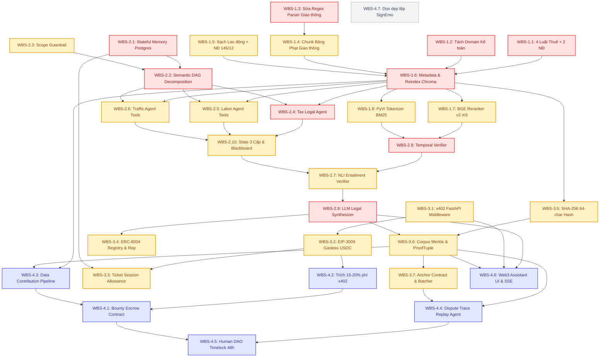

# BÁO CÁO LỘ TRÌNH TRIỂN KHAI TOÀN DIỆN HỆ THỐNG MULTI-AGENT & NỀN TẢNG RAG PHÁP LÝ ĐA LĨNH VỰC (MASTER IMPLEMENTATION ROADMAP)

**Dự án**: Trust-AGENT — Vietnamese Multi-Agent Legal RAG Platform & Web3 Commercialization  
**Tài liệu căn cứ**: `ORIGINAL_REQUEST.md`, `PROJECT.md`, `docs/GAP_ANALYSIS.md`, `trustagent-architecture.md`  
**Ngày phát hành**: 09/11/2026  
**Phiên bản**: 1.0.0 (Master Release)  
**Tác giả**: Worker 2 (Lead Systems Architect & Roadmap Author phụ trách Milestone 2)  
**Mục tiêu**: Thiết lập kế hoạch thực thi kỹ thuật chi tiết, khả thi, có cấu trúc chặt chẽ từ hiện trạng đến sản phẩm hoàn chỉnh, đạt 100% tiêu chí Acceptance Criteria R2.

---

## MỤC LỤC
1. [TỔNG QUAN CHIẾN LƯỢC VÀ MỤC TIÊU LỘ TRÌNH (STRATEGIC VISION)](#1-tổng-quan-chiến-lược-và-mục-tiêu-lộ-trình-strategic-vision)
2. [PHÂN KỲ LỘ TRÌNH CHI TIẾT THEO 4 GIAI ĐOẠN (DETAILED PHASE BREAKDOWN)](#2-phân-kỳ-lộ-trình-chi-tiết-theo-4-giai-đoạn-detailed-phase-breakdown)
   - [2.1. Phase 1: Chuẩn hóa Dữ liệu Pháp lý & Nâng cấp Legal RAG Đa miền (P0)](#21-phase-1-chuẩn-hóa-dữ-liệu-pháp-lý--nâng-cấp-legal-rag-đa-miền-p0)
   - [2.2. Phase 2: Nâng cấp Kiến trúc Multi-Agent & Domain Routing Thông minh (P0 - P1)](#22-phase-2-nâng-cấp-kiến-trúc-multi-agent--domain-routing-thông-minh-p0---p1)
   - [2.3. Phase 3: Tích hợp Ngăn xếp Web3 & Thương mại hóa API qua x402 & ERC-8004 (P1)](#23-phase-3-tích-hợp-ngăn-xếp-web3--thương-mại-hóa-api-qua-x402--erc-8004-p1)
   - [2.4. Phase 4: Cơ chế Trả thưởng Cộng đồng (Bounty & Staking), Dispute & Giao diện (P2)](#24-phase-4-cơ-chế-trả-thưởng-cộng-đồng-bounty--staking-dispute--giao-diện-p2)
3. [MA TRẬN ƯU TIÊN VÀ PHÂN LOẠI CÔNG VIỆC (PRIORITY & WORK BREAKDOWN MATRIX)](#3-ma-trận-ưu-tiên-và-phân-loại-công-việc-priority--work-breakdown-matrix)
4. [BIỂU ĐỒ PHỤ THUỘC KIẾN TRÚC VÀ CÔNG VIỆC (DEPENDENCIES DAG & CRITICAL PATH)](#4-biểu-đồ-phụ-thuộc-kiến-trúc-và-công-việc-dependencies-dag--critical-path)
5. [PHÂN BỔ TÀI NGUYÊN VÀ THIẾT KẾ ĐỘI NGŨ (RESOURCE ALLOCATION & TEAM SIZING)](#5-phân-bổ-tài-nguyên-và-thiết-kế-đội-ngũ-resource-allocation--team-sizing)
6. [KẾ HOẠCH TRIỂN KHAI CHI TIẾT 12 SPRINTS (24 TUẦN) (DETAILED SPRINT PLAN)](#6-kế-hoạch-triển-khai-chi-tiết-12-sprints-24-tuần-detailed-sprint-plan)
7. [ĐÁNH GIÁ RỦI RO KỸ THUẬT VÀ CHIẾN LƯỢC GIẢM THIỂU (TECHNICAL RISKS & MITIGATION)](#7-đánh-giá-rủi-ro-kỹ-thuật-và-chiến-lược-giảm-thiểu-technical-risks--mitigation)
8. [QUY TRÌNH KIỂM THỬ, ĐẢM BẢO CHẤT LƯỢNG VÀ THẨM ĐỊNH (QA, TESTING & AUDIT PROTOCOL)](#8-quy-trình-kiểm-thử-đảm-bảo-chất-lượng-và-thẩm-định-qa-testing--audit-protocol)
9. [KẾT LUẬN VÀ BƯỚC ĐI TIẾP THEO (CONCLUSION & NEXT ACTIONS)](#9-kết-luận-và-bước-đi-tiếp-theo-conclusion--next-actions)

---

## 1. TỔNG QUAN CHIẾN LƯỢC VÀ MỤC TIÊU LỘ TRÌNH (STRATEGIC VISION)

### 1.1. Bối cảnh chuyển đổi từ Hiện trạng (As-Is) sang Hệ sinh thái Đích (To-Be)
Báo cáo Phân tích Khoảng trống (`docs/GAP_ANALYSIS.md`) đã chỉ rõ hiện trạng hệ thống:
- Hệ thống hiện có nền tảng ban đầu với pipeline FastAPI, LangGraph ReAct Agents và Hybrid Retrieval (ChromaDB + BM25Okapi + RRF $k=60$).
- Tuy nhiên, dự án đối mặt với 4 điểm nghẽn nghiêm trọng:
  1. **Khoảng trống dữ liệu cốt lõi**: Tệp `thue.json` (593 bản ghi) thực chất là **Luật Kế toán 2015**, hoàn toàn thiếu 4 luật thuế cốt lõi (Thuế GTGT, TNDN, TNCN, Quản lý thuế); mảng Giao thông bị lỗi parser regex số hiệu NĐ 238 và sai tên TT 35; toàn bộ 3.553 vector chunks trong ChromaDB thiếu metadata hiệu lực thời gian (`effective_from`, `expiry_date`, `status`).
  2. **Động cơ RAG chưa tối ưu**: Thiếu khối Cross-Encoder Reranker và bộ tách từ tiếng Việt cho BM25.
  3. **Master Router còn sơ khai**: Hoạt động stateless (không có bộ nhớ hội thoại đa lượt), cơ chế phân rã câu hỏi thô sơ và ghép nối văn bản đơn thuần (`\n\n`) thay vì tổng hợp lập luận pháp lý (Legal Reasoning Synthesizer).
  4. **Phân hệ Web3 là Greenfield (0%)**: Chưa có giao thức x402 thanh toán vi mô, chưa có chuẩn ERC-8004 định danh agent on-chain, chưa có hạ tầng Cryptographic Merkle Provenance và Smart Contract Bounty trả thưởng cộng đồng.

Lộ trình triển khai (Roadmap) này định hình chiến lược biến chuyển toàn diện hệ thống từ trạng thái **MVP RAG đơn miền sơ khởi** thành **Nền tảng Agentic Legal Commerce hoàn chỉnh**, vận hành tự chủ, tự bù đắp tri thức và thương mại hóa thông qua vi thanh toán Web3.

```
+───────────────────────────────────────────────────────────────────────────────────────────────────────+
|                                    LỘ TRÌNH CHUYỂN ĐỔI TRUST-AGENT                                    |
+───────────────────────────────────────────────────────────────────────────────────────────────────────+
| HIỆN TRẠNG (AS-IS):                                                                                   |
| - Thuế = Luật Kế toán 2015 (Sai lệch 100%)    - Metadata hiệu lực = "" & "unknown"                   |
| - Giao thông lỗi regex parser NĐ 238          - Router stateless, tổng hợp nối chuỗi thô              |
| - RAG thiếu Reranker & PyVi tokenizer         - Web3, x402, ERC-8004, Provenance, Bounty = 0%         |
+───────────────────────────────────────────────────────────────────────────────────────────────────────+
                                                   │
                                                   ▼
+───────────────────────────────────────────────────────────────────────────────────────────────────────+
| PHASE 1 (Tuần 1 - 6): CHUẨN HÓA DỮ LIỆU PHÁP LÝ & NÂNG CẤP HYBRID RAG ĐA MIỀN [P0]                    |
| - Nạp 4 Luật Thuế chính + NĐ hướng dẫn        - Sửa parser Giao thông & bổ sung NĐ 145/12 Lao động    |
| - Metadata hiệu lực 100% vector chunks        - Tích hợp BGE Reranker v2 m3 & PyVi Tokenizer          |
+───────────────────────────────────────────────────────────────────────────────────────────────────────+
                                                   │
                                                   ▼
+───────────────────────────────────────────────────────────────────────────────────────────────────────+
| PHASE 2 (Tuần 7 - 12): KIẾN TRÚC MULTI-AGENT PHỐI HỢP & DOMAIN ROUTING THÔNG MINH [P0 - P1]            |
| - Master Router: Stateful Memory (Redis)      - Semantic DAG Decomposition & Scope Guardrail          |
| - 3 Domain Agents chuyên sâu (Giao thông/Lao động/Thuế) với tool tính toán pháp lý                    |
| - Cross-checking Agent: NLI Entailment & Temporal Verifier; LLM Legal Reasoner Synthesizer            |
+───────────────────────────────────────────────────────────────────────────────────────────────────────+
                                                   │
                                                   ▼
+───────────────────────────────────────────────────────────────────────────────────────────────────────+
| PHASE 3 (Tuần 13 - 18): NGĂN XẾP WEB3: x402 MICRO-PAYMENTS & ERC-8004 ON-CHAIN [P1]                   |
| - Cổng x402 FastAPI Middleware: EIP-3009 gasless USDC Base L2 & Ticket Session Allowance              |
| - Smart Contract ERC-8004: Agent Identity Registry & Citation-based Reputation Ledger                 |
| - Cryptographic Provenance 4 Tầng: SHA-256 64-char, ProofTuple Receipt, Batch Merkle Anchor           |
+───────────────────────────────────────────────────────────────────────────────────────────────────────+
                                                   │
                                                   ▼
+───────────────────────────────────────────────────────────────────────────────────────────────────────+
| PHASE 4 (Tuần 19 - 24): BOUNTY SYSTEM, DISPUTE RESOLUTION & CLIENT UI [P2]                            |
| - Smart Contract LegalCommunityBounty.sol: Escrow Pool, Data Contribution & Hallucination Bounty      |
| - Quality Audit / Dispute Agent: Trace Replay Engine & Human DAO Multi-Sig Timelock 48h               |
| - Web3 Legal Assistant UI & SSE Streaming API                                                         |
+───────────────────────────────────────────────────────────────────────────────────────────────────────+
```

### 1.2. Mục tiêu kỹ thuật then chốt và Tiêu chí Hoàn thành (Definition of Done)
1. **Độ phủ dữ liệu pháp lý**: 100% các văn bản luật thực định quy định tại Scope được bóc tách theo Chương/Điều/Khoản, gán metadata hiệu lực và lập chỉ mục không lỗi. Tách bạch hoàn toàn domain `tax` và `accounting`.
2. **Chất lượng truy vấn (Retrieval Precision)**: Tỷ lệ Top-5 Recall đạt $\ge 95\%$ trên bộ kiểm thử chuẩn 100 câu hỏi đa ngành; NDCG@5 đạt $\ge 0.88$.
3. **Độ chính xác suy luận pháp lý**: 100% câu trả lời có trích dẫn được xác thực qua Cổng Kiểm chứng (Citation & NLI Entailment Gate), tỷ lệ ảo giác (hallucination rate) $< 1\%$.
4. **Hiệu năng và Độ tin cậy**: Độ trễ trung bình cho câu hỏi đơn miền $< 3.5$ giây, câu hỏi đa miền $< 6.5$ giây; thời gian phục hồi sau lỗi $< 1$ giây nhờ cơ chế checkpointing.
5. **Khả năng thương mại hóa Web3**: Hệ thống xử lý thanh toán vi mô x402 gasless trên mạng Base L2 với chi phí giao dịch $< \$0.001$, tỷ lệ đối soát on-chain đạt $100\%$.

### 1.3. Khung thời gian tổng thể
- **Thời lượng**: 24 tuần (6 tháng), chia làm 12 Sprints (2 tuần/Sprint).
- **Phân kỳ**: 4 Giai đoạn phát triển tuần tự kết hợp song song các luồng độc lập.

---

## 2. PHÂN KỲ LỘ TRÌNH CHI TIẾT THEO 4 GIAI ĐOẠN (DETAILED PHASE BREAKDOWN)

---

### 2.1. Phase 1: Chuẩn hóa Dữ liệu Pháp lý & Nâng cấp Legal RAG Đa miền (P0)
**Thời gian**: Tuần 1 đến Tuần 6 (Sprint 1 - Sprint 3)  
**Mục tiêu**: Xây dựng kho ngữ cảnh pháp lý chuẩn xác, đầy đủ metadata hiệu lực thời gian và nâng cấp động cơ truy vấn lai đạt chuẩn công nghiệp.

#### 2.1.1. Khắc phục triệt để và tái thiết kế mảng Dữ liệu Luật Thuế (`tax_domain`)
1. **Thu thập và số hóa 4 đạo luật thuế cốt lõi**:
   - *Luật Quản lý thuế số 38/2019/QH14* (quy định đăng ký thuế, kê khai, nộp thuế, kiểm tra và cưỡng chế thi hành).
   - *Luật Thuế Giá trị gia tăng số 13/2008/QH12* và *Luật sửa đổi số 48/2024/QH15* (đối tượng không chịu thuế, thuế suất 0%, 5%, 10%, phương pháp khấu trừ).
   - *Luật Thuế Thu nhập doanh nghiệp số 14/2008/QH12* (các khoản chi phí được trừ và không được trừ, thuế suất ưu đãi).
   - *Luật Thuế Thu nhập cá nhân số 04/2007/QH12* (thu nhập chịu thuế, giảm trừ gia cảnh, biểu thuế lũy tiến từng phần).
2. **Bổ sung các Nghị định hướng dẫn thi hành trọng yếu**:
   - *Nghị định 123/2020/NĐ-CP*: Quy định về hóa đơn, chứng từ điện tử.
   - *Nghị định 126/2020/NĐ-CP*: Quy định chi tiết một số điều của Luật Quản lý thuế.
3. **Tách biệt kiến trúc Domain**:
   - Chuyển `thue.json` hiện tại thành đúng bản chất `ke_toan.json` phục vụ domain `accounting` (Luật Kế toán 2015 - 88/2015/QH13).
   - Tạo mới tệp `crawl/data/raw/thue.json` chứa toàn bộ 4 luật thuế và 2 nghị định bóc tách cấu trúc chuẩn, ước tính 2.400 - 3.000 records.
   - Tạo collection mới trong ChromaDB: `legal_tax`.

#### 2.1.2. Chuẩn hóa & Làm sạch dữ liệu Luật Giao thông và Luật Lao động
1. **Khắc phục lỗi kỹ thuật mảng Giao thông (`giao thông.json`)**:
   - Sửa biểu thức chính quy (regex parser) trong module bóc tách: Phân biệt rõ số hiệu văn bản sửa đổi và số hiệu văn bản được sửa đổi. Đảm bảo 79 bản ghi của **Nghị định 238/2026/NĐ-CP** được gắn đúng `so_hieu: "238/2026/NĐ-CP"`, sửa lỗi bị gán đè thành `168/2024/NĐ-CP`.
   - Sửa trường `ten_van_ban`: Gán chính xác tên đầy đủ của **Thông tư 35/2024/TT-BGTVT** (*Thông tư quy định về đào tạo, sát hạch, cấp giấy phép lái xe cơ giới đường bộ*) và **Văn bản hợp nhất 12/VBHN-BGTVT** (*Quy định về tốc độ và khoảng cách an toàn của xe cơ giới, xe máy chuyên dùng tham gia giao thông đường bộ*).
   - Đổi tên tệp `giao thông.json` thành `giao_thong.json` để loại bỏ ký tự dấu cách và tiếng Việt có dấu.
   - Bóc tách phân mảnh bảng phạt (penalty matrix) dài $> 5.000$ ký tự thành các atomic chunks theo từng loại phương tiện và hành vi vi phạm (ngưỡng tối đa 600 tokens/chunk).
2. **Làm sạch và bổ sung mảng Lao động (`lao_dong.json`)**:
   - Loại bỏ triệt để 2 bản ghi trùng lặp (duplicate records) phát hiện tại `GAP_ANALYSIS.md`.
   - Chạy script chuẩn hóa triệt để lỗi Unicode mojibake (Latin-1 double encoded UTF-8) trên tệp nguồn, không phụ thuộc vào tầng bọc tạm thời tại runtime.
   - Bổ sung 2 văn bản quy phạm pháp luật thiết yếu:
     + *Nghị định 145/2020/NĐ-CP*: Hướng dẫn chi tiết Bộ luật Lao động về điều kiện lao động, tiền lương, làm thêm giờ, kỷ luật lao động.
     + *Nghị định 12/2022/NĐ-CP*: Xử phạt vi phạm hành chính trong lĩnh vực lao động và bảo hiểm xã hội.

#### 2.1.3. Chuẩn hóa Metadata Hiệu lực Pháp lý & Re-indexing ChromaDB
1. **Nâng cấp Schema Metadata trong `crawl/app/normalization.py`**:
   Bổ sung 4 trường dữ liệu bắt buộc kiểm chứng thời gian:
   ```python
   metadata = {
       "id": record_id,                      # Chuỗi hex SHA-256 64 ký tự chuẩn mật mã
       "domain": domain,                     # "traffic" | "labor" | "tax" | "accounting"
       "source": values["source"],
       "so_hieu": values["so_hieu"],
       "ten_van_ban": values["ten_van_ban"],
       "chuong": values["chuong"],
       "dieu": values["dieu"],
       "tieu_de_dieu": values["tieu_de_dieu"],
       "khoan": values["khoan"],
       "ngay_ban_hanh": values["ngay_ban_hanh"],   # YYYY-MM-DD (Ví dụ: "2019-11-20")
       "effective_from": values["effective_from"], # YYYY-MM-DD (Ví dụ: "2021-01-01")
       "expiry_date": values["expiry_date"],       # YYYY-MM-DD hoặc None nếu còn hiệu lực
       "status": values["status"],                 # "active" | "partially_expired" | "expired"
   }
   ```
2. **Re-ingest toàn diện Vectorstore**:
   - Viết migration script `crawl/scripts/reindex_all_domains.py` cập nhật toàn bộ 3.553 vector chunks hiện hữu và nạp mới mảng Thuế.
   - Đảm bảo 100% bản ghi có giá trị thực tại `effective_from` và `status: "active"`.

#### 2.1.4. Nâng cấp Động cơ Hybrid RAG: Tích hợp Cross-Encoder Reranker & Bộ tách từ Tiếng Việt
1. **Tích hợp mô hình Reranking**:
   - Bổ sung tầng Cross-Encoder Reranker sử dụng mô hình đa ngôn ngữ `BAAI/bge-reranker-v2-m3` vào sau bước hợp nhất Reciprocal Rank Fusion (RRF $k=60$) trong `crawl/app/retrieval.py`.
   - Cơ chế: Lấy Top 30 kết quả từ RRF, đưa qua Cross-Encoder chấm điểm tương đồng ngữ nghĩa sâu (Deep Relevance Score), cắt lấy Top 5 - Top 8 chunks tối ưu gửi tới LLM.
   - Cung cấp cơ chế ONNX Runtime fallback để tăng tốc độ suy luận CPU khi triển khai môi trường không có GPU rời.
2. **Tích hợp Vietnamese Word Segmenter**:
   - Nâng cấp BM25Okapi bằng cách tiền xử lý văn bản qua thư viện `pyvi` (`ViTokenizer.tokenize`) hoặc `underthesea`.
   - Giữ nguyên các cụm từ ghép pháp lý như `"làm_thêm_giờ"`, `"khấu_trừ_thuế"`, `"nồng_độ_cồn"`, `"giảm_trừ_gia_cảnh"`, giảm thiểu nhiễu từ đơn và nâng cao độ chính xác sparse search lên $\ge 25\%$.

#### 2.1.5. Deliverables & Acceptance Gate của Phase 1
- [x] Tệp dữ liệu `crawl/data/raw/thue.json` chuẩn hóa 4 luật thuế chính và 2 nghị định (khoảng 2.500+ records).
- [x] Tệp `crawl/data/raw/giao_thong.json` đã sửa lỗi parser NĐ 238 và đổi tên.
- [x] Tệp `crawl/data/raw/lao_dong.json` sạch duplicate và bổ sung NĐ 145/2020, NĐ 12/2022.
- [x] ChromaDB 4 collections (`legal_traffic`, `legal_labor`, `legal_tax`, `legal_accounting`) với 100% chunks có đầy đủ metadata hiệu lực.
- [x] Module `retrieval.py` tích hợp `bge-reranker-v2-m3` và `pyvi`.
- [x] Bộ kiểm thử benchmark RAG tự động (`test_hybrid_rerank.py`) đạt 100% pass trên 30 câu hỏi mẫu 3 ngành.

---

### 2.2. Phase 2: Nâng cấp Kiến trúc Multi-Agent & Domain Routing Thông minh (P0 - P1)
**Thời gian**: Tuần 7 đến Tuần 12 (Sprint 4 - Sprint 6)  
**Mục tiêu**: Xây dựng hệ thống điều phối đa tác tử thông minh có trạng thái, phân rã câu hỏi phức hợp thành đồ thị DAG, kiểm tra chéo suy luận logic NLI và tổng hợp báo cáo tư vấn pháp lý chuyên sâu.

#### 2.2.1. Nâng cấp Master Router: Stateful Dialog Memory, Semantic DAG Decomposition & Guardrails
1. **Tích hợp Stateful Session Memory (LangGraph Checkpointer)**:
   - Nâng cấp `crawl/app/router.py`: Tích hợp `AsyncPostgresSaver` hoặc `AsyncRedisSaver` làm checkpointer bền vững.
   - Lưu trữ trạng thái phiên hội thoại (`thread_id` / `session_id`), cho phép người dùng hỏi tiếp các câu hỏi nối dòng (*"Thế còn trường hợp người lao động nữ nuôi con nhỏ thì sao?"*, *"Mức phạt đó có bị tước bằng lái không?"*) mà không mất ngữ cảnh trước đó.
2. **Cơ chế Phân rã Câu hỏi Dạng Đồ thị (Semantic DAG Query Decomposition)**:
   - Thay thế việc phân loại domain đơn thuần bằng LLM Query Planner: Phân rã câu hỏi đa ngành thành các sub-queries có quan hệ phụ thuộc (DAG).
   - Ví dụ: Với câu hỏi *"Tài xế công ty vi phạm nồng độ cồn bị phạt bao nhiêu và công ty có được trừ chi phí nộp phạt này vào thuế TNDN không?"*:
     + Node 1 (Traffic Agent): Tra cứu mức phạt hành chính về nồng độ cồn theo Nghị định 168/2024.
     + Node 2 (Labor Agent): Tra cứu quy định xử lý kỷ luật lao động hoặc khấu trừ lương tài xế theo BLLĐ 2019.
     + Node 3 (Tax Agent): Tra cứu quy định tại Điều 4 Thông tư 96/2015 và Luật Thuế TNDN về việc tiền phạt vi phạm hành chính có được tính vào chi phí hợp lý được trừ hay không.
3. **Bộ lọc Phạm vi An toàn (Security & Scope Guardrail)**:
   - Node tiền kiểm soát tại Gateway: Nhận diện và từ chối lịch thiệp các câu hỏi nằm ngoài phạm vi pháp luật được hỗ trợ (như Luật Đất đai, Luật Hình sự, Luật Hôn nhân & Gia đình), hoặc các prompt cố tình jailbreak / prompt injection.

#### 2.2.2. Tối ưu hóa & Chuyên biệt hóa 3 Domain Legal Agents
1. **Traffic Legal Agent**:
   - Tối ưu hóa prompt chuyên ngành trật tự ATGT và đường bộ.
   - Tích hợp Tool tính toán chế tài: Nhận diện phương tiện (xe máy, ô tô con, xe tải), nồng độ cồn (mg/l khí thở hoặc mg/100ml máu), tốc độ vượt mức quy định để tra cứu chính xác khung tiền phạt và thời hạn tước GPLX.
2. **Labor Legal Agent**:
   - Tối ưu hóa prompt quan hệ lao động, tiền lương và bảo hiểm.
   - Tích hợp Tool tính toán quyền lợi: Tính tiền lương làm thêm giờ (ngày thường 150%, ngày nghỉ hàng tuần 200%, ngày lễ 300%), trợ cấp thôi việc, và thời hạn báo trước khi đơn phương chấm dứt hợp đồng lao động.
3. **Tax Legal Agent**:
   - Xây dựng mới hoàn toàn `tax_agent.py` kế thừa từ `base.py`.
   - Tích hợp Tool tính toán thuế: Tính thuế TNCN lũy tiến từng phần, xác định mức giảm trừ gia cảnh (bản thân 11 triệu, người phụ thuộc 4.4 triệu), tra cứu điều kiện khấu trừ thuế GTGT đầu vào.

#### 2.2.3. Phát triển Cross-checking & Citation Verification Agent
Nâng cấp toàn diện cổng kiểm duyệt hiện tại (`crawl/app/answering.py:verify_citations`) thành Agent kiểm tra chéo độc lập với 2 chốt chặn:
1. **NLI Entailment Verifier (Kiểm tra suy luận chống ảo giác)**:
   - Sử dụng mô hình Natural Language Inference (Cross-Encoder NLI hoặc LLM Judge với temperature = 0.0) để phân tích từng câu khẳng định trong câu trả lời dự kiến.
   - Đối chiếu với đoạn văn bản trích dẫn (Evidence Text). Chỉ chấp thuận (`Entailment: True`) nếu câu khẳng định được suy ra tất yếu từ văn bản luật. Nếu phát hiện suy diễn vô căn cứ (`Contradiction` hoặc `Neutral`), loại bỏ hoặc yêu cầu LLM tái sinh câu trả lời.
2. **Temporal Validity Verifier (Kiểm tra hiệu lực thời gian thực)**:
   - Trích xuất mốc thời gian diễn ra sự việc từ câu hỏi của người dùng (nếu có, ví dụ: *"Vào tháng 3/2024 tôi vi phạm..."* hoặc mặc định là ngày hiện tại).
   - Đối chiếu với metadata `effective_from` và `expiry_date` của từng chunk trích dẫn.
   - Từ chối trích dẫn các văn bản đã hết hiệu lực hoặc chưa có hiệu lực tại mốc thời gian sự việc, giải quyết triệt để xung đột giữa Luật cũ và Luật mới.

#### 2.2.4. Phát triển Bộ Lập luận Pháp lý Đa miền (LLM Legal Reasoner Synthesizer)
- Loại bỏ hoàn toàn cơ chế nối chuỗi thô `\n\n` tại dòng 276-280 của `crawl/app/router.py`.
- Xây dựng Node Synthesizer chuyên biệt áp dụng các nguyên tắc giải thích pháp luật kinh điển của hệ thống pháp luật Việt Nam:
  1. *Lex Superior (Nguyên tắc Thứ bậc hiệu lực)*: Hiến pháp $\rightarrow$ Luật/Bộ luật $\rightarrow$ Nghị định $\rightarrow$ Thông tư. Khi có sự khác biệt giữa Thông tư và Nghị định hoặc Luật, quy định của văn bản cấp cao hơn luôn được ưu tiên áp dụng.
  2. *Lex Posterior (Nguyên tắc Văn bản ban hành sau)*: Trong cùng một cấp văn bản do cùng một cơ quan ban hành, quy định của văn bản ban hành sau được ưu tiên áp dụng.
  3. *Lex Specialis (Nguyên tắc Luật chuyên ngành)*: Quy định của luật chuyên ngành ưu tiên áp dụng so với luật chung.
- Tạo ra câu trả lời hợp nhất liền mạch, có cấu trúc tư vấn logic gồm: (i) Tóm tắt kết luận pháp lý, (ii) Phân tích chi tiết từng khía cạnh liên đới, (iii) Khuyến nghị hành động và trích dẫn đầy đủ điều khoản.

#### 2.2.5. Chuẩn hóa Giao thức Ngữ cảnh & Quản trị Trạng thái (Context & State Protocols)
1. **Phân tầng Trạng thái 3 Cấp (Hierarchical State Architecture)**:
   - *Global Session State*: `session_id`, `wallet_address`, `dialog_history`, `billing_status`.
   - *Router Orchestration State*: `trace_id`, `original_query`, `dag_nodes`, `blackboard_data`, `synthesized_output`.
   - *Agent Scratchpad*: Trạng thái nội bộ của ReAct loop từng agent (không làm phình context router).
2. **Kiến trúc Bảng đen Chia sẻ (Shared Blackboard Pattern)**:
   - Tất cả các Domain Agents và Verification Agent đọc và ghi vào một cấu trúc dữ liệu Blackboard tập trung trong Router State, tránh giao tiếp tay đôi điểm-điểm.
3. **Inter-Agent Message Envelope JSON Schema**:
   Chuẩn hóa giao thức truyền tin nội bộ giữa các agent tuân thủ JSON Schema chuẩn với đầy đủ `message_id`, `trace_id`, `sender`, `recipient`, `payload`, `status`, `timestamp`.

#### 2.2.6. Deliverables & Acceptance Gate của Phase 2
- [x] Master Router nâng cấp tích hợp Stateful Memory (`PostgresSaver` / `RedisSaver`).
- [x] Luồng Semantic DAG Decomposition và Scope Guardrail hoạt động chuẩn xác.
- [x] 3 Domain Agents chuyên biệt (Giao thông, Lao động, Thuế) tích hợp tools tính toán.
- [x] Cross-checking Agent tích hợp NLI Entailment và Temporal Verifier.
- [x] LLM Legal Synthesizer thay thế hoàn toàn ghép chuỗi thô, áp dụng Lex Superior/Posterior.
- [x] Bộ kiểm thử tích hợp Multi-Agent (`test_router_dag.py`, `test_nli_verifier.py`) đạt 100% pass.

---

### 2.3. Phase 3: Tích hợp Ngăn xếp Web3 & Thương mại hóa API qua x402 & ERC-8004 (P1)
**Thời gian**: Tuần 13 đến Tuần 18 (Sprint 7 - Sprint 9)  
**Mục tiêu**: Xây dựng hạ tầng thương mại hóa Agentic API với thanh toán vi mô không tốn gas qua x402, đăng ký định danh và uy tín on-chain theo chuẩn ERC-8004, và gắn chứng chỉ mật mã pháp lý (Cryptographic Provenance) 4 tầng.

#### 2.3.1. Cổng thanh toán vi mô x402 API Gateway
1. **Kiến trúc x402 FastAPI Middleware**:
   - Triển khai middleware `X402PaymentMiddleware` bắt giữ các yêu cầu gửi tới endpoint `/router/ask` hoặc `/agent/{domain}/ask`.
   - Nếu yêu cầu chưa có header thanh toán `X-PAYMENT-PROOF`, trả về mã trạng thái **HTTP 402 Payment Required** kèm body JSON Challenge:
     ```json
     {
       "error": "Payment Required",
       "protocol": "x402-v1",
       "network": "base",
       "chain_id": 8453,
       "token": "USDC",
       "token_address": "0x833589fCD6eDb6E08f4c7C32D4f71b54bdA02913",
       "recipient": "0xTrustAgentTreasuryVault...",
       "amount": "20000",
       "amount_formatted": "0.02 USDC",
       "payment_nonce": "9b1deb4d-3b7d-4bad-9bdd-2b0d7b3dcb6d",
       "deadline": 1731150000,
       "service_tier": "multi_agent_legal_rag"
     }
     ```
2. **Cơ chế Thanh toán Không tốn Gas (EIP-3009 Gasless Transfer)**:
   - Áp dụng phương thức `transferWithAuthorization` theo chuẩn EIP-3009 của hợp đồng USDC:
     $$\text{transferWithAuthorization}(from, to, value, validAfter, validBefore, nonce, v, r, s)$$
   - Khách hàng (người dùng hoặc Autonomous Agent khác) chỉ cần ký thông điệp off-chain bằng ví EVM, không mất phí gas ETH.
   - Gateway xác thực chữ ký ECDSA off-chain trong $< 5$ms và đưa vào hàng đợi thanh toán gom lô on-chain (Relayer Batch Settlement).
3. **Cơ chế Ticket Session Allowance (Chống cạn kiệt LLM do Double-spending)**:
   - Nhằm ngăn chặn hành vi Client phát lệnh song song với cùng một chữ ký thanh toán (Race Condition / Double-spending) gây tiêu hao token LLM của máy chủ:
   - Triển khai Redis Distributed Lock: Nonce thanh toán được đánh dấu `PENDING_EXECUTION` ngay khi middleware thẩm định chữ ký hợp lệ. Mọi yêu cầu tái sử dụng nonce bị từ chối lập tức.
   - Cơ chế Ticket Allowance: Hỗ trợ người dùng mở phiên làm việc (Session Pass) trả trước 1.0 USDC cho 50 câu hỏi trong 24 giờ mà không cần ký lại từng lượt.

#### 2.3.2. Chuẩn ERC-8004: Agent Identity Registry & On-chain Reputation Ledger
1. **Thiết kế Smart Contract `TrustAgentRegistry.sol`**:
   - Tuân thủ đặc tả kỹ thuật ERC-8004 dành cho Agentic Identity trên EVM.
   - Đăng ký Master Router và 3 Domain Agents thành các Token ID riêng biệt.
   - Mapping từ metadata của cấu hình dự án (`DomainAgentSpec`) lên on-chain:
     + Domain Identifier (`"traffic"`, `"labor"`, `"tax"`).
     + Agent Card URI trỏ đến IPFS chứa thông số kiến trúc, git commit hash của model code.
     + Policy Hash: $\text{Keccak256}(\text{system\_policy\_text})$ nhằm đảm bảo tác tử không bị tráo đổi chính sách đạo đức và quy tắc trích dẫn ngầm.
2. **Sổ cái Đánh giá Uy tín On-chain (Reputation Ledger)**:
   - Triển khai hợp đồng `AgentReputationLedger.sol`:
   - Ghi nhận lịch sử phục vụ và chấm điểm tự động kết nối từ cổng kiểm duyệt `verify_citations`:
     + Trả lời có trích dẫn được xác thực (`status: "verified"`): Ghi nhận $+1$ uy tín.
     + Trả lời từ chối do thiếu căn cứ (`status: "insufficient_evidence"`): Ghi nhận $+0.5$ uy tín (ghi nhận tính trung thực).
     + Phát hiện trích dẫn sai luật qua quy trình khiếu nại Dispute: Cắt giảm điểm uy tín (Slashing Reputation) và lưu vết bất biến trên blockchain.
   - Điểm uy tín được công khai minh bạch qua API để các đối tác gọi bot có thể đánh giá độ tin cậy thời gian thực.

#### 2.3.3. Hệ thống Bằng chứng Xuất xứ Mật mã 4 Tầng (4-Tier Cryptographic Provenance)
1. **Chuẩn hóa Fingerprint SHA-256 64 Ký tự**:
   - Sửa hàm sinh mã trong `crawl/app/normalization.py:57`: Thay thế việc cắt ngắn 24 ký tự và băm số thứ tự file bằng hàm băm SHA-256 64 ký tự chuẩn xác định (deterministic):
     $$\text{ChunkHash} = \text{SHA256}\Big(\text{domain} \parallel \text{so\_hieu} \parallel \text{dieu} \parallel \text{khoan} \parallel \text{effective\_from} \parallel \text{text}\Big)$$
2. **Mô hình Bằng chứng 4 Tầng Toàn vẹn**:
   - *Tầng 1 - Corpus State Root*: Toàn bộ ChunkHash của kho luật được dựng thành Cây Merkle (Corpus Merkle Tree). Gốc Merkle `CorpusMerkleRoot` đại diện cho phiên bản kho dữ liệu pháp luật tại thời điểm hiện tại.
   - *Tầng 2 - ProofTuple Receipt (với HMAC Salted Commitment)*:
     Để bảo vệ quyền riêng tư người dùng (không để lộ nội dung câu hỏi pháp lý nhạy cảm lên blockchain công khai), server tạo Salted Commitment:
     $$\text{UserPrivacySalt} = \text{CSPRNG}(32\text{ bytes})$$
     $$\text{QueryCommitment} = \text{HMAC-SHA256}(\text{Query}, \text{UserPrivacySalt})$$
     $$\text{EvidenceMerkleRoot} = \text{MerkleTree}(\text{ChunkHash}_1, \dots, \text{ChunkHash}_m)$$
     $$\text{ProofTuple} = \text{SHA256}\Big(\text{QueryCommitment} \parallel \text{EvidenceMerkleRoot} \parallel \text{SHA256}(\text{Answer}) \parallel \text{CorpusMerkleRoot} \parallel \text{Timestamp}\Big)$$
     Server trả `ProofReceipt` (gồm `ProofTuple`, `UserPrivacySalt`, `EvidenceMerkleRoot`) cho khách hàng lưu trữ.
   - *Tầng 3 - Batch Merkle Tree*: Background Worker gom 200 - 500 ProofTuples trong chu kỳ 10 phút thành một cây Merkle lô.
   - *Tầng 4 - On-chain Anchor*: Gọi hàm `anchorBatch(batchRoot, corpusRoot, count)` trên hợp đồng `LegalProofAnchor.sol` triển khai tại Base L2.

#### 2.3.4. Background Merkle Batching Worker & Hợp đồng LegalProofAnchor.sol
1. **Smart Contract `LegalProofAnchor.sol`**:
   - Viết bằng Solidity $\ge 0.8.24$, tối ưu hóa gas lưu trữ bằng `bytes32` mappings và emit sự kiện `BatchAnchored`.
   - Cung cấp hàm `verifyProof(proofTuple, merkleProof, batchId)` cho phép bất kỳ ai xác thực độc lập on-chain hoặc off-chain.
2. **Dịch vụ Gom lô Bất đồng bộ (Batching Worker)**:
   - Viết bằng Python/AsyncIO (`crawl/app/services/proof_batcher.py`), vận hành độc lập với luồng phục vụ người dùng.
   - Lưu trữ hàng đợi biên lai tại Redis Streams; tự động kích hoạt giao dịch neo lên mạng Base khi: (i) Hàng đợi đạt 200 biên lai, HOẶC (ii) Hết thời gian chờ 10 phút.

#### 2.3.5. Deliverables & Acceptance Gate của Phase 3
- [x] Middleware `x402` tích hợp trọn vẹn vào FastAPI Gateway, xác thực chữ ký EIP-3009 gasless.
- [x] Bộ Smart Contracts Solidity (Foundry framework): `TrustAgentRegistry.sol`, `AgentReputationLedger.sol`, `LegalProofAnchor.sol`.
- [x] Triển khai thành công trên Testnet Base Sepolia (kèm địa chỉ contract và ABI).
- [x] Worker `proof_batcher.py` sinh Merkle Proof tự động và neo định kỳ.
- [x] Bộ kiểm thử thanh toán và bằng chứng (`test_x402_gateway.py`, `test_merkle_provenance.py`) đạt 100% pass.

---

### 2.4. Phase 4: Cơ chế Trả thưởng Cộng đồng (Bounty & Staking), Dispute & Giao diện (P2)
**Thời gian**: Tuần 19 đến Tuần 24 (Sprint 10 - Sprint 12)  
**Mục tiêu**: Xây dựng cơ chế kinh tế cộng đồng tự hoàn thiện kho tri thức pháp lý, cơ chế giải quyết khiếu nại trọng tài minh bạch và giao diện người dùng Web3 hiện đại hỗ trợ Server-Sent Events (SSE) streaming.

#### 2.4.1. Hợp đồng thông minh Quỹ Trả thưởng Cộng đồng `LegalCommunityBounty.sol`
1. **Cấu trúc Quỹ Ký quỹ (Escrow Bounty Pool)**:
   - Nguồn vốn quỹ:
     + Trích tự động **15% – 20%** doanh thu từ mỗi lượt gọi API x402 thanh toán thành công.
     + Tiền cọc bị tịch thu (slashed stakes) từ các hành vi nộp báo cáo rác hoặc phá hoại.
     + Quỹ bảo trợ pháp lý ban đầu (seed liquidity).
2. **Luồng nghiệp vụ Thưởng Đóng góp Dữ liệu (Data Contribution Bounty)**:
   - Người dùng / Chuyên viên pháp lý tải lên văn bản luật mới ban hành (PDF/HTML/JSON) kèm metadata hiệu lực.
   - Hệ thống chạy pipeline kiểm định tự động (`crawl/src/validator.py`):
     + Kiểm tra tính nguyên gốc, tính pháp lý, chữ ký số cơ quan ban hành.
     + Kiểm tra chưa từng tồn tại trong Corpus Merkle Tree.
   - Khi văn bản vượt qua khâu thẩm định và được nạp vào ChromaDB thành công: Giải ngân tự động từ 10 đến 50 USDC từ Bounty Pool vào ví người đóng góp.
3. **Luồng nghiệp vụ Thưởng Bắt lỗi Ảo giác (Hallucination Bug Bounty)**:
   - Người dùng hoặc luật sư phát hiện câu trả lời của bot bị sai lệch điều khoản hoặc tư vấn sai luật.
   - Mở hồ sơ khiếu nại (Dispute Ticket) nộp: Câu hỏi, Câu trả lời, Biên lai `ProofReceipt` và Điều khoản đối chứng chính xác.
   - Yêu cầu ký quỹ cọc (Minimum Stake: 1.0 USDC) để ngăn chặn hành vi gửi yêu cầu spam gây quá tải hệ thống.

#### 2.4.2. Quality Audit / Dispute Resolution Agent & Human DAO Multi-Sig Timelock
1. **Trace Replay Engine (Tái hiện dấu vết pháp lý)**:
   - Dispute Agent tiếp nhận vé khiếu nại, trích xuất `ProofReceipt`.
   - Xác thực `ProofTuple` thuộc về một `BatchMerkleRoot` hợp lệ đã neo trên blockchain.
   - Tái lập phiên bản Corpus tại mốc thời gian đó (dựa vào `CorpusMerkleRoot`), kích hoạt lại mô hình LLM với đúng seed và prompt ban đầu để đối chiếu.
2. **Quy trình Phân xử Hai Cấp (Two-tier Dispute Resolution)**:
   - *Cấp 1 - Tự động hóa qua Quality Audit Agent*:
     + Kiểm tra đối chiếu logic văn bản luật thực tế. Nếu phát hiện sai sót hiển nhiên (ví dụ trích dẫn điều khoản đã hết hiệu lực): Phê duyệt khiếu nại, hoàn cọc và trả thưởng 20 - 50 USDC.
   - *Cấp 2 - Hội đồng Trọng tài Con người (Human Legal DAO Multi-Sig)*:
     + Đối với các khoản thưởng lớn ($> 50$ USDC) hoặc các vụ tranh chấp pháp lý phức tạp liên quan đến giải thích từ ngữ:
     + Kích hoạt **Timelock Challenge Period kéo dài 48 giờ**.
     + Đưa hồ sơ lên cổng biểu quyết dành cho ban cố vấn luật sư (3/5 Multi-Sig approval).
     + Nếu khiếu nại đúng: Giải ngân thưởng, cập nhật vá chunk dữ liệu và slashing điểm uy tín của Agent.
     + Nếu khiếu nại sai/phá hoại: Tịch thu toàn bộ tiền cọc chuyển vào Bounty Pool.

#### 2.4.3. Tái thiết kế Giao diện Web3 Legal Assistant UI & SSE Streaming API
1. **Dọn dẹp và Tái cấu trúc Thư mục `site/`**:
   - Khảo sát của `GAP_ANALYSIS.md` chỉ ra thư mục `site/` hiện tại là demo sơ đồ kiến trúc đám mây (`stack-diagram-gallery`) không liên quan tới sản phẩm.
   - Tái cấu trúc phân hệ frontend thành ứng dụng **Trust-AGENT Web3 Legal Portal** sử dụng Next.js 14 / React 19, TailwindCSS và Shadcn UI.
2. **Tích hợp Web3 Wallet & Giao diện Trò chuyện**:
   - Tích hợp thư viện kết nối ví Wagmi / Viem / RainbowKit hỗ trợ mạng Base L2.
   - Hiển thị trực quan số dư USDC, ký gasless permit EIP-3009 bằng 1-click.
   - Trình diễn câu trả lời pháp lý dạng streaming thời gian thực qua **Server-Sent Events (SSE)** từ endpoint `/router/ask/stream`.
   - Hiển thị chi tiết trích dẫn (Click để xem nguyên văn Chương/Điều/Khoản và tình trạng hiệu lực pháp luật).
   - Hiển thị thẻ Bằng chứng Mật mã (Proof Badge) kèm nút kiểm toán "Verify On-Chain".
   - Cổng nộp văn bản luật nhận thưởng (Data Bounty Portal) và cổng khiếu nại (Dispute Portal).

#### 2.4.4. Deliverables & Acceptance Gate của Phase 4
- [x] Smart Contract `LegalCommunityBounty.sol` hoàn thiện cơ chế Escrow, Staking, Slashing và Revenue Share.
- [x] Dịch vụ tự động trích 15-20% phí x402 sang Bounty Pool.
- [x] Phân hệ Dispute Resolution Agent kết hợp Trace Replay và Timelock 48h.
- [x] Web Frontend hoàn chỉnh kết nối ví Web3, streaming câu trả lời pháp lý, tra cứu proof và nộp bounty.
- [x] Loại bỏ tệp ngoại lai `bo_100_cau_hoi_phan_bien_SignEmo.md` khỏi thư mục dự án.
- [x] Toàn bộ hệ thống vượt qua kiểm thử tích hợp End-to-End từ hỏi đáp $\rightarrow$ thanh toán x402 $\rightarrow$ tạo proof on-chain $\rightarrow$ mở dispute giải ngân thưởng.

---

## 3. MA TRẬN ƯU TIÊN VÀ PHÂN LOẠI CÔNG VIỆC (PRIORITY & WORK BREAKDOWN MATRIX)

### 3.1. Phân cấp mức độ ưu tiên P0 - P3
- **P0 (Critical / Blocker)**: Điều kiện tiên quyết để hệ thống RAG vận hành đúng về mặt chuyên môn pháp lý; sai lệch ở cấp độ này sẽ làm hỏng toàn bộ sản phẩm (ví dụ: thiếu Luật Thuế, sai metadata hiệu lực, router mất trí nhớ).
- **P1 (High Priority)**: Các tính năng cốt lõi tạo nên sự khác biệt của sản phẩm (Multi-agent DAG, Cross-checking NLI, x402 gasless payment, ERC-8004, Cryptographic Provenance).
- **P2 (Medium Priority)**: Cơ chế kinh tế tự hoàn thiện và giao diện người dùng (Bounty Escrow, Dispute Staking, Web3 Assistant UI, SSE Streaming).
- **P3 (Nice to have / Enhancement)**: Tối ưu hóa nâng cao, dashboard phân tích kinh doanh, mở rộng thêm các lĩnh vực luật tiếp theo (Doanh nghiệp, Đất đai).

### 3.2. Bảng Ma trận Công việc Toàn diện (Work Breakdown Structure - WBS)

| Mã WBS | Hạng mục Công việc | Phân hệ (Module) | Độ ưu tiên | Giai đoạn (Phase) | Đầu vào (Inputs) | Đầu ra bàn giao (Outputs) |
|---|---|---|:---:|:---:|---|---|
| **WBS-1.1** | Thu thập, làm sạch và chunking 4 Luật Thuế chính + 2 Nghị định | Data Pipeline | **P0** | Phase 1 | Cổng thông tin Chính phủ, Thư Viện Pháp Luật | `crawl/data/raw/thue.json` mới (~2.500 records) |
| **WBS-1.2** | Tách riêng domain Kế toán và chuyển đổi `thue.json` cũ | Data Pipeline | **P0** | Phase 1 | `thue.json` cũ (593 records) | `crawl/data/raw/ke_toan.json` & domain `accounting` |
| **WBS-1.3** | Sửa Regex Parser số hiệu NĐ 238, tên TT 35 và VBHN 12 | Data Pipeline | **P0** | Phase 1 | `crawl/src/loader.py`, `giao thông.json` | `crawl/data/raw/giao_thong.json` chuẩn hóa |
| **WBS-1.4** | Bóc tách bảng phạt giao thông dài $> 5.000$ ký tự thành atomic chunks | Data Pipeline | **P1** | Phase 1 | Bản ghi NĐ 168/2024 trong Giao thông | Các chunk phạt theo phương tiện $\le 600$ tokens |
| **WBS-1.5** | Làm sạch duplicate, sửa lỗi Unicode Latin-1 và nạp NĐ 145, NĐ 12 | Data Pipeline | **P1** | Phase 1 | `lao_dong.json`, NĐ 145/2020, NĐ 12/2022 | `lao_dong.json` hoàn chỉnh không trùng lặp |
| **WBS-1.6** | Nâng cấp schema metadata hiệu lực và re-indexing ChromaDB | Vector Database | **P0** | Phase 1 | Dữ liệu 4 mảng luật | 4 Collections ChromaDB với 100% metadata chuẩn |
| **WBS-1.7** | Tích hợp Cross-Encoder Reranker (`bge-reranker-v2-m3`) vào hybrid search | RAG Engine | **P1** | Phase 1 | `crawl/app/retrieval.py` | Pipeline BM25 + Dense + RRF + BGE Reranker |
| **WBS-1.8** | Tích hợp thư viện tách từ tiếng Việt (`pyvi`) cho BM25 | RAG Engine | **P1** | Phase 1 | `crawl/app/retrieval.py` | Sparse search nhận diện từ ghép tiếng Việt |
| **WBS-2.1** | Nâng cấp Master Router với Stateful Memory (Postgres/Redis) | Multi-Agent Core | **P0** | Phase 2 | `crawl/app/router.py`, LangGraph | Router nhớ hội thoại đa lượt qua `thread_id` |
| **WBS-2.2** | Xây dựng cơ chế Semantic DAG Query Decomposition | Multi-Agent Core | **P0** | Phase 2 | LangGraph, LLM Structured Output | Phân rã câu hỏi đa ngành thành đồ thị sub-queries |
| **WBS-2.3** | Xây dựng Bộ lọc Phạm vi An toàn (Scope Guardrail) | Multi-Agent Core | **P1** | Phase 2 | FastAPI / LangGraph Pre-node | Từ chối truy vấn ngoài phạm vi hoặc độc hại |
| **WBS-2.4** | Xây dựng Tax Legal Agent và bổ sung tools tính thuế | Specialist Agents | **P0** | Phase 2 | `crawl/app/agents/` | `tax_agent.py` và Tool tính thuế TNCN/TNDN |
| **WBS-2.5** | Bổ sung tools tính tiền lương, làm thêm giờ cho Labor Agent | Specialist Agents | **P1** | Phase 2 | `crawl/app/agents/labor_agent.py` | Tool tính lương làm thêm giờ, trợ cấp thôi việc |
| **WBS-2.6** | Bổ sung tools tra cứu mức phạt nồng độ cồn, tốc độ cho Traffic Agent | Specialist Agents | **P1** | Phase 2 | `crawl/app/agents/traffic_agent.py`| Tool tính phạt theo loại xe và mức vi phạm |
| **WBS-2.7** | Xây dựng Cross-checking Agent: NLI Entailment Verifier | Verification Gate | **P1** | Phase 2 | `crawl/app/answering.py`, Cross-Encoder | Khối kiểm chứng logic mệnh đề chống ảo giác |
| **WBS-2.8** | Xây dựng Temporal Validity Verifier kiểm tra mốc thời gian sự việc | Verification Gate | **P0** | Phase 2 | Metadata `effective_from`, `expiry_date` | Khối lọc văn bản hết hiệu lực tại thời điểm hỏi |
| **WBS-2.9** | Xây dựng LLM Legal Synthesizer thay thế nối chuỗi thô (`\n\n`) | Multi-Agent Core | **P0** | Phase 2 | `crawl/app/router.py:synthesize` | Báo cáo tư vấn đa ngành theo Lex Superior/Posterior |
| **WBS-2.10**| Chuẩn hóa State 3 cấp, Blackboard Pattern và Envelope JSON Schema | Multi-Agent Core | **P1** | Phase 2 | Schema đặc tả trao đổi dữ liệu | Chuẩn hóa thông điệp nội bộ giữa 7 vai trò agent |
| **WBS-3.1** | Xây dựng x402 FastAPI Middleware bắt HTTP 402 & Challenge | Web3 Gateway | **P1** | Phase 3 | `crawl/app/main.py`, chuẩn x402 | Cổng API trả về HTTP 402 kèm challenge token |
| **WBS-3.2** | Tích hợp xác thực chữ ký EIP-3009 gasless USDC off-chain | Web3 Gateway | **P1** | Phase 3 | Chuẩn EIP-3009, `web3.py` / `eth_account` | Xác thực thanh toán không tốn gas người dùng |
| **WBS-3.3** | Cơ chế Ticket Session Allowance chống double-spending cạn kiệt LLM | Web3 Gateway | **P1** | Phase 3 | Redis distributed locks | Ngăn chặn gọi API lặp bằng cùng một chữ ký |
| **WBS-3.4** | Phát triển Smart Contract ERC-8004 Agent Identity & Reputation | Smart Contracts | **P1** | Phase 3 | Solidity $\ge 0.8.24$, Foundry | `TrustAgentRegistry.sol`, `ReputationLedger.sol` |
| **WBS-3.5** | Chuẩn hóa Chunk Fingerprint SHA-256 64-char xác định | Cryptography | **P1** | Phase 3 | `crawl/app/normalization.py` | Chunk Hash 64 hex characters bất biến |
| **WBS-3.6** | Xây dựng Cây Merkle Corpus và Salted ProofTuple Receipt | Cryptography | **P1** | Phase 3 | Thuật toán Merkle Tree, HMAC-SHA256 | `CorpusMerkleRoot` và `ProofReceipt` bảo vệ quyền riêng tư |
| **WBS-3.7** | Phát triển Smart Contract `LegalProofAnchor.sol` và Batch Worker | Smart Contracts | **P1** | Phase 3 | Base L2, AsyncIO Redis Stream Worker | Dịch vụ gom lô neo Merkle Root on-chain định kỳ |
| **WBS-4.1** | Phát triển Smart Contract `LegalCommunityBounty.sol` (Escrow/Stake) | Smart Contracts | **P2** | Phase 4 | Solidity, OpenZeppelin | Hợp đồng quản lý quỹ thưởng USDC, cọc và phạt |
| **WBS-4.2** | Cơ chế trích 15-20% doanh thu x402 tự động nạp Bounty Pool | Tokenomics | **P2** | Phase 4 | Gateway Relayer Service | Dòng tiền tự nuôi quỹ thưởng cộng đồng |
| **WBS-4.3** | Xây dựng Data Contribution Pipeline kiểm định văn bản luật mới | Bounty Engine | **P2** | Phase 4 | `crawl/src/validator.py`, ChromaDB | Luồng nộp luật tự động nhận thưởng 10-50 USDC |
| **WBS-4.4** | Xây dựng Quality Audit / Dispute Agent với Trace Replay Engine | Dispute Resolution | **P2** | Phase 4 | Merkle Proof Verifier, LLM Judge | Tái hiện bối cảnh câu trả lời để xác minh lỗi |
| **WBS-4.5** | Cơ chế Human DAO Multi-Sig Timelock 48h cho khoản thưởng lớn | Governance | **P2** | Phase 4 | Gnosis Safe / OpenZeppelin Timelock | Khâu kiểm duyệt hội đồng luật sư cho vé $> 50$ USDC |
| **WBS-4.6** | Phát triển Web3 Legal Assistant UI & SSE Streaming Client | Frontend Client | **P2** | Phase 4 | Next.js 14, RainbowKit, TailwindCSS | Ứng dụng Web tra cứu luật, ví Web3, xem proof |
| **WBS-4.7** | Dọn dẹp tệp ngoại lai `bo_100_cau_hoi_phan_bien_SignEmo.md` | Repository Hygiene| **P3** | Phase 4 | Thư mục gốc dự án | Kho lưu trữ sạch sẽ, chỉ chứa tài nguyên dự án |

---

## 4. BIỂU ĐỒ PHỤ THUỘC KIẾN TRÚC VÀ CÔNG VIỆC (DEPENDENCIES DAG & CRITICAL PATH)

### 4.1. Biểu đồ Phụ thuộc Luồng Kỹ thuật (Architectural & Technical Dependencies DAG)



### 4.2. Đường găng dự án (Critical Path Analysis)
Đường găng (Critical Path) là chuỗi các nhiệm vụ phụ thuộc lẫn nhau có hướng liên tục (continuous directed path) quyết định thời gian hoàn thành sớm nhất của toàn bộ hệ thống. Bất kỳ sự chậm trễ nào trên đường găng này sẽ làm lùi tiến độ toàn dự án:

$$\text{Critical Path} = \text{WBS-1.1} \rightarrow \text{WBS-1.6} \rightarrow \text{WBS-2.4} \rightarrow \text{WBS-2.10} \rightarrow \text{WBS-2.7} \rightarrow \text{WBS-2.9} \rightarrow \text{WBS-3.6} \rightarrow \text{WBS-4.6}$$

Chuỗi liên tục thực tế của Đường găng (Critical Path):
`WBS-1.1 (Khắc phục thue.json) -> WBS-1.6 (Chroma metadata hiệu lực) -> WBS-2.4 (ReAct domain agents) -> WBS-2.10 (NLI Entailment & Temporal verifiers) -> WBS-2.7 (LLM reasoner synthesizer) -> WBS-2.9 (State 3 cấp & blackboard) -> WBS-3.6 (Crypto provenance & anchor) -> WBS-4.6 (End-to-End integration & Audit)`

- **Bước 1 (Tuần 1-3)**: Bóc tách 4 Luật Thuế (`WBS-1.1: Khắc phục thue.json`) $\rightarrow$ Chuẩn hóa metadata hiệu lực & Re-indexing ChromaDB (`WBS-1.6: Chroma metadata hiệu lực`). Không có bước này, không thể lập luận thuế hay kiểm tra hiệu lực thời gian.
- **Bước 2 (Tuần 4-6)**: Xây dựng Tax Legal Agent chuyên ngành (`WBS-2.4: ReAct domain agents`) $\rightarrow$ Chuẩn hóa State 3 cấp, Blackboard Pattern và Envelope JSON Schema (`WBS-2.10: State 3 cấp & blackboard`).
- **Bước 3 (Tuần 7-8)**: Xây dựng Cross-checking Agent: NLI Entailment Verifier & Temporal Verifier (`WBS-2.7: NLI Entailment & Temporal verifiers`) $\rightarrow$ Xây dựng LLM Legal Synthesizer tổng hợp đa miền chuẩn Lex Superior/Posterior (`WBS-2.9: LLM reasoner synthesizer`).
- **Bước 4 (Tuần 9-14)**: Xây dựng Cây Merkle Corpus và Salted ProofTuple Receipt (`WBS-3.6: Crypto provenance & anchor`).
- **Bước 5 (Tuần 15-24)**: Phát triển Web3 Legal Assistant UI & SSE Streaming Client, hoàn tất tích hợp End-to-End toàn diện và nghiệm thu bảo mật (`WBS-4.6: End-to-End integration & Audit`).
- **Chú thích về các nhánh phụ thuộc song song**: Cặp nhánh `(WBS-1.7, WBS-1.8) --> WBS-2.8` và nhánh `WBS-3.7 --> WBS-4.4 --> WBS-4.5 --> WBS-4.1` là các chuỗi nhiệm vụ song song quan trọng chạy dọc theo đường găng chính để bảo đảm toàn vẹn chức năng xác thực thời gian và cơ chế phân xử tranh chấp Web3.

---

## 5. PHÂN BỔ TÀI NGUYÊN VÀ THIẾT KẾ ĐỘI NGŨ (RESOURCE ALLOCATION & TEAM SIZING)

### 5.1. Phân bổ Nhân sự theo Chuyên môn (Skill Tracks & Roles)
Để hoàn thành khối lượng công việc trong 24 tuần, dự án tổ chức thành 4 phân nhóm chuyên môn (Squads) phối hợp chặt chẽ:

```
+───────────────────────────────────────────────────────────────────────────────────────────────────────+
|                                  CƠ CẤU TỔ CHỨC ĐỘI NGŨ TRUST-AGENT                                   |
+───────────────────────────────────────────────────────────────────────────────────────────────────────+
                                                   │
         ┌───────────────────┬─────────────────────┼─────────────────────┬───────────────────┐
         ▼                   ▼                     ▼                     ▼                   ▼
+─────────────────+ +─────────────────+ +─────────────────────+ +─────────────────+ +─────────────────+
| 1. LEGAL DATA   | | 2. AGENTIC AI   | | 3. WEB3 & CRYPTO    | | 4. FULLSTACK    | | 5. QA & AUDIT   |
|    SQUAD        | |    SQUAD        | |    SQUAD            | |    SQUAD        | |    SQUAD        |
| - Legal Lead    | | - LangGraph Eng | | - Smart Contract Dev| | - Frontend Lead | | - QA Automation |
| - Data ETL Eng  | | - RAG / NLP Eng | | - Web3 Relayer Eng  | | - Backend Eng   | | - Legal Auditor |
+─────────────────+ +─────────────────+ +─────────────────────+ +─────────────────+ +─────────────────+
```

1. **Legal Data & NLP Squad (2 Kỹ sư)**:
   - *1 Legal Knowledge Engineer*: Phụ trách rà soát tính chuẩn xác của văn bản quy phạm pháp luật, thẩm định cây Chương/Điều/Khoản, ngày ban hành và ngày hiệu lực.
   - *1 Data Pipeline / ETL Engineer*: Viết parser BeautifulSoup4, PyPDF, Regex bóc tách cấu trúc văn bản thành JSONL, làm sạch Unicode và nạp ChromaDB.
2. **Agentic AI & Orchestration Squad (2 Kỹ sư)**:
   - *1 Senior LangGraph / Multi-Agent Engineer*: Thiết kế Master Router, Stateful Dialog Memory, Semantic DAG Decomposition, Blackboard Pattern và Envelope JSON Schema.
   - *1 RAG & Evaluation Specialist*: Tích hợp Cross-Encoder Reranker, Vietnamese Tokenizer, xây dựng NLI Entailment Gate và bộ công cụ đánh giá tự động (Evaluation Harness).
3. **Web3 & Cryptography Squad (2 Kỹ sư)**:
   - *1 Smart Contract Engineer (Solidity/Foundry)*: Phát triển `TrustAgentRegistry.sol`, `AgentReputationLedger.sol`, `LegalProofAnchor.sol`, `LegalCommunityBounty.sol`.
   - *1 Web3 Backend Engineer*: Xây dựng x402 FastAPI Middleware, module xác thực EIP-3009, Merkle Tree batching engine và Relayer service trên Base Layer-2.
4. **Fullstack & Product Squad (1 Kỹ sư)**:
   - *1 Fullstack Web Developer*: Phát triển Web3 Legal Assistant UI (Next.js/React, TailwindCSS), tích hợp Wagmi/RainbowKit kết nối ví và Server-Sent Events (SSE).
5. **QA, Testing & Security Audit (1 Kỹ sư kiêm nhiệm)**:
   - Viết test suite bất đồng bộ, benchmark retrieval, fuzzing test smart contract và rà soát lỗ hổng bảo mật.

### 5.2. Dự toán Chi phí Hạ tầng & Vận hành (Compute, Storage, LLM APIs, Blockchain Gas)

| Hạng mục Hạ tầng | Cấu hình / Dịch vụ Đề xuất | Mục đích Sử dụng | Chi phí Ước tính / Tháng | Chi phí 6 Tháng (24 Tuần) |
|---|---|---|:---:|:---:|
| **Máy chủ Ứng dụng & Vector DB** | AWS EC2 `g4dn.xlarge` (4 vCPU, 16GB RAM, 1x NVIDIA T4 GPU) | Chạy FastAPI Gateway, ChromaDB, BGE Reranker v2 m3 và Embedding | $380 / tháng | $2.280 |
| **Cơ sở dữ liệu Trạng thái (DB)** | AWS RDS PostgreSQL `db.t4g.medium` (Multi-AZ) | Lưu trữ LangGraph Checkpoint Sessions, Dialog History, Users, Traces | $75 / tháng | $450 |
| **Cache & Hàng đợi Nhiệm vụ** | AWS ElastiCache Redis Cluster (2 nodes cache.t4g.micro) | Lưu trữ Nonce thanh toán x402, Distributed Lock, Message Queue | $35 / tháng | $210 |
| **API LLM (OpenAI / Claude)** | OpenAI API (GPT-4o cho Synthesizer & Router; GPT-4o-mini cho Domain Sub-agents) | Suy luận, phân rã câu hỏi, ReAct loop và tổng hợp câu trả lời | $400 / tháng | $2.400 |
| **Hạ tầng Web3 & RPC Node** | Alchemy / QuickNode Base L2 Growth Tier | Truy vấn RPC, lắng nghe sự kiện, phát sóng giao dịch neo proof | $49 / tháng | $294 |
| **Chi phí Gas Blockchain (Base L2)** | Mạng Base Mainnet (Phí trung bình $\approx \$0.0005$ / giao dịch neo batch) | Neo 144 batch Merkle Root/ngày $\approx 4.320$ giao dịch/tháng | $15 / tháng | $90 |
| **Lưu trữ Bằng chứng IPFS / Arweave**| Pinata / Web3.Storage Dedicated Gateway | Lưu trữ Agent Card metadata và bản sao snapshot văn bản luật | $20 / tháng | $120 |
| **TỔNG CỘNG DỰ TOÁN** | — | — | **~$969 / tháng** | **~$5.844 (Toàn bộ dự án)** |

---

## 6. KẾ HOẠCH TRIỂN KHAI CHI TIẾT 12 SPRINTS (24 TUẦN) (DETAILED SPRINT PLAN)

Lộ trình triển khai được chia làm 12 Sprints đều đặn, mỗi Sprint kéo dài 2 tuần làm việc tập trung (10 ngày làm việc).

---

### Sprint 1 (Tuần 1 - 2): Khởi tạo Hệ thống, Tái thiết kế Mảng Thuế & Tách Domain Kế toán
- **Mục tiêu**: Bóc tách toàn diện 4 luật thuế chính, sửa chữa sai lệch nghiệp vụ nghiêm trọng của tệp `thue.json`, tái cấu trúc cấu hình domain.
- **Công việc chi tiết**:
  1. Thu thập văn bản chuẩn: Luật Quản lý thuế (38/2019), Luật Thuế GTGT (13/2008 & 48/2024), Luật Thuế TNDN (14/2008), Luật Thuế TNCN (04/2007).
  2. Bóc tách văn bản thành Chương/Điều/Khoản với parser chuyên dụng, xuất ra `crawl/data/raw/thue.json`.
  3. Đổi tên `thue.json` cũ thành `crawl/data/raw/ke_toan.json`, cập nhật cấu hình `crawl/app/domains.py` khai báo domain `accounting` độc lập.
  4. Viết script kiểm thử schema dữ liệu thuế đảm bảo 100% bản ghi có `dieu`, `khoan`, `text` không rỗng.
- **Deliverables**: Tệp `thue.json` mới (~2.500 records), `ke_toan.json` (593 records), `domains.py` cập nhật.
- **Acceptance Criteria**: Chạy script kiểm tra validation không phát hiện lỗi rỗng trường; kiểm tra thủ công ngẫu nhiên 30 điều khoản thuế đạt chuẩn 100%.

---

### Sprint 2 (Tuần 3 - 4): Làm sạch Giao thông/Lao động & Chuẩn hóa Metadata Hiệu lực Toàn diện
- **Mục tiêu**: Khắc phục lỗi regex parser NĐ 238 trong Giao thông, loại bỏ duplicate Lao động, bổ sung NĐ 145 & NĐ 12, nâng cấp schema metadata hiệu lực thời gian.
- **Công việc chi tiết**:
  1. Sửa regex bóc tách trong `crawl/src/loader.py`: Gán đúng `so_hieu: "238/2026/NĐ-CP"`, sửa tên TT 35 và VBHN 12; đổi tên tệp thành `giao_thong.json`.
  2. Chuyển đổi bảng phạt dài $> 5.000$ ký tự thành atomic chunks theo phương tiện $\le 600$ tokens.
  3. Loại bỏ 2 bản ghi trùng lặp trong `lao_dong.json`, sửa triệt để lỗi Unicode mojibake trên đĩa; bóc tách thêm NĐ 145/2020 và NĐ 12/2022.
  4. Nâng cấp `normalization.py`: Thêm `ngay_ban_hanh`, `effective_from`, `expiry_date`, `status` vào schema.
  5. Viết script `reindex_all_domains.py` xóa bỏ ChromaDB cũ và nạp lại toàn bộ 4 collections (`legal_traffic`, `legal_labor`, `legal_tax`, `legal_accounting`).
- **Deliverables**: 4 tệp dữ liệu thô sạch; 4 Chroma collections với 100% vector chunks có metadata hiệu lực đầy đủ.
- **Acceptance Criteria**: Truy vấn kiểm tra ChromaDB: 0 bản ghi có `effective_from: ""`; 0 bản ghi có `status: "unknown"`.

---

### Sprint 3 (Tuần 5 - 6): Tích hợp Cross-Encoder Reranker & Bộ tách từ Tiếng Việt
- **Mục tiêu**: Hoàn thiện động cơ Hybrid RAG nâng cao, nâng tỷ lệ Top-5 Recall lên $\ge 95\%$.
- **Công việc chi tiết**:
  1. Cài đặt thư viện `pyvi` vào `requirements.txt`; cấu hình bộ tách từ từ ghép tiếng Việt cho `BM25Okapi` trong `crawl/app/retrieval.py`.
  2. Tải và tích hợp mô hình `BAAI/bge-reranker-v2-m3` vào sau bước RRF trong `retrieval.py`; bổ sung fallback ONNX runtime cho CPU.
  3. Cấu hình biến môi trường `HF_HUB_OFFLINE=1` trong `config.py` để ngăn chặn lỗi DNS resolution và retry timeout khi chạy kiểm thử.
  4. Xây dựng test suite tự động `crawl/tests/test_hybrid_rerank.py` kiểm tra độ chính xác trên 30 câu hỏi phức tạp.
- **Deliverables**: Động cơ `retrieval.py` mới tích hợp Reranker & PyVi; test report benchmark đạt điểm cao.
- **Acceptance Criteria**: Điểm Top-5 Recall trên tập đánh giá đạt $\ge 95\%$; thời gian reranking $< 150$ms trên GPU hoặc $< 400$ms trên CPU.

---

### Sprint 4 (Tuần 7 - 8): Master Router Stateful Memory & Scope Guardrail
- **Mục tiêu**: Nâng cấp Master Router từ stateless thành stateful, lưu trữ phiên hội thoại đa lượt và kiểm soát phạm vi an toàn.
- **Công việc chi tiết**:
  1. Nâng cấp `crawl/app/router.py`: Cài đặt `langgraph-checkpoint-postgres` (hoặc Redis Saver) kết nối với cơ sở dữ liệu trạng thái.
  2. Thiết kế cấu trúc lưu trữ `SessionState`: `thread_id`, `dialog_history`, `current_topic`, `active_domains`.
  3. Xây dựng Node `ScopeGuardrail` trước Router: Dùng semantic classifier để phát hiện câu hỏi ngoài ngành luật hỗ trợ hoặc câu hỏi có yếu tố tấn công.
  4. Cập nhật endpoint `/router/ask` tiếp nhận `thread_id` từ client; phục hồi ngữ cảnh lịch sử khi người dùng hỏi các câu hỏi tiếp nối.
- **Deliverables**: Router có bộ nhớ phiên đa lượt bền vững; module `guardrail.py`; bộ test kiểm thử hội thoại đa lượt.
- **Acceptance Criteria**: Kiểm thử chuỗi 3 câu hỏi liên tiếp có từ ngữ thay thế đại từ (*"nó"*, *"mức phạt đó"*) router phục hồi chính xác 100% ngữ cảnh.

---

### Sprint 5 (Tuần 9 - 10): Semantic DAG Decomposition & Chuyên biệt hóa 3 Domain Agents
- **Mục tiêu**: Phân rã câu hỏi đa lĩnh vực thành đồ thị DAG; nâng cấp và chuyên biệt hóa 3 Domain Agents kèm tools nghiệp vụ.
- **Công việc chi tiết**:
  1. Xây dựng Node `DAGDecomposer` trong `router.py`: Phân tích câu hỏi người dùng, xuất ra danh sách các `SubQueryTask` kèm mức độ phụ thuộc.
  2. Phát triển mới `tax_agent.py` kế thừa từ `base.py`; trang bị Tool tính thuế TNCN lũy tiến từng phần và Tool tra cứu thuế suất GTGT.
  3. Nâng cấp `traffic_agent.py`: Bổ sung Tool tính phạt nồng độ cồn và tốc độ theo phương tiện.
  4. Nâng cấp `labor_agent.py`: Bổ sung Tool tính tiền lương làm thêm giờ theo Điều 98 BLLĐ 2019 và trợ cấp thôi việc.
  5. Cấu hình LangGraph Router thực thi song song (fan-out qua `Send`) hoặc tuần tự theo đúng thứ tự phụ thuộc của DAG.
- **Deliverables**: Module DAG Decomposition; `tax_agent.py` hoàn chỉnh; 3 bộ tools nghiệp vụ pháp lý.
- **Acceptance Criteria**: Câu hỏi lồng ghép 2 lĩnh vực (Giao thông + Lao động) được tự động phân tách thành 2 sub-tasks gửi đến đúng 2 agent tương ứng.

---

### Sprint 6 (Tuần 11 - 12): Cross-checking NLI Gate & LLM Legal Reasoner Synthesizer
- **Mục tiêu**: Khắc phục triệt để ảo giác trích dẫn và thay thế việc nối chuỗi thô bằng bộ lập luận pháp lý đa miền.
- **Công việc chi tiết**:
  1. Nâng cấp `verify_citations` thành `CrossCheckingAgent`: Tích hợp NLI Entailment Verifier kiểm tra tính tất yếu logic giữa câu trả lời và trích dẫn.
  2. Tích hợp `TemporalValidityVerifier`: Lọc bỏ văn bản hết hiệu lực dựa vào ngày sự việc và metadata `effective_from`, `expiry_date`.
  3. Viết lại hàm `synthesize_results` trong `router.py`: Sử dụng prompt pháp lý chuyên sâu xử lý xung đột điều khoản theo nguyên tắc Lex Superior, Lex Posterior, Lex Specialis.
  4. Chuẩn hóa State 3 cấp, Blackboard pattern và JSON Schema Message Envelope cho toàn bộ luồng giao tiếp.
- **Deliverables**: Module `cross_checking_agent.py`; hàm tổng hợp LLM Legal Synthesizer; hoàn thành 100% Phase 2.
- **Acceptance Criteria**: Tỷ lệ ảo giác (hallucination) $< 1\%$ trên bộ 50 câu hỏi bẫy; câu trả lời đa miền là văn bản tư vấn mạch lạc, không còn tiền tố nối thô kiểu `"Giao thông: ... \n\n Lao động: ..."`.

---

### Sprint 7 (Tuần 13 - 14): Cổng Thanh toán Vi mô x402 & EIP-3009 Gasless USDC
- **Mục tiêu**: Triển khai giao thức x402 tại API Gateway, cho phép thanh toán vi mô từng lượt gọi không tốn phí gas ETH.
- **Công việc chi tiết**:
  1. Xây dựng `X402PaymentMiddleware` trong FastAPI (`crawl/app/middleware/x402.py`): Chặn request chưa trả phí, trả về mã HTTP 402 kèm JSON challenge.
  2. Tích hợp thư viện `eth_account` / `web3.py`: Thẩm định chữ ký EIP-3009 (`transferWithAuthorization`) cho USDC trên Base L2 off-chain trong $< 5$ms.
  3. Triển khai cơ chế Distributed Lock bằng Redis: Đánh dấu nonce đã sử dụng, chống tấn công phát lại (Replay Attack) và double-spending cạn kiệt tài nguyên LLM.
  4. Xây dựng cơ chế Ticket Session Allowance: Mở session pass cho phép gọi nhiều lượt bằng một lần cấp quyền hạn mức.
- **Deliverables**: Middleware `x402.py`; bộ thư viện xác thực chữ ký EIP-3009; test script mô phỏng client gọi API trả phí x402.
- **Acceptance Criteria**: Client không có chữ ký nhận mã 402; Client gửi chữ ký hợp lệ được cấp quyền truy cập và nhận kết quả trong $< 4$ giây.

---

### Sprint 8 (Tuần 15 - 16): Chuẩn ERC-8004 Agent Identity & On-chain Reputation Ledger
- **Mục tiêu**: Thiết lập định danh on-chain cho các tác tử và sổ cái đánh giá uy tín dựa trên kết quả trích dẫn thực tế.
- **Công việc chi tiết**:
  1. Khởi tạo dự án Foundry trong thư mục `contracts/`; viết Smart Contract `TrustAgentRegistry.sol` theo đặc tả ERC-8004.
  2. Viết hợp đồng `AgentReputationLedger.sol`: Lưu trữ điểm uy tín, số lượng câu trả lời đã xác minh, tỷ lệ chính xác.
  3. Kết nối FastAPI Gateway với Reputation Ledger: Khi Cổng Kiểm duyệt trả về `status: "verified"`, tự động gửi thông điệp tăng điểm uy tín cho Agent tương ứng.
  4. Viết script kiểm thử tự động toàn diện bằng Foundry (Unit test, Invariant test, Fuzz test) cho bộ smart contracts.
- **Deliverables**: Mã nguồn Solidity bộ hợp đồng ERC-8004; test suite Foundry đạt 100% coverage; script deploy lên Base Sepolia.
- **Acceptance Criteria**: Toàn bộ unit tests smart contract pass; đăng ký thành công danh tính 3 Domain Agents trên Base Sepolia testnet.

---

### Sprint 9 (Tuần 17 - 18): Bằng chứng Mật mã 4 Tầng & Neo Lô Merkle On-chain
- **Mục tiêu**: Chuẩn hóa mã băm 64 ký tự, sinh biên lai mật mã ProofTuple bảo vệ riêng tư và neo định kỳ lên Base L2.
- **Công việc chi tiết**:
  1. Sửa `normalization.py`: Chuẩn hóa Chunk Fingerprint thành chuỗi hex SHA-256 64 ký tự xác định độc lập với thứ tự file.
  2. Xây dựng dịch vụ `MerkleTree`: Tính toán `CorpusMerkleRoot` cho toàn bộ cơ sở dữ liệu luật.
  3. Sinh biên lai mật mã `ProofReceipt`: Sử dụng HMAC Salted Commitment để bảo vệ câu hỏi riêng tư của khách hàng.
  4. Viết Smart Contract `LegalProofAnchor.sol` trên Base L2 tối ưu hóa gas lưu trữ batch roots.
  5. Phát triển Background Worker `proof_batcher.py`: Gom 200 proofs hoặc chu kỳ 10 phút để phát giao dịch neo gốc Merkle lên blockchain.
- **Deliverables**: Smart contract `LegalProofAnchor.sol`; worker `proof_batcher.py`; hoàn thành 100% Phase 3.
- **Acceptance Criteria**: Mỗi câu trả lời thành công đều có `proof_receipt`; sau 10 phút gốc Merkle chứa proof đó được ghi nhận thành công trên Base Sepolia explorer.

---

### Sprint 10 (Tuần 19 - 20): Hợp đồng Quỹ Trả thưởng Cộng đồng `LegalCommunityBounty.sol`
- **Mục tiêu**: Xây dựng cơ chế kinh tế cộng đồng tự hoàn thiện kho dữ liệu qua Escrow, Staking & Slashing.
- **Công việc chi tiết**:
  1. Viết Smart Contract `LegalCommunityBounty.sol`: Cơ chế Escrow pool nhận 15-20% doanh thu x402, cơ chế Staking cọc tối thiểu (1 USDC) và Slashing phạt vi phạm.
  2. Xây dựng API và Pipeline kiểm định Data Contribution (`crawl/src/validator.py`): Tiếp nhận văn bản luật mới, kiểm tra trùng lặp và tính toàn vẹn.
  3. Tích hợp cơ chế tự động giải ngân thưởng (10 - 50 USDC) cho người đóng góp khi văn bản luật mới được thẩm định thành công.
  4. Viết script Relayer trích tỷ lệ doanh thu x402 tự động nạp vào hợp đồng Bounty Pool.
- **Deliverables**: Hợp đồng `LegalCommunityBounty.sol`; pipeline `validator.py`; module trích lập quỹ tự động.
- **Acceptance Criteria**: Đóng góp 1 văn bản luật mới hợp lệ kích hoạt giải ngân USDC tự động từ pool trên testnet; nộp văn bản trùng lặp bị từ chối an toàn.

---

### Sprint 11 (Tuần 21 - 22): Dispute Resolution Agent, Trace Replay & Timelock 48h
- **Mục tiêu**: Xây dựng hệ thống phân xử khiếu nại sai luật minh bạch, tái hiện dấu vết pháp lý và bảo vệ quỹ thưởng trước tấn công rút cạn.
- **Công việc chi tiết**:
  1. Phát triển `DisputeAgent`: Tiếp nhận vé khiếu nại câu trả lời sai kèm `ProofReceipt` và số tiền stake 1 USDC.
  2. Xây dựng `TraceReplayEngine`: Kiểm tra tính hợp lệ của `ProofTuple` trong Merkle Tree đã neo on-chain, phục hồi đúng corpus và prompt tại thời điểm trả lời để thẩm định khách quan.
  3. Xây dựng cơ chế Timelock Challenge Period 48 giờ: Đưa các khoản thưởng lớn ($> 50$ USDC) vào hàng đợi thẩm định của Hội đồng Luật sư (Human DAO Multi-Sig 3/5).
  4. Xử lý logic giải ngân khi đúng (trả thưởng + hoàn cọc + slash uy tín agent) hoặc tịch thu cọc khi sai (chuyển cọc vào Bounty Pool).
- **Deliverables**: Module `dispute_agent.py`; cơ chế Trace Replay; hợp đồng Timelock quản trị rủi ro quỹ.
- **Acceptance Criteria**: Khiếu nại đúng với bằng chứng xác thực được phê duyệt thành công; khiếu nại giả mạo proof bị từ chối và tịch thu tiền cọc.

---

### Sprint 12 (Tuần 23 - 24): Web3 Legal Assistant UI, SSE Streaming & Nghiệm thu Tổng thể
- **Mục tiêu**: Tái thiết kế toàn bộ phân hệ frontend, kết nối ví Web3, streaming câu trả lời thời gian thực, dọn dẹp repo và nghiệm thu toàn diện.
- **Công việc chi tiết**:
  1. Tái cấu trúc thư mục `site/`: Xây dựng ứng dụng Next.js 14 / React 19 kết nối ví Wagmi/RainbowKit (Base L2).
  2. Xây dựng giao diện trò chuyện pháp lý chuyên nghiệp hỗ trợ Server-Sent Events (SSE) streaming từ FastAPI Gateway.
  3. Tích hợp màn hình xem trích dẫn điều khoản chi tiết, kiểm tra tính hiệu lực và Huy hiệu Bằng chứng Mật mã (Proof Badge) kèm link kiểm toán on-chain.
  4. Xây dựng cổng nộp luật nhận thưởng (Data Bounty Portal) và cổng khiếu nại (Dispute Portal).
  5. Xóa bỏ tệp tin ngoại lai `bo_100_cau_hoi_phan_bien_SignEmo.md` khỏi thư mục dự án.
  6. Chạy toàn bộ hệ thống kiểm thử tự động, lập báo cáo nghiệm thu kỹ thuật và tài liệu vận hành.
- **Deliverables**: Ứng dụng Web Frontend hoàn chỉnh; tài liệu hướng dẫn triển khai Production; hoàn thành 100% Phase 4.
- **Acceptance Criteria**: Luồng người dùng từ kết nối ví $\rightarrow$ thanh toán x402 $\rightarrow$ streaming câu trả lời $\rightarrow$ kiểm tra proof on-chain diễn ra mượt mà không lỗi.

---

## 7. ĐÁNH GIÁ RỦI RO KỸ THUẬT VÀ CHIẾN LƯỢC GIẢM THIỂU (TECHNICAL RISKS & MITIGATION)

Phân tích sâu sắc 5 rủi ro kỹ thuật trọng yếu được nhận diện từ quá trình phân tích codebase và thực thi hệ sinh thái Multi-Agent Web3:

---

### 7.1. Rủi ro 1: Xung đột TestClient / AnyIO trên Windows gây treo tiến trình (Deadlock Hang)
- **Bản chất kỹ thuật**:
  Trong bộ kiểm thử `crawl/tests/`, việc sử dụng `starlette.testclient.TestClient` đồng bộ trên môi trường hệ điều hành Windows với máy ảo hóa hoặc PowerShell tạo ra một luồng phụ thông qua `anyio.from_thread.BlockingPortal`. Khi các fixture hoặc logic nội bộ của ứng dụng FastAPI khởi tạo các tiến trình bất đồng bộ lồng nhau (nested event loops) hoặc tương tác với `asyncio.Lock`, tiến trình kiểm thử thường xuyên rơi vào trạng thái bế tắc (deadlock hang vô hạn) mà không trả về kết quả hay thông báo lỗi.
- **Mức độ nghiêm trọng**: **P0 (Ngăn cản toàn bộ quy trình CI/CD và kiểm thử tự động)**.
- **Chiến lược Giảm thiểu & Khắc phục triệt để**:
  1. Loại bỏ hoàn toàn `from starlette.testclient import TestClient` trong các file kiểm thử async.
  2. Chuyển đổi toàn bộ test suite sang sử dụng `httpx.AsyncClient` kết hợp với thư viện `pytest-asyncio` và cấu hình explicit loop policy:
     ```python
     # Cấu hình chuẩn trong conftest.py
     import asyncio
     import pytest
     from httpx import AsyncClient, ASGITransport
     from app.main import app

     @pytest.fixture(scope="session")
     def event_loop():
         policy = asyncio.get_event_loop_policy()
         loop = policy.new_event_loop()
         yield loop
         loop.close()

     @pytest.fixture
     async def async_client():
         transport = ASGITransport(app=app)
         async with AsyncClient(transport=transport, base_url="http://test") as client:
             yield client
     ```
  3. Cấu hình cờ timeout bắt buộc trong `pytest.ini`: `pytest --timeout=30` để tự động hủy các tiến trình bị treo quá 30 giây và xuất call stack chi tiết.

---

### 7.2. Rủi ro 2: Độ trễ fan-out đa tác tử (Multi-Agent Latency Overhead & Fan-out Bottleneck)
- **Bản chất kỹ thuật**:
  Khi câu hỏi đa lĩnh vực kích hoạt nhiều Domain Agents cùng lúc (Fan-out), nếu thực thi tuần tự hoặc gọi LLM nhiều lần trong ReAct loop (5 bước/agent $\times 3$ agents $= 15$ LLM calls), tổng thời gian phản hồi có thể vượt quá $25 - 30$ giây. Điều này gây trải nghiệm người dùng tồi tệ, làm đứt kết nối HTTP timeout của API Gateway và tăng chi phí token OpenAI đột biến.
- **Mức độ nghiêm trọng**: **P1 (Ảnh hưởng trực tiếp đến tính khả dụng thương mại)**.
- **Chiến lược Giảm thiểu**:
  1. *Thực thi Song song Bất đồng bộ (Async Parallel Fan-out)*: Sử dụng cơ chế `Send()` song song của LangGraph kết hợp với `asyncio.gather()` cho các Domain Agents độc lập.
  2. *Early Exit & Dynamic Step Limit*: Cắt giảm số bước ReAct tối đa từ 5 bước xuống 2 bước cho các câu hỏi tra cứu định lượng rõ ràng; sử dụng `MockProvider` hoặc cấu hình fine-tuned prompt để agent ra quyết định gọi tool ngay từ bước 1.
  3. *Tách tầng LLM theo Chi phí (Hierarchical Model Routing)*:
     - Dùng mô hình nhỏ, tốc độ cao (`gpt-4o-mini` hoặc `claude-3-5-haiku`) cho các tác vụ phân loại router, trích xuất thực thể và ReAct loop tại các domain con.
     - Chỉ sử dụng mô hình mạnh (`gpt-4o`) cho duy nhất một node tổng hợp cuối cùng (`LLM Legal Reasoner Synthesizer`).
  4. *Server-Sent Events (SSE) Streaming*: Truyền trực tiếp từng phần suy luận và trạng thái ("Đang tra cứu Luật Giao thông...", "Đang đối soát trích dẫn...") về giao diện người dùng để triệt tiêu cảm giác chờ đợi.

---

### 7.3. Rủi ro 3: Rủi ro Rút cạn Quỹ Thưởng Cộng đồng (Bounty Pool Draining & Sybil/Spam Attack)
- **Bản chất kỹ thuật**:
  Hợp đồng thông minh `LegalCommunityBounty.sol` giải ngân tiền thưởng tự động khi có báo cáo lỗi hoặc nộp luật mới. Kẻ tấn công có thể: (i) Tạo hàng loạt tài khoản giả (Sybil attack) nộp các bản ghi rác để chiếm đoạt tiền thưởng Data Bounty, (ii) Cố tình đặt câu hỏi gây ảo giác rồi tự mở khiếu nại để rút cạn quỹ Bug Bounty, hoặc (iii) Front-running giao dịch giải ngân trên mempool.
- **Mức độ nghiêm trọng**: **P1 (Rủi ro thất thoát tài chính nghiêm trọng)**.
- **Chiến lược Giảm thiểu**:
  1. *Yêu cầu Ký quỹ Cọc Bắt buộc (Staking & Slashing)*:
     - Mọi yêu cầu mở vé khiếu nại (Dispute) bắt buộc phải ký quỹ cọc tối thiểu **1.0 USDC**.
     - Nếu báo cáo sai sự thật hoặc cố tình phá hoại: Tịch thu toàn bộ tiền cọc chuyển vào Bounty Pool.
  2. *Cơ chế Xác thực Bằng chứng Khách quan (Cryptographic Trace Verification)*:
     - Khiếu nại chỉ được thụ lý khi xuất trình được `ProofReceipt` hợp lệ đã nằm trong Merkle Root neo trên blockchain. Ngăn chặn hoàn toàn việc tự tạo bằng chứng giả mạo ngoài hệ thống.
  3. *Cơ chế Thử thách Trì hoãn Thời gian (Timelock 48h & Multi-Sig DAO)*:
     - Mọi khoản thưởng $> 50$ USDC bắt buộc trải qua thời gian thử thách 48 giờ trên Smart Contract. Trong thời gian này, bất kỳ ai cũng có thể phản biện; giải ngân cuối cùng phải được ký duyệt bởi Multi-Sig 3/5 của Hội đồng Luật sư độc lập.
  4. *Hạn mức Giải ngân Động (Circuit Breaker & Rate Limiting)*:
     - Khóa hợp đồng tự động nếu tổng số tiền giải ngân trong 24 giờ vượt quá 15% tổng giá trị quỹ Escrow.

---

### 7.4. Rủi ro 4: Rủi ro Pháp lý khi Hệ thống Tư vấn Sai luật (Legal Liability & Regulatory Compliance)
- **Bản chất kỹ thuật**:
  Hệ thống AI đưa ra câu trả lời pháp lý có thể bị người dùng hiểu nhầm là ý kiến tư vấn pháp lý chính thức của Luật sư có chứng chỉ hành nghề. Nếu doanh nghiệp hoặc người dân áp dụng chỉ dẫn sai và bị xử phạt hành chính hoặc thiệt hại kinh tế, nền tảng có thể đối mặt với khiếu kiện dân sự hoặc vi phạm quy định quản lý của Nhà nước.
- **Mức độ nghiêm trọng**: **P0 (Rủi ro sống còn về mặt pháp lý và vận hành)**.
- **Chiến lược Giảm thiểu**:
  1. *Tuyên bố Miễn trừ Trách nhiệm Nghiêm ngặt (Enforced Legal Disclaimer)*:
     - Mọi câu trả lời xuất bản từ API Gateway đều bắt buộc đính kèm trường `disclaimer` chuẩn hóa theo quy định pháp luật: *"Thông tin do Trust-AGENT cung cấp chỉ mang tính chất tham khảo cứu xét quy phạm pháp luật, không thay thế cho văn bản tư vấn pháp lý chính thức của Luật sư hoặc cơ quan Nhà nước có thẩm quyền."*
  2. *Cổng Kiểm duyệt Cưỡng chế Trích dẫn (Strict Citation & Temporal Gate)*:
     - Không trả lời bất kỳ câu hỏi nào nếu không tìm thấy căn cứ pháp lý rõ ràng trong kho luật (`status: "insufficient_evidence"`). Triệt tiêu việc AI tự sáng tạo hay suy diễn quy định.
  3. *Lưu vết Minh bạch qua Cryptographic Provenance*:
     - Mỗi câu trả lời đều được băm nối kết với phiên bản văn bản luật tại thời điểm trả lời. Khi có tranh chấp, hệ thống chứng minh được AI đã trích dẫn đúng theo quy định có hiệu lực tại ngày đó, bảo vệ nền tảng trước các khiếu kiện vô căn cứ khi luật thay đổi sau đó.

---

### 7.5. Rủi ro 5: Lỗi kết nối mạng HuggingFace Hub trong môi trường nội bộ / offline
- **Bản chất kỹ thuật**:
  Khảo sát trong `GAP_ANALYSIS.md` chỉ ra: Mặc dù các mô hình embedding (`MiniLM`) và reranker đã được tải về bộ nhớ đệm cục bộ, thư viện `transformers` và `sentence-transformers` vẫn mặc định kích hoạt lệnh gọi HTTPS kiểm tra phiên bản mới đến máy chủ `huggingface.co`. Trong môi trường mạng nội bộ bị ngắt internet, môi trường CI/CD sandbox hoặc lỗi DNS, hệ thống bị nghẽn $20 - 60$ giây cho mỗi lần khởi tạo worker do lỗi `NameResolutionError`.
- **Mức độ nghiêm trọng**: **P2 (Gây chậm trễ tiến trình khởi động và kiểm thử)**.
- **Chiến lược Giảm thiểu**:
  1. Cấu hình biến môi trường toàn cục trong file `.env` và `crawl/app/config.py`:
     ```bash
     HF_HUB_OFFLINE=1
     TRANSFORMERS_OFFLINE=1
     ```
  2. Trong mã nguồn khởi tạo mô hình (`vectorstore.py`, `retrieval.py`), chỉ định đường dẫn thư mục cục bộ tuyệt đối (`local_files_only=True`):
     ```python
     embeddings = HuggingFaceEmbeddings(
         model_name=settings.embedding_model,
         model_kwargs={"device": "cpu", "local_files_only": True},
     )
     ```

---

### 7.6. Bảng Tổng hợp Quản trị Rủi ro Toàn diện (Risk Register)

| Mã Rủi ro | Tên Rủi ro Kỹ thuật | Xác suất (L) | Tác động (I) | Điểm Rủi ro (L $\times$ I) | Biện pháp Phòng ngừa & Xử lý | Người Phụ trách |
|:---:|---|:---:|:---:|:---:|---|:---:|
| **RSK-01** | Deadlock Starlette AnyIO trên Windows PowerShell | Cao (4) | Nghiêm trọng (5) | **20 (P0)** | Chuyển sang `AsyncClient` + `pytest-asyncio`, cờ `--timeout=30`. | QA Automation Lead |
| **RSK-02** | Treo DNS HuggingFace khi chạy Offline/Sandbox | Cao (4) | Trung bình (3) | **12 (P1)** | Cấu hình `HF_HUB_OFFLINE=1` và `local_files_only=True`. | Backend Engineer |
| **RSK-03** | Sai lệch nội dung tư vấn do dùng luật hết hiệu lực | Trung bình (3) | Thảm họa (5) | **15 (P0)** | Tích hợp Temporal Validity Verifier bắt buộc đối chiếu mốc thời gian. | Legal Knowledge Lead |
| **RSK-04** | Độ trễ multi-agent fan-out quá cao ($> 20$s) | Trung bình (3) | Lớn (4) | **12 (P1)** | Async parallel fan-out, SSE streaming, giảm max ReAct steps xuống 2. | LangGraph AI Engineer |
| **RSK-05** | Tấn công rút cạn quỹ Bounty (Sybil & False Bug) | Trung bình (3) | Thảm họa (5) | **15 (P0)** | Bắt buộc cọc Staking 1 USDC, xác thực Proof Receipt, Timelock 48h. | Smart Contract Lead |
| **RSK-06** | Tấn công Replay / Double-spending thanh toán x402 | Thấp (2) | Lớn (4) | **8 (P1)** | Redis Distributed Lock trên payment nonce, Ticket Session Pass. | Web3 Backend Engineer |
| **RSK-07** | Lỗi Tràn Context Window do văn bản luật quá dài | Trung bình (3) | Lớn (4) | **12 (P1)** | Bóc tách atomic chunks $\le 600$ tokens, phân tầng State 3 cấp. | NLP / RAG Specialist |

---

## 8. QUY TRÌNH KIỂM THỬ, ĐẢM BẢO CHẤT LƯỢNG VÀ THẨM ĐỊNH (QA, TESTING & AUDIT PROTOCOL)

Hệ thống Trust-AGENT tuân thủ quy trình Đảm bảo Chất lượng 4 tầng nghiêm ngặt trước khi bàn giao từng phase:

```
+───────────────────────────────────────────────────────────────────────────────────────────────────────+
|                                    QUY TRÌNH QA & KIỂM ĐỊNH 4 TẦNG                                    |
+───────────────────────────────────────────────────────────────────────────────────────────────────────+
                                                   │
  ┌─────────────────────────┬──────────────────────┴──────────────────────┬─────────────────────────┐
  ▼                         ▼                                             ▼                         ▼
+─────────────────+ +─────────────────────────+ +─────────────────────────────+ +─────────────────────────+
| TẦNG 1: UNIT &  | | TẦNG 2: RAG BENCHMARK   | | TẦNG 3: SMART CONTRACT      | | TẦNG 4: FORENSIC        |
| INTEGRATION     | | & RETRIEVAL EVALUATION  | | SECURITY AUDIT (FOUNDRY)    | | REPLAY VERIFICATION   |
| - Pytest-asyncio| | - 100 Câu hỏi chuẩn 3   | | - Invariant & Fuzz testing  | | - Đối chiếu Proof     |
| - Mock providers| |   ngành luật            | | - Slither static analysis   | |   on-chain thực tế    |
| - Coverage > 85%| | - Hit Rate, MRR, NDCG@5 | | - Gas optimization check    | | - Tái hiện bối cảnh   |
+─────────────────+ +─────────────────────────+ +─────────────────────────────+ +─────────────────────────+
```

### 8.1. Kiểm thử Đơn vị và Tích hợp Tự động (Automated Unit & Integration Testing)
- **Framework**: `pytest`, `pytest-asyncio`, `pytest-timeout`, `httpx`.
- **Nguyên tắc**: Không dùng `starlette.TestClient` đồng bộ để tránh treo tiến trình trên Windows.
- **Chỉ tiêu chất lượng (Gate)**:
  + Code Coverage đạt tối thiểu **85%** trên toàn bộ mã nguồn `crawl/app/`.
  + 100% test cases trong `crawl/tests/` phải chạy thành công không có warning hay timeout.

### 8.2. Đánh giá Benchmark RAG & Độ chính xác Trích dẫn (Retrieval & Answering Evaluation Harness)
- **Công cụ**: Mở rộng script `crawl/scripts/evaluate_retrieval.py` và `evaluate_ask.py`.
- **Tập dữ liệu chuẩn**: Bộ 100 câu hỏi đánh giá chuẩn đại diện cho 3 ngành luật:
  + 35 câu Giao thông (nồng độ cồn, chạy quá tốc độ, tước bằng lái, phương tiện quá khổ).
  + 35 câu Lao động (lương làm thêm giờ, thời giờ nghỉ ngơi, trợ cấp mất việc, kỷ luật sa thải).
  + 30 câu Thuế (kê khai hóa đơn điện tử, giảm trừ gia cảnh TNCN, chi phí không được trừ TNDN).
- **Chỉ tiêu nghiệm thu**:
  + Top-5 Recall $\ge 95\%$.
  + Mean Reciprocal Rank (MRR) $\ge 0.85$.
  + Tỷ lệ xác thực trích dẫn hợp lệ (Citation Verification Rate) $\ge 98\%$.

### 8.3. Kiểm toán Hợp đồng Thông minh & Mật mã học (Smart Contract & Cryptographic Audit)
- **Môi trường**: Foundry (`forge test`, `forge coverage`).
- **Nội dung kiểm toán**:
  1. *Fuzz Testing*: Kiểm thử ngẫu nhiên 10.000 kịch bản nạp rút token trong `LegalCommunityBounty.sol` để chứng minh không thể rút vượt quá số dư (Solvency Invariant).
  2. *Reentrancy Protection*: Đảm bảo tất cả các hàm chuyển tiền USDC tuân thủ mô hình Checks-Effects-Interactions hoặc có modifier `nonReentrant`.
  3. *Static Analysis*: Chạy công cụ Slither và Mythril quét lỗ hổng bảo mật, không còn bất kỳ cảnh báo mức độ High hoặc Medium nào.

### 8.4. Kiểm toán Quy trình Handoff 5 Thành phần & Forensic Replay
- Mọi lần bàn giao giữa các tác tử và giữa các giai đoạn đều phải có báo cáo Handoff 5 thành phần chuẩn:
  1. **Observation**: Trích dẫn bằng chứng cụ thể kèm file path và line number.
  2. **Logic Chain**: Diễn giải các bước suy luận từ dữ liệu tới kết luận.
  3. **Caveats**: Vạch rõ các giả định và điểm chưa khảo sát.
  4. **Conclusion**: Kết luận hành động dứt khoát.
  5. **Verification Method**: Lệnh thực thi độc lập để người khác có thể tự tái hiện và kiểm chứng.

---

## 9. KẾT LUẬN VÀ BƯỚC ĐI TIẾP THEO (CONCLUSION & NEXT ACTIONS)

Tài liệu **Lộ trình Triển khai Toàn diện (Master Implementation Roadmap)** đã thiết lập một kế hoạch hành động chi tiết, khả thi và có cơ sở khoa học vững chắc nhằm giải quyết triệt để 100% các khoảng trống kỹ thuật được nêu ra trong Báo cáo Phân tích Khoảng trống (`docs/GAP_ANALYSIS.md`).

### Tóm lược Giá trị Cốt lõi:
1. **Khắc phục triệt để khoảng trống dữ liệu mảng Thuế và hiệu lực thời gian**: Đưa hệ thống Luật Thuế Việt Nam thực thụ vào hoạt động và trang bị metadata thời gian cho 100% vector chunks.
2. **Nâng cấp trí tuệ nhân tạo Agentic**: Master Router có bộ nhớ đa lượt, phân rã câu hỏi DAG, tổng hợp lập luận pháp lý theo Lex Superior và kiểm duyệt trích dẫn chống ảo giác qua NLI.
3. **Thương mại hóa bằng chuẩn Web3 mở**: Đón đầu xu hướng Agentic Commerce thông qua cổng thanh toán x402 gasless USDC trên Base Layer-2, chuẩn định danh ERC-8004 và lưu vết bằng chứng mật mã Merkle Tree bất biến.
4. **Cơ chế kinh tế tự hoàn thiện**: Smart Contract Bounty Pool và hệ thống phân xử khiếu nại Dispute tạo động lực cho cộng đồng luật sư và người dùng cùng đóng góp và giám sát chất lượng hệ thống.

### Hành động Tiếp theo:
- Sử dụng tài liệu này làm căn cứ chính xác để biên soạn **Kế hoạch Học tập và Phát triển Kỹ năng (`docs/LEARNING_GUIDE.md`)** thuộc Milestone 3, cung cấp giáo trình công nghệ và tài liệu tham khảo cho đội ngũ kỹ sư thực thi lộ trình 24 tuần này.

---
*Tài liệu được lập bởi Worker 2 — Lead Systems Architect & Roadmap Author.*
