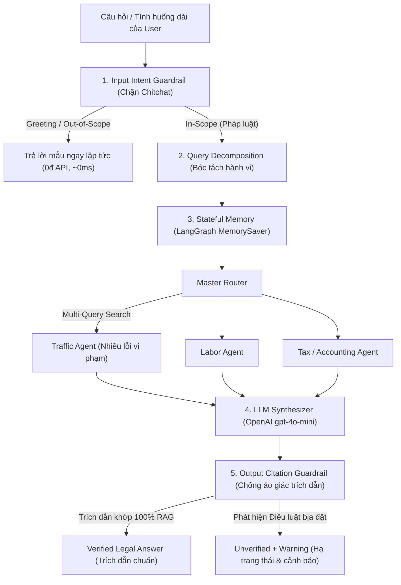

# TÀI LIỆU KỸ THUẬT: TỔNG KẾT NÂNG CẤP HỆ THỐNG MULTI-AGENT & CƠ SỞ LÝ THUYẾT
**Dự án**: Trust-AGENT (Vietnamese Multi-Agent Legal RAG Platform)  
**Thời gian thực hiện**: 09/11/2026 – 10/11/2026  
**Tác giả**: Antigravity Assistant & Teamwork Swarm  
**Mục tiêu**: Nâng cấp bộ định tuyến đơn giản thành hệ thống Multi-Agent có bộ nhớ đa lượt, phân rã tình huống phức tạp (Query Decomposition), tổng hợp LLM liền mạch và 2 lớp Guardrails bảo vệ (Input Intent + Output Citation).

---

## PHẦN 1: TỔNG HỢP CÁC THAY ĐỔI TRONG MÃ NGUỒN (WHAT CHANGED)

### 1. Danh sách các file được tạo mới và cập nhật
| STT | Tập tin | Trạng thái | Mô tả thay đổi chính |
| :---: | :--- | :---: | :--- |
| 1 | `crawl/app/router.py` | **Modified** | Tích hợp LangGraph `MemorySaver`, mở rộng `RouterState`, thêm tham số `thread_id`/`session_id`, tích hợp `LLM Synthesizer` (OpenAI `gpt-4o-mini`), **bổ sung Query Decomposition (bóc tách tình huống dài thành sub-queries hành vi)** và kết nối 2 tầng Guardrails. |
| 2 | `crawl/app/agents/base.py` & `traffic_agent.py`... | **Modified** | Hỗ trợ **Multi-Query Retrieval**: Khi nhận `sub_queries`, Agent tự động quét song song từng hành vi vi phạm độc lập, hợp nhất evidence không trùng lặp trước khi ReAct suy luận. |
| 3 | `crawl/app/main.py` | **Modified** | Cập nhật schema Pydantic `SearchRequest` và endpoint `POST /router/ask` tiếp nhận `thread_id`/`session_id` để client gọi API có ngữ cảnh liên tục. |
| 4 | `crawl/app/citation_guardrail.py` | **NEW** | Module **Output Guardrail**: Bóc tách số hiệu văn bản quy phạm pháp luật, Điều, Khoản, Điểm; so khớp với dữ liệu RAG thực tế; hạ trạng thái xuống `unverified` nếu phát hiện ảo giác. |
| 5 | `crawl/app/intent_guardrail.py` | **NEW** | Module **Input Guardrail**: Nhận diện câu chào hỏi (chitchat) và câu hỏi ngoài lề (thời tiết, làm thơ, đố vui...) bằng Regex fast-path và từ khóa/semantic matching; phản hồi ngay 0ms, **0đ API OpenAI**. |
| 6 | `crawl/app/answering.py` | **Modified** | Kết nối trực tiếp với Citation Guardrail để đảm bảo từng domain agent trả về trạng thái chuẩn hóa (`verified` / `unverified`). |
| 7 | `crawl/tests/conftest.py` | **NEW** | Hạ tầng kiểm thử offline: Mock toàn bộ tương tác OpenAI API, chặn các cuộc gọi mạng socket ra ngoài (`prevent_external_network_calls`), bảo đảm test chạy độc lập 100%. |
| 8 | `crawl/tests/test_multi_turn_memory.py` | **NEW** | 6 test cases: Kiểm thử nhớ ngữ cảnh qua 2-25 lượt hỏi, phân lập giữa các phiên khác nhau. |
| 9 | `crawl/tests/test_citation_guardrail.py` | **NEW** | 36 test cases: Kiểm thử rà soát trích dẫn luật, phát hiện điều luật bịa đặt, chuẩn hóa Unicode NFD/NFC. |
| 10 | `crawl/tests/test_router_synthesizer.py` | **NEW** | 7 test cases: Kiểm thử định tuyến đa ngành, tổng hợp phản hồi bằng OpenAI `gpt-4o-mini` (mocked). |
| 11 | `crawl/tests/test_intent_guardrail.py` | **NEW** | 5 test cases: Kiểm thử chặn câu chào và câu ngoài lề không tốn token OpenAI. |
| 12 | `crawl/tests/test_query_decomposition.py` | **NEW** | Kiểm thử cơ chế bảo toàn và truyền nhận `sub_queries` qua quy trình mở rộng Router. |

### 2. Kết quả kiểm thử hồi quy (Test Results)
- **Tổng số test cases**: **98/98 unit tests pass 100% offline** trong 31.13s mà không cần kết nối mạng hay OpenAI API Key thật.

---

## PHẦN 2: CƠ SỞ LÝ THUYẾT KỸ THUẬT (THEORETICAL FOUNDATIONS)

Hệ thống được nâng cấp dựa trên 5 trụ cột lý thuyết kiến trúc AI hiện đại:



---

### Trụ cột 1: Phân rã Tình huống Pháp lý phức tạp (Query Decomposition & Multi-Query RAG)

#### 1.1. Vấn đề "Ngộp ngữ nghĩa" (Semantic Dilution) ở câu hỏi tình huống dài
Khi người dùng nhập một đoạn văn kể chuyện đời thực (như vụ việc anh A: vừa uống rượu, vừa vượt đèn đỏ, không đội mũ, không mang bằng lái, chạy quá tốc độ):
- Đoạn văn chứa quá nhiều chi tiết kể chuyện ("trên đường về nhà cùng bạn bè", "cho rằng đường vắng"...).
- Khi đưa nguyên văn vào mô hình embedding hoặc BM25, vector bị kéo lệch và điểm số tương đồng bị pha loãng, không thể nào tìm trúng cùng lúc 5 điều khoản xử phạt khác nhau trong Nghị định 168.

#### 1.2. Giải pháp: Phân rã thành Sub-queries độc lập
- Router sử dụng mô hình LLM phân tích câu chuyện đời thực và bóc tách thành danh sách các hành vi vi phạm cốt lõi:
  $$\text{Query}_{\text{complex}} \xrightarrow{\text{LLM Decompose}} \{\text{sub}_1: \text{nồng độ cồn}, \text{sub}_2: \text{vượt đèn đỏ}, \text{sub}_3: \text{mũ bảo hiểm}, \dots\}$$
- **Multi-Query Retrieval**: Domain Agent lặp qua từng `sub_query` để truy xuất các Điều/Khoản riêng biệt trong CSDL, sau đó khử trùng lặp và gộp lại thành tập bằng chứng đầy đủ trước khi LLM suy luận.

---

### Trụ cột 2: Điều phối Multi-Agent có Trạng thái (Stateful Multi-Agent Orchestration)
- Sử dụng **Checkpointing Pattern** với LangGraph `MemorySaver`.
- Trạng thái hội thoại (`messages`) được lưu theo cặp khóa:
  $$\text{Session Key} = (\text{thread\_id}, \text{checkpoint\_id})$$
- Áp dụng **Sliding-window history** (4-6 lượt gần nhất) giúp hệ thống nhớ ngữ cảnh các câu hỏi nối tiếp mà không bị tràn token context window.

---

### Trụ cột 3: Tổng hợp đa ngành bằng LLM (LLM Cross-Domain Synthesis)
- Thay thế hoàn toàn phương pháp ghép chuỗi văn bản thô sơ `\n\n`.
- Sử dụng OpenAI `gpt-4o-mini` ($\text{Temperature} = 0$) với prompt lý luận pháp lý chuyên biệt: kết nối các quy định pháp luật thành bài tư vấn logic, mạch lạc, phân định rõ ràng giữa quy định pháp luật và suy luận tình huống.

---

### Trụ cột 4: Hàng rào kiểm định trích dẫn đầu ra (Output Citation Verification Guardrail)
- **Chống ảo giác pháp lý (Legal Hallucination)**: So khớp từng trích dẫn số hiệu văn bản, Điều, Khoản mà LLM đưa ra với tập metadata của các tài liệu RAG thực tế.
- Tự động hạ trạng thái kết quả xuống `unverified` kèm cảnh báo minh bạch nếu phát hiện điều luật không tồn tại trong tập bằng chứng.

---

### Trụ cột 5: Hàng rào ngữ nghĩa phân loại đầu vào (Input Semantic Intent Guardrail)
- **Tối ưu 100% chi phí cho câu chào hỏi**: Nhận diện câu chào hỏi xã giao, cảm ơn, tạm biệt hoặc câu hỏi ngoài lề (thời tiết, làm thơ, đố vui...) bằng Regex fast-path và từ khóa matching.
- Phản hồi ngay thông điệp định hướng với độ trễ ~0ms và **0đ API OpenAI**.

---

## PHẦN 3: HƯỚNG DẪN VẬN HÀNH

### 1. Khởi chạy Server
```powershell
cd crawl
.\.venv\Scripts\python.exe -m uvicorn app.main:app --host 127.0.0.1 --port 8000 --reload
```

### 2. Chạy toàn bộ 98 Unit Tests Offline
```powershell
cd crawl
.\.venv\Scripts\python.exe -m pytest tests/ -q
```
*Kết quả: 98 passed 100% offline.*
