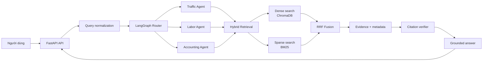
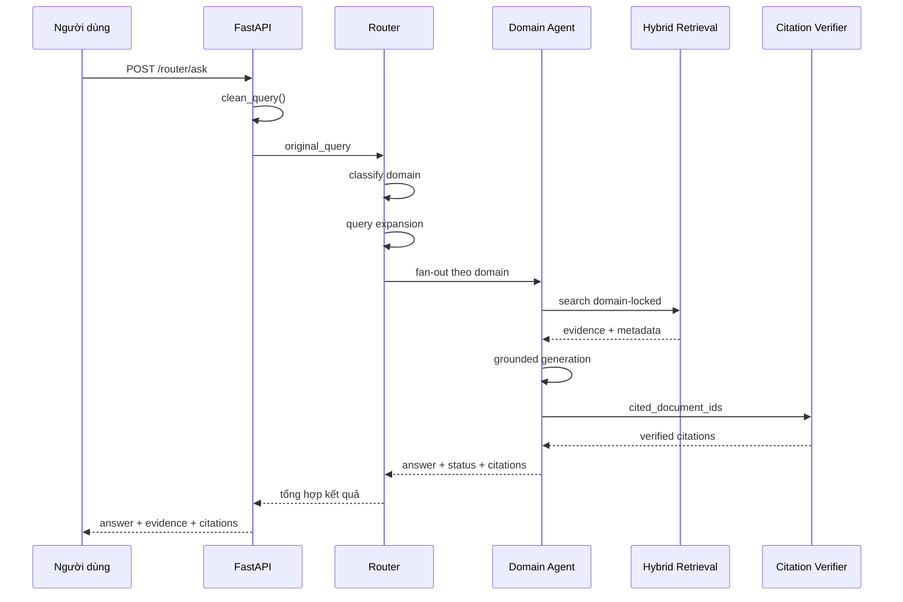
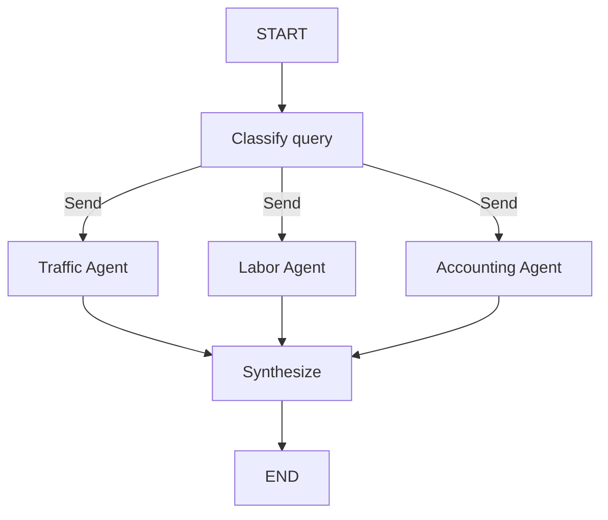

# Trust Agent

Trợ lý tra cứu pháp luật Việt Nam theo hướng **Agentic RAG**, hỗ trợ ba lĩnh vực:

- Giao thông (`traffic`)
- Lao động (`labor`)
- Thuế (`accounting`, alias API: `tax`)

Hệ thống ưu tiên câu trả lời có căn cứ từ dữ liệu pháp luật đã truy xuất, kèm citation đến văn bản, chương, điều, khoản và nguồn.

## Kiến trúc tổng quan



## Luồng xử lý câu hỏi



## Query normalization và routing

Hệ thống giữ hai biểu diễn của câu hỏi:

```text
original_query
    Câu hỏi gốc sau khi dọn khoảng trắng.
    Được dùng cho retrieval, LLM, citation và response.

routing_query
    Phiên bản lowercase, bỏ dấu và chuẩn hóa khoảng trắng.
    Chỉ dùng cho keyword fallback và routing.
```

Ví dụ:

```text
Original:  Mức phạt nồng độ cồn khi lái xe máy?
Routing:   muc phat nong do con khi lai xe may?
Domain:    traffic
```

Query expansion chỉ bổ sung thuật ngữ tìm kiếm chuẩn, không thay đổi câu hỏi gốc:

```text
muc phat nong do con
→ Mức phạt vi phạm nồng độ cồn khi điều khiển phương tiện giao thông
```

Expansion không tự tạo Điều, Khoản, mức phạt hoặc citation.

## Hybrid retrieval

Mỗi domain có một ChromaDB collection riêng:

| Domain | Collection |
|---|---|
| Traffic | `legal_traffic` |
| Labor | `legal_labor` |
| Accounting | `legal_accounting` |

Hybrid retrieval kết hợp hai nguồn:

1. **Dense retrieval**: embedding multilingual và semantic search trong ChromaDB.
2. **Sparse retrieval**: BM25 tìm các cụm từ khóa chính xác.
3. **RRF fusion**: kết hợp thứ hạng của dense và sparse.

Công thức RRF:

```text
RRF(d) = Σ 1 / (k + rank(d))

### Reranker tùy chọn

Sau RRF, hệ thống có thể dùng Cross-Encoder để chấm lại một tập ứng viên lớn
hơn trước khi lấy top-k. Tính năng này mặc định tắt để không làm tăng thời gian
khởi động hoặc tự tải model khi chạy local/Docker:

```env
RERANKER_ENABLED=false
RERANKER_MODEL=BAAI/bge-reranker-v2-m3
RERANKER_CANDIDATE_K=40
```

Khi bật `RERANKER_ENABLED=true`, model được tải lazy ở request đầu tiên và chỉ
chấm lại ứng viên trong cùng domain. Điểm cuối là kết hợp 75% điểm Cross-Encoder
đã chuẩn hóa và 25% điểm RRF; nếu model lỗi hoặc không có mạng/cache local,
retrieval tự động giữ nguyên thứ tự RRF. Vì vậy đây là tầng tối ưu tùy chọn,
không thay đổi hành vi mặc định hay ranh giới dữ liệu giữa ba domain.
```

Trong đó `k` là hằng số làm trơn, thường dùng `60`.

Kết quả retrieval chỉ được lấy trong collection và domain tương ứng; agent không được tự chọn domain khác.

## Domain agents

Router sử dụng LangGraph để phân loại và fan-out song song:



Mỗi agent có:

- system prompt theo lĩnh vực;
- search tool bị khóa domain;
- document lookup tool bị khóa domain;
- giới hạn số bước/tool calls;
- structured final output;
- citation verifier độc lập với nội dung LLM sinh ra.

## Citation và grounded answer

LLM không được tự viết citation tùy ý. LLM chỉ trả về danh sách `cited_document_ids`. Backend kiểm tra:

```text
cited_document_id ∈ evidence_observed_during_run
```

Citation hợp lệ gồm:

- `document_id`
- số hiệu văn bản
- tên văn bản
- chương
- điều
- khoản
- source

Nếu không có evidence đủ mạnh hoặc citation không hợp lệ, hệ thống trả:

```text
status = insufficient_evidence
```

và câu an toàn:

```text
Chưa đủ căn cứ từ dữ liệu hiện có để kết luận.
```

## Guardrails

- Không sử dụng kiến thức ngoài evidence được truy xuất.
- Không bịa Điều, Khoản, mức phạt, ngày hiệu lực hoặc số hiệu.
- Không trộn dữ liệu giữa traffic, labor và accounting.
- Không cho model truyền domain tùy ý vào retrieval.
- Không để citation do model tự sinh quyết định.
- Không trả chain-of-thought hoặc tool trace ra API public.
- Phân biệt quy định pháp luật và suy luận theo tình huống.
- Nếu provider lỗi hoặc thiếu API key, trả trạng thái lỗi an toàn, không làm server crash.

## API chính

```text
GET  /health
POST /search
POST /search/hybrid
POST /ask

POST /router/ask

POST /agents/traffic/ask
POST /agents/labor/ask
POST /agents/accounting/ask

GET  /domains/{domain}/overview
```

Các câu hỏi tổng quan như `Luật lao động có gì?` hoặc `Luật giao thông gồm những gì?` được nhận diện là intent `overview`. Hệ thống đọc metadata của collection để nhóm theo văn bản, chương và điều, thay vì lấy ngẫu nhiên top-k chunk. Response vẫn có trường `answer` để frontend hiện được danh sách nhóm chính và có thêm trường `overview` chứa cấu trúc chi tiết.

Ví dụ:

```bash
curl -X POST http://localhost:8000/router/ask \
  -H "Content-Type: application/json" \
  -d '{"query":"Mức phạt nồng độ cồn khi lái xe máy?","k":5}'
```

Response rút gọn:

```json
{
  "query": "Mức phạt nồng độ cồn khi lái xe máy?",
  "answer": "...",
  "status": "verified",
  "citations": [
    {
      "document_id": "...",
      "so_hieu": "168/2024/NĐ-CP",
      "dieu": "8",
      "khoan": "9",
      "source": "..."
    }
  ],
  "retrieval_strategy": "hybrid_rrf"
}
```

## Đánh giá retrieval

Benchmark hiện có 300 cases, chia đều cho ba domain:

```text
Traffic:    100 cases
Labor:      100 cases
Accounting: 100 cases
```

Kết quả đã đo:

```text
Recall@1 = 53.67%
Recall@5 = 73.00%
MRR@5    = 0.6139
```

Đây là chỉ số retrieval trên benchmark hiện tại, không phải độ chính xác pháp lý tổng thể.

Chạy benchmark:

```powershell
cd crawl
\.venv\Scripts\python.exe scripts\evaluate\benchmark_retrieval_v2.py --cases scripts\evaluate\benchmark_v3.jsonl --k 1
\.venv\Scripts\python.exe scripts\evaluate\benchmark_retrieval_v2.py --cases scripts\evaluate\benchmark_v3.jsonl --k 5
```

## Công nghệ

## Crawl thêm dữ liệu pháp luật

Crawler mới chuẩn hóa HTML/PDF/TXT/MD về cùng schema với corpus hiện tại:

```text
source, so_hieu, ten_van_ban, chuong, dieu, tieu_de_dieu, khoan, text
```

Chạy từ thư mục `crawl`:

```powershell
# Crawl các URL trong data/raw/urls.json và merge vào corpus giao thông
.\.venv\Scripts\python.exe scripts\crawl_legal.py traffic --urls data\raw\urls.json

# Crawl file HTML/PDF mới và merge vào corpus thuế/kế toán
.\.venv\Scripts\python.exe scripts\crawl_legal.py accounting `
  --input data\raw\van_ban_thue_moi.html

# Ingest lại collection sau khi crawl
.\.venv\Scripts\python.exe scripts\ingest_domain.py traffic
```

Script merge và deduplicate theo `source + so_hieu + dieu + khoan + text`, không tạo dữ liệu giả. Nếu URL không cho phép client thường, crawler sẽ dùng Playwright nếu môi trường đã cài; PDF cần cài thêm:

```powershell
\.venv\Scripts\python.exe -m pip install -e ".[crawler]"
```

- Python 3.11
- FastAPI
- LangChain / LangGraph
- ChromaDB persistent
- Sentence Transformers multilingual embeddings
- BM25
- Reciprocal Rank Fusion
- OpenAI-compatible LLM provider abstraction
- Docker
- Next.js frontend
- Cloudflare/Vercel deployment
