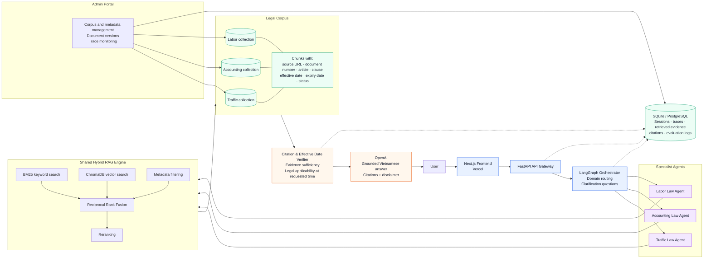

# Trust Agent — System Architecture

Vietnamese legal Agentic RAG platform for traffic, accounting, and labor law.

## Main request flow

`User → Next.js/Vercel → FastAPI → LangGraph → Specialist Agent → Hybrid RAG → Legal Corpus → Citation and Effective Date Verifier → OpenAI answer → User`

## Architecture notes

- Routing is centralized in LangGraph; a request can be clarified before specialist dispatch.
- The three legal collections are separated by domain, while retrieval and verification are shared.
- Legal applicability must be evaluated against the requested time using effective date, expiry date, and status metadata.
- The verifier is a gate before answer generation: insufficient or inapplicable evidence should prevent an unsupported legal answer.
- Admin writes are separated from the user query path and must preserve document versions and audit traces.
